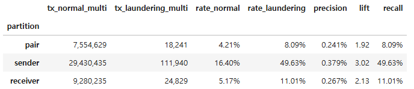
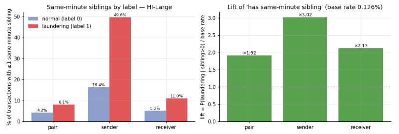
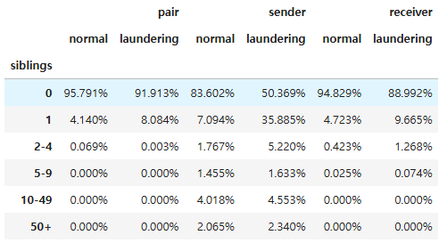
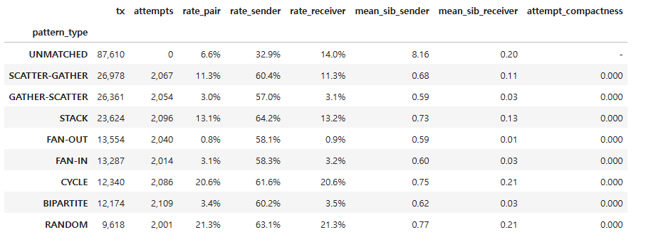

# 같은 시간에 발생한 거래 내역 분석

현재 초단위가 아닌 분단위로 거래가 체크되고 있는데 피처에서 완전히 같은 분에 발생한 피처에 대한 정보가 누락되고 있는게 아닌가 해서 체크 해보는 단계임

## 라벨별 "같은 분 2건 이상" 비율

**rate_normal / rate_laundering** : 그 라벨 거래 중 같은 분에 다른 거래가 1건 이상 있는 비율 (n ≥ 2)

**precision** : 같은 분 2건 이상인 거래 중 라벨1 비율 = P(세탁 | siblings>0)

**lift** : precision / 전체 라벨1 비율. 1 이면 정보 없음

**recall** : 라벨1 중 siblings>0 인 비율 (= rate_laundering) — 이 비율만큼의 세탁 거래가 현재 피처에서 "같은 분 정보 없음"으로 들어간다

- tx(거래) · normal(라벨0) · multi(같은 분에 2건 이상)

> sender에서 자금세탁에 경우 49.63프로가 같은 분에 다른 사람에게 보낸 적이 있음

#### 계산 방법(sender 기준)

전체 거래 중 세탁 비율(기저율) = 0.126% - 아무 거래나 하나 집었을 때 세탁일 확률
"같은 분 동반 거래 있음"인 거래만 모아서 그 안의 세탁 비율 = 0.379%
lift = 0.379 ÷ 0.126 = 3.02배

> 정해진 기준은 없지만 2~5정도면 피처로 쓸만한 거라고 함

## siblings 수 분포 - 라벨별

## 패턴 유형별

**attempt_compactness = 0.000**
한 시도(attempt) 안의 거래들은 전부 서로 다른 분에 찍혀 있다는 뜻
그러니까 세탁 거래의 같은 분 동반 거래는 그 패턴의 일부가 아니라 패턴 바깥의 다른 거래임

**mean_sib_sender ≈ 0.6~0.77 + 비율 60%**
거의 항상 딱 1건이 같이 있다는 뜻
패턴 종류와 무관하게 "세탁 거래 1건당 같은 송신 계좌에서 같은 분에 다른 거래 1건" — 이렇게 균일한 건 자연스러운 행동보다 생성기(AMLworld)의 규칙일 가능성이 높다. 예를 들어 세탁 거래를 심을 때 그 계좌의 정상 거래 시각을 재사용한다든지

그래서 유형 분류에는 따기 의미가 없고 이진 분류에는 **같은 분 동반 거래 수** 정도는 넣어봐도 괜찮지 않을까? 하는 생각이 듬

