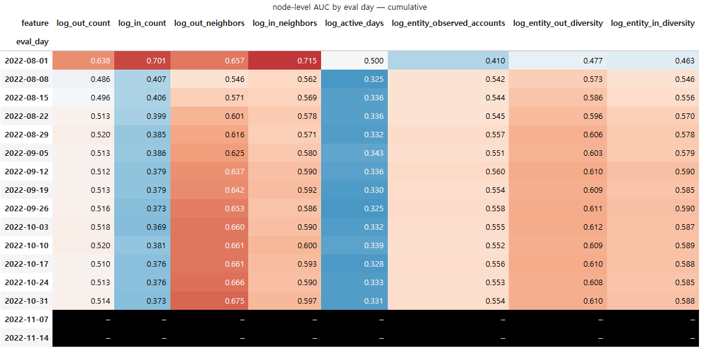
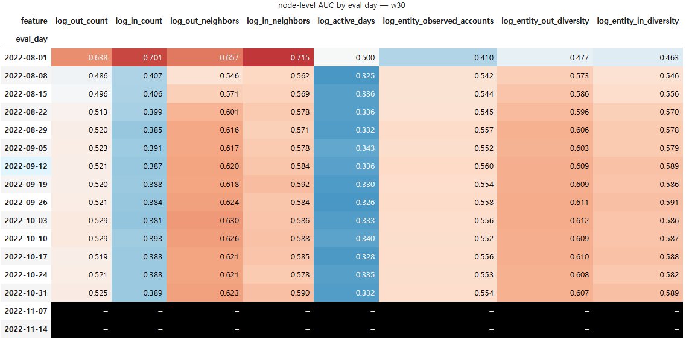
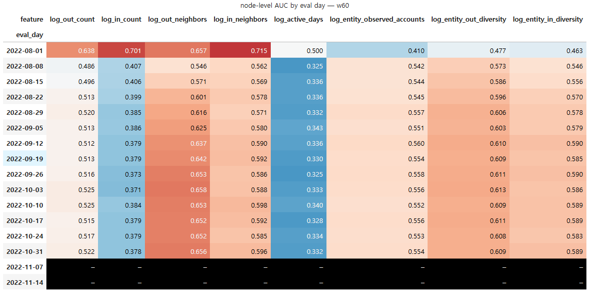
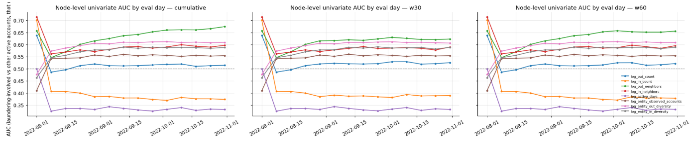
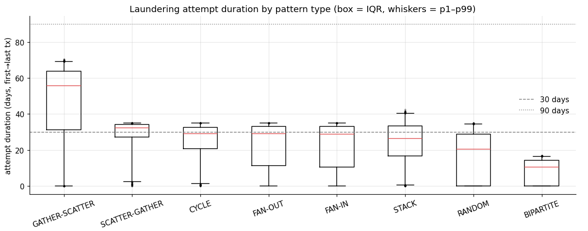

# 카운트형 노드 피처의 누적창 vs 고정창(30일, 60일)
노드 피처를 데이터 시작일부터 전체 누적으로 계산한다. 그러면 log_out_count 같은 카운트형 피처는 시간이 갈수록 단조 증가하고, 값이 "계좌 성격"이 아니라 "달력"을 담을 수 있다.
이게 문제가 될 수 있나 없나를 확인하기 위해 하는 과정임

월별로 세탁 계좌 vs 정상 계좌의 피처 분포 차이(단변량 AUC)가 일정하게 유지되는가?를 보면서 뒤로 갈수록 AUC 가 떨어지면 누적 창이 신호를 희석하는 것이고, 고정 창(예: 90일)으로 바꿀 근거가 된다.

여기서 AUC는 모델 성능이 아니라, 피처 하나짜리 성능이다.

보통 AUC라고 하면 "모델이 낸 점수로 세탁/정상을 얼마나 잘 가르나"인데, 04에서는 모델 대신 피처값 그 자체를 점수로 씁니다. 예를 들어 10/31의 log_in_count 칸이면:

1. 10/31에 거래한 계좌 90만 개를 모은다
2. 각 계좌의 "지금까지 받은 거래 수"를 점수로 삼는다 (모델 없음, 그냥 그 숫자)
3. 그 점수로 ROC 곡선을 그려 아래 면적을 잰다 → 0.373

0.373이면 "받은 거래 수만 보고 세탁 계좌를 골라내면 랜덤(0.5)보다 반대 방향으로 0.13만큼 낫다", 즉 세탁 계좌는 받은 거래가 적은 쪽에 몰려 있다는 뜻이다. 

이걸 단변량(univariate) AUC라고 불르고. 목적은 모델 평가가 아니라 피처 진단이다.

그래서 피처 진단에서는 창길이가 바뀌든 말든 AUC에 영향이 거의 없다. 이유에는 여러가지가 있는데
1. **AUC는 순위만 본다.** 
  - 창을 30일→90일로 늘리면 모든 계좌의 건수가 대략 3배가 되지만, 줄 세운 순서는 그대로다. AUC는 값의 크기가 아니라 순위로 계산되므로 변하지 않는다. (`ln(1+x)` 변환도 단조 함수라 순위를 바꾸지 않는다.)

2. **계좌별 거래 생성 속도가 시간에 따라 일정하다.** 
  - 1번이 성립하려면 각 계좌가 "정속"으로 거래해야 하는데, AMLworld 생성기는 계좌별 비율을 고정해 두고 뽑는다. 3절 표에서 `mean_out_n`이 매주 +5.7씩 자로 잰 듯 선형으로 늘어나는 것이 그 증거다. 실제 은행 데이터라면 급여일·계절성·계좌 행동 변화 때문에 창에 따라 순위가 달라지고 창 길이가 중요해진다. 따라서 "영향 없음"은 이 데이터셋에 한한 결론이다.

3. **사용 가능한 기간이 짧다(~96일).** 
  - w60은 10/3 이후에야 누적과 달라지고, w30도 9/5 이후부터다. 두 창이 실제로 다른 값을 내는 비교 구간 자체가 4~8주뿐이라 차이가 벌어질 시간이 없었다. 90일 창은 누적과 구분조차 되지 않았다.

4. **세탁 계좌는 이력이 짧아 창에 잘리는 것이 거의 없다.** 
  - 노드 수준 `log_active_days` AUC가 0.33, 즉 세탁 계좌는 활동일이 적은 쪽이다. 창을 잘라도 깎이는 것은 오래 활동한 정상 계좌들의 값이고, 세탁 계좌 값은 그대로라 양쪽의 상대적 위치가 유지된다.

5. **거래 단위에서는 허브 효과가 지배적이다.** 
  - 엣지 수준에서 정상 거래의 다수는 초대형 허브 계좌(30일에 189만 건)에서 나온다. 어떤 창을 써도 허브의 값은 압도적으로 커서 "허브 거래 vs 세탁 거래"의 순위가 흔들리지 않는다.

6. **예외가 이 설명과 일치한다.** 
  - 창 길이에 반응한 유일한 피처는 `log_out_neighbors`(누적 0.675 / w60 0.656 / w30 0.623)다. "서로 다른 상대 수"는 건수처럼 기간에 비례하지 않고(늘 같은 5명에게 보내는 계좌는 어느 창이든 5), 새 상대에게 계속 보내는 계좌만 기간이 길수록 커진다. 비례하지 않는 피처만 창 길이에 반응했다는 점이 1·2번 설명을 뒷받침한다.

정리하면, 창 길이는 **노드 카운트 피처의 분리력**에는 영향이 없지만 **모델 입력의 절대값**은 바꾸므로(ln 스케일에서 ln(창 길이 비율)만큼 이동) 학습과 서비스의 창은 반드시 같아야 한다. 또한 **패턴 구조가 들어가는 쌍 이력 엣지 피처와 문맥 그래프는 별개 문제**로, 패턴 지속시간(GATHER-SCATTER p75 ≈ 64일) 기준으로 60일 이상이 필요하다.

### [추가] GATHER-SCATTER 최대 약 70.45일, STACK 최대 약 42.51일로 나왔었는데 이게 이상치 인건지 아니면 전체적으로 높은건지 확인
- GATHER-SCATTER 만 전체적으로 높게 주기 길다.

