# IBM AML HI-Large 데이터셋 EDA

## 분석 개요

| 항목 | 값 |
| --- | ---: |
| 거래 데이터 | `Trans.csv` |
| 계좌 데이터 | `accounts.csv` |
| 거래 기간 | 2022-08-01 00:00 ~ 2023-01-12 16:49 |
| 전체 거래 수 | 179,702,229건 |
| 자금세탁 거래 수 | 225,546건 |

| 파일 | 용도 | 규모 |
|---|---|---|
| `HI-Large_Trans.csv` | 거래 원본 11열 | 179,702,229행 · 17.05 GB |
| `HI-Large_accounts.csv` | 계좌·엔티티 원본 5열 | 2,126,855행 · 147.69 MB |
| `HI-Large_Patterns.txt` | 시도별 패턴 종류·소속 거래 | 16,467개 시도 · 137,936개 거래 · 13.81 MB |

파일 크기는 10진 단위입니다. 원본 위치는 `/workspace/IBM/`입니다.

### 집계 정의와 신뢰 범위

- **범위:** 원본 전체 행을 엄격한 CSV 파서로 처리했습니다. 형식 불량 행을 조용히 제외하지 않았습니다.
- **결측:** 빈 CSV 필드/NULL, 공백만 있는 값, 문자형 NULL 표식, 앞뒤 공백을 각각 확인했습니다.
- **정확 집계:** 행 수·고유값 수·중복 수는 정확 집계입니다. 금액 분위수는 `approx_quantile` 근사값입니다.
- **금액:** 연결·동등성 비교는 `DECIMAL(38,8)`을 사용했습니다. 평균·분위수 및 아래 표의 금액 표시에는 부동소수점·반올림이 포함됩니다.
- **한계:** 정합성 검사는 독립적인 두 번째 전체 원본 파싱이 아닙니다. 전체 파일의 암호학적 무결성 증명도 아닙니다.

## 1. 거래 데이터(`Trans.csv`) 확인

### 1.1 기본 정보

| 항목 | 값 |
| --- | ---: |
| 전체 행 수 | 179,702,229 |
| 거래 기간 | 2022-08-01 00:00:00 ~ 2023-01-12 16:49:00 |
| 자금세탁 거래 수 | 225,546 |
| `Amount Paid` 범위 | 0.000001 ~ 8,158,609,321,727.61 |
| 결측치 | 없음 |


| 순번 | 컬럼 | 타입 | 설명 | 분석용 이름 |
| ---: | --- | --- | --- | --- |
| 0 | `Timestamp` | Datetime | 거래 시각(분 단위) | `timestamp_raw` |
| 1 | `From Bank` | String | 송금 은행 ID | `from_bank` |
| 2 | `Account` | String | 송금 계좌번호 | `from_account` |
| 3 | `To Bank` | String | 수취 은행 ID | `to_bank` |
| 4 | `Account.1` | String | 수취 계좌번호 | `to_account` |
| 5 | `Amount Received` | Float64 | 수취 금액 | `amount_received_raw` |
| 6 | `Receiving Currency` | String | 수취 통화 | `receiving_currency` |
| 7 | `Amount Paid` | Float64 | 송금 금액 | `amount_paid_raw` |
| 8 | `Payment Currency` | String | 송금 통화 | `payment_currency` |
| 9 | `Payment Format` | String | 거래 방식(ACH, Cheque, Credit Card 등) | `payment_format` |
| 10 | `Is Laundering` | Int8 | 자금세탁 여부(0/1) | `label_raw` |

**앞부분 5행**

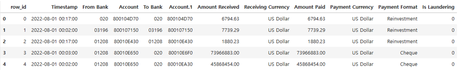

### 1.2 완전 중복 거래 확인

| 항목 | 행 수 |
| --- | ---: |
| 중복을 제외한 추가 행 | 150 |
| 중복에 포함된 전체 행 | 300 |
| 중복 제거 후 남은 행 | 179,702,079 |
| 중복 그룹 | 150개 |
| 그룹당 최대 반복 | 2회 |
| 양성 중복 그룹 | 0개 |
| 6개 연결 키가 반복된 그룹 | 376개 |
| 그중 다른 필드가 실제로 다른 그룹 | 226개 |

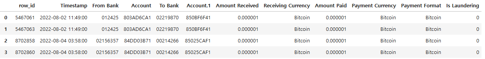

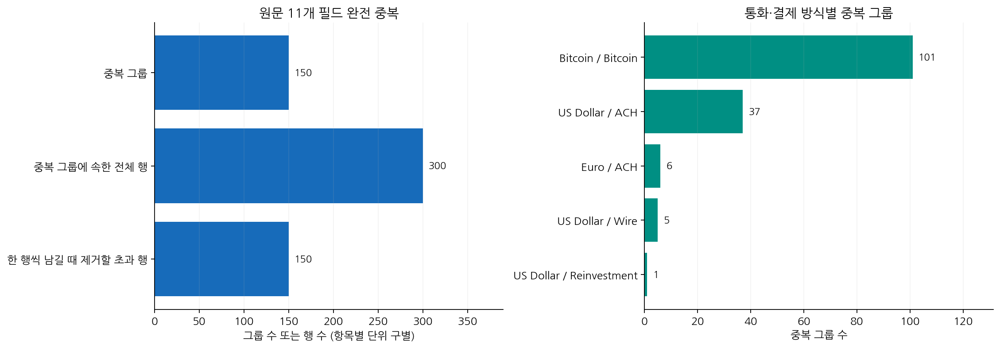

**그래프 해석:** 완전 중복은 150그룹·300행이며 각 그룹에서 한 행을 남기면 제거되는 초과분은 150행입니다. 모두 정상 라벨이고, 반복 발생 원인은 확인되지 않았습니다.

6개 키는 **시각·송신 은행·송신 계좌·수신 은행·수신 계좌·송금 금액**입니다. 이 키만으로 중복 제거하면 통화·수취 금액·결제 방식이 다른 거래까지 합칠 수 있습니다. 완전 중복은 해시로 후보를 좁힌 뒤 원본 11개 필드로 재확인했습니다.

| 송금 통화 | 결제 방식 | 완전 중복 그룹 |
|---|---|---|
| Bitcoin | Bitcoin | 101 |
| US Dollar | ACH | 37 |
| Euro | ACH | 6 |
| US Dollar | Wire | 5 |
| US Dollar | Reinvestment | 1 |

#### 실제 반복 거래인가요?

- 원본 행 위치 차이가 2인 중복쌍은 **129개**, 4는 **19개**, 1과 15는 각각 **1개**입니다.
- 인접 행과 작은 금액의 환전·지급 흐름은 실제 반복 거래 또는 생성 과정의 연속 이벤트일 가능성을 시사하지만, **원인을 확정하지는 못했습니다.**
- 독립적인 거래 ID, 초·밀리초 시각, 생성기 이벤트 로그가 없어 ‘중복 적재’와 ‘값이 같은 두 거래’를 확실히 구분할 수 없습니다.
- **현재 정책:** 원본은 유지하고 중복 감사를 남깁니다. 적재 중복이 확인되면 이벤트 ID에 따른 멱등 처리를 적용하는 것이 좋습니다.
- 라벨이 0이어도 반복 횟수·시간 피처·그래프 구조에 영향을 줍니다. 반대로 이번 초과분 150행은 전체 규모 대비 매우 작으므로, 그것이 성능 저하의 주원인이라고 단정하지 않습니다.

### 1.3 거래 데이터 추가 분석

| 구분 | 거래 수 |
| --- | ---: |
| 송금·수취 금액이 같은 거래 | 176,905,192 |
| 송금·수취 금액이 다른 거래 | 2,797,037 |
| 송금·수취 통화가 같은 거래 | 176,904,911 |
| 송금·수취 통화가 다른 거래 | 2,797,318 |
| 통화는 다르고 금액은 같은 거래 | 281 |
| 통화는 같고 금액은 다른 거래 | 0 |
| 같은 계좌로 보내는 거래 | 10,895,216 (6.0629%) |
| 계좌번호는 같고 은행은 다른 거래 | 0 |
| 같은 은행 안에서 발생한 거래 | 12,307,096 (6.8486%) |

#### 이름이 같은 컬럼과 값이 같은 컬럼

- 거래 헤더의 3번째와 5번째 `Account`는 각각 **송신·수신 계좌**입니다. 중복된 이름을 분리해야 하며 열 자체를 삭제하면 안 됩니다.
- `Amount Paid`와 `Amount Received`가 같은 거래는 **176,905,192건**이지만, 다른 거래도 **2,797,037건** 있습니다. 의미와 값이 항상 같지 않으므로 원본에서 하나를 없애지 않습니다.
- 같은 통화에서는 송금·수취 금액 차이가 0건이지만, 서로 다른 통화에서는 단위가 달라집니다. 자주 같다는 사실만으로 불필요한 컬럼이라고 판단하지 않습니다.

### 1.4 결측과 형식 검사

#### 전체 원본 검사

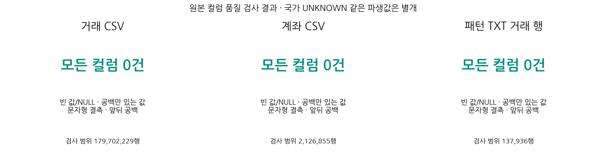

**그래프 해석:** 원본 세 파일 모두 검사한 결측·공백 항목이 0건입니다. 국가 정보 미상과 같은 파생 속성의 정보 부족은 이 결과와 구분합니다.

| 검사 | 거래 11열 | 계좌 5열 | 패턴 거래 11열 |
|---|---|---|---|
| 빈 필드·NULL | 0 | 0 | 0 |
| 공백만 있는 값 | 0 | 0 | 0 |
| 문자형 NULL 표식 | 0 | 0 | 0 |
| 앞뒤 공백 | 0 | 0 | 0 |

| 추가 검사 | 결과 |
|---|---|
| 시각 파싱 실패 | 0 |
| 0/1 이외 라벨 | 0 |
| 송금 금액 변환 실패 | 0 |
| 수취 금액 변환 실패 | 0 |
| 음수 송금 | 0 |
| 음수 수취 | 0 |
| 0원 송금 | 0 |
| 0원 수취 | 0 |
| 은행 ID 형식 오류 | 0 |
| 송금 금액 소수점 8자리 초과 | 0 |
| 수취 금액 소수점 8자리 초과 | 0 |

**해석:** 검사한 원본에서는 결측·타입 오류가 발견되지 않았습니다. 그러나 국가처럼 원본에 명시적으로 없는 속성을 파생할 때의 `UNKNOWN`은 별개입니다. 계좌번호는 영문자와 숫자가 섞인 문자열 식별자이므로 숫자 변환 대상이 아닙니다.

## 2. 계좌 데이터(`accounts.csv`) 확인

### 2.1 기본 정보

| 항목 | 값 |
| --- | ---: |
| 전체 행 수 | 2,126,855 |

| 순번 | 컬럼 | 타입 | 설명 | 분석에서의 역할 |
| ---: | --- | --- | --- | --- |
| 0 | `Bank Name` | String | 은행 이름 | 표시·국가 토큰 추출. 고유 은행 키가 아님 |
| 1 | `Bank ID` | String | 은행 ID | 표기를 정규화해 복합키의 은행 부분으로 사용 |
| 2 | `Account Number` | String | 계좌번호 | 숫자 크기 의미 없이 은행 ID와 함께 계좌 식별 |
| 3 | `Entity ID` | String | 계좌 소유 엔티티 ID | 같은 주체의 여러 계좌를 묶는 식별자 |
| 4 | `Entity Name` | String | 엔티티 이름(Corporation, Partnership 등) | 표시 및 유형 접두부 추출. 이진 라벨이 아님 |

**앞부분 5행**

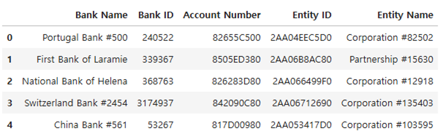

대상 파일은 `HI-Large_accounts.csv`입니다. **2,126,855행 × 5개 컬럼**, 파일 크기 **147,691,860바이트(약 140.85 MiB)**이며 저장된 원본 전량 EDA 결과를 사용했습니다. 원본의 각 행은 계좌 등록 정보입니다. 계좌 CSV에는 **거래 시각·금액·자금세탁 라벨·패턴명·계좌 개설 시각이 없습니다.** 따라서 이 파일만으로 일별 양성 수나 계좌의 세탁 여부를 산출하지 않습니다. 거래와 연결한 활동 분석은 아래에서 별도로 구분합니다.

#### 컬럼별 결측·공백·길이·고유값

빈 필드/NULL, 공백만 있는 값, `NULL`·`N/A` 등의 문자형 결측 표기, 앞뒤 공백을 각각 검사했습니다. 고유값 수는 근사가 아닌 전체 집계입니다.

| 컬럼 | 빈 값/NULL | 공백만 | 문자형 결측 | 앞뒤 공백 | 원문 길이 최소~최대 | 고유값 수 |
|---|---:|---:|---:|---:|---|---:|
| `bank_name` | 0 | 0 | 0 | 0 | 8~30 | 80,180 |
| `bank_id` | 0 | 0 | 0 | 0 | 1~7 | 122,333 |
| `account_number` | 0 | 0 | 0 | 0 | 9~9 | 2,110,228 |
| `entity_id` | 0 | 0 | 0 | 0 | 11~11 | 670,231 |
| `entity_name` | 0 | 0 | 0 | 0 | 9~27 | 670,231 |

**해석:** 검사한 5개 컬럼은 모두 결측·공백 문제가 없었습니다. 그러나 국가 정보가 은행명에 없는 경우까지 “정보가 완전하다”는 뜻은 아닙니다. 계좌번호는 모두 9자리이며 16진수 형식에서 벗어난 값은 0개입니다. 은행 ID의 숫자 형식 오류와 선행 0은 각각 0개입니다. 엔티티 ID는 모두 11자리라는 길이 검사 결과이며, 계좌번호와 동일한 숫자 변환 규칙을 적용한다는 뜻은 아닙니다.

### 2.2 중복 계좌 확인

| 항목 | 수 |
| --- | ---: |
| 중복 관련 행 | 33,123 |
| 중복된 `Account Number` 종류 | 16,496 |

`Account Number`는 전체 데이터에서 고유하지 않으며, 같은 은행 안에서만 고유하다.

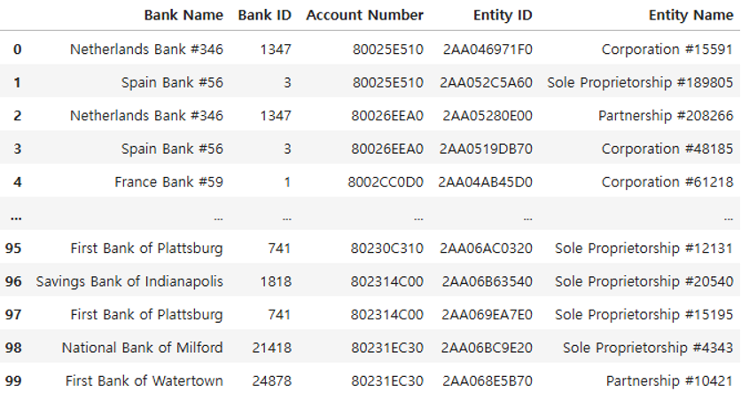

#### 중복과 식별자 충돌을 구별

| 검사 | 전량 결과 | 해석·처리 |
|---|---:|---|
| 계좌 CSV의 중복 헤더 | 0개 | 거래 CSV의 중복 `Account` 헤더와 구별 |
| 5개 컬럼 완전 중복 초과 행 | 0행 | 현재 계좌 파일에서 완전 중복으로 제거할 행 없음 |
| 정규화된 은행 ID + 계좌번호 중복 키 | 0개 | 노드 식별용 복합키로 사용 가능 |
| 같은 복합키의 엔티티 충돌 | 0개 | 하나의 계좌 키에 여러 소유 주체가 연결되지 않음 |
| 여러 소유 주체와 연결된 계좌번호 | 16,443개 | 복합키가 아닌 계좌번호 단독 비교의 결과. 소유권 오류로 단정하지 않음 |

**핵심:** 같은 은행명·계좌번호 문자열이 반복된다는 사실과 완전 중복 행은 다릅니다. 반복된 ID·이름을 임의로 삭제하면 정상적인 계좌–은행–소유 주체 관계가 사라질 수 있습니다.

### 2.3 Entity ID 확인

| 항목 | 값 |
| --- | ---: |
| 전체 계좌 수 | 2,126,855 |
| `Entity ID` 종류 수 | 670,231 |
| 여러 은행에 계좌를 가진 Entity 수 | 211,971 |
| Entity당 최대 계좌 수 | 8,611 |
| Entity당 계좌 수 중앙값 | 1.0 |
| Entity당 계좌 수 평균 | 3.1733 |
| Entity당 계좌 수 95백분위 | 14 |
| Entity당 계좌 수 99백분위 | 22 |
| 동일 `Entity ID`에 서로 다른 `Entity Name`이 있는 경우 | 없음 |

#### Entity ID당 계좌 수 분포(계좌 수 1~10)

| 계좌 수 | Entity 수 |
| ---: | ---: |
| 1 | 457,996 |
| 2 | 63,142 |
| 3 | 36,783 |
| 4 | 21,474 |
| 5 | 13,678 |
| 6 | 10,004 |
| 7 | 7,703 |
| 8 | 6,142 |
| 9 | 4,804 |
| 10 | 4,061 |

#### 계좌를 가장 많이 가진 Entity 상위 10개

| 순위 | Entity ID | 계좌 수 |
| ---: | --- | ---: |
| 1 | `2AA03CCAFB0` | 8,611 |
| 2 | `2AA067413D0` | 5,836 |
| 3 | `2AA06CC87D0` | 5,689 |
| 4 | `2AA06293330` | 5,199 |
| 5 | `2AA0659ADA0` | 4,349 |
| 6 | `2AA069FF9A0` | 4,280 |
| 7 | `2AA0643EBD0` | 4,188 |
| 8 | `2AA069FF730` | 3,874 |
| 9 | `2AA04821CB0` | 3,567 |
| 10 | `2AA03CE29D0` | 3,340 |

#### 소유 주체별 등록 계좌 수 분포

분위수는 엔티티별 계좌 수 빈도표를 이용한 선형 보간이며 정확 집계에 기반합니다.

| 등록 계좌 수 구간 | 엔티티 수 | 엔티티 비율 | 소속 계좌 수 |
|---|---:|---:|---:|
| 1개 | 457,996 | 68.3341% | 457,996 |
| 2~5개 | 135,077 | 20.1538% | 390,919 |
| 6~10개 | 32,714 | 4.8810% | 246,927 |
| 11~50개 | 43,246 | 6.4524% | 758,197 |
| 51~100개 | 711 | 0.1061% | 48,866 |
| 101개 이상 | 487 | 0.0727% | 223,950 |

**해석:** 하나의 계좌만 가진 주체가 많지만 많은 계좌를 가진 주체도 있습니다. 이는 등록 정보의 분포이며 거래량·위험도의 분포는 아닙니다. `log_entity_observed_accounts`는 이 전체 등록 계좌 수가 아니라 **그날 최근 30일 문맥에서 활동이 관측된 같은 엔티티 계좌 수**를 사용하므로 구별해야 합니다.

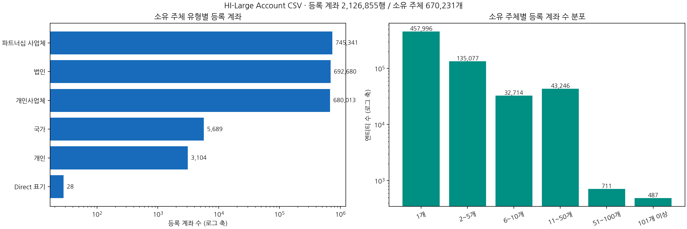

### 2.4 Bank ID 확인

#### Bank ID는 다르지만 Bank Name이 같은 경우

| 항목 | 수 |
| --- | ---: |
| 전체 `Bank ID` | 122,333 |
| 전체 `Bank Name` | 80,180 |
| 해당 (`Bank Name`, `Bank ID`) 쌍 | 42,621 |
| 중복 이름을 사용하는 `Bank Name` 종류 | 468 |
| 동일 `Bank ID`에 서로 다른 `Bank Name`이 있는 경우 | 없음 |

#### 같은 이름을 사용하는 Bank ID가 많은 은행명 상위 10개

| 순위 | Bank Name | Bank ID 수 |
| ---: | --- | ---: |
| 1 | First Bank of Newport | 165 |
| 2 | First Bank of New York | 158 |
| 3 | Bank of Lacrosse | 155 |
| 4 | Bank of Huron | 154 |
| 5 | Savings Bank of Lincoln | 154 |
| 6 | National Bank of Miami | 153 |
| 7 | First Bank of Dallas | 152 |
| 8 | Savings Bank of the South | 152 |
| 9 | Bank of Butte | 151 |
| 10 | National Bank of Omaha | 150 |

### 2.5 계좌 식별과 연결

| 항목 | 결과 |
|---|---|
| 은행 ID 정규화 없이 문자열 그대로 연결된 관측 노드 | 0개 |
| 정규화 후 연결 실패 노드·거래 끝점 | 각각 0개 |
| 등록됐지만 거래에서 관측되지 않은 계좌 | 10,687개 |

**원인:** 거래 원본의 은행 ID는 송신·수신 모두 선행 0을 포함하지만 계좌 원본의 은행 ID에는 선행 0이 없습니다. 은행명도 여러 은행 ID에 대응하는 이름이 468개 있어 단독 식별자로 사용할 수 없습니다.

**적용:** 은행 ID 표기를 정규화하고 **은행 ID + 문자열 계좌번호**를 노드 키로 사용합니다. 계좌번호만으로 연결하면 다른 은행·엔티티 계좌가 합쳐질 수 있습니다.

### 2.6 국가·엔티티 속성

- 은행명에서 국가가 명시적으로 드러나지 않는 계좌는 **789,927개**입니다.
- Crypto/Crytpo 표식 계좌 **46,600개**가 별도 집계되었습니다. 두 집계의 중첩 여부를 이 보고서에서 재검사하지 않았으므로 합산하지 않습니다.
- 국가를 원본의 독립된 검증 컬럼으로 받은 것이 아니라 은행명에서 추출합니다. 모르는 값은 `UNKNOWN`으로 유지합니다.
- 엔티티 유형도 이름 접두부에서 파생한 값입니다. 실제 법적 유형과 동등한 검증 정보로 간주하지 않습니다.

| 추출 유형 | 계좌 수 | 엔티티 수 |
|---|---|---|
| Partnership | 745,341 | 222,958 |
| Corporation | 692,680 | 223,674 |
| Sole Proprietorship | 680,013 | 223,101 |
| Country | 5,689 | 1 |
| Individual | 3,104 | 495 |
| Direct | 28 | 2 |

Country 유형은 5,689개 계좌가 하나의 엔티티 ID에 속합니다. 엔티티 집계가 일부 큰 그룹의 영향을 받을 수 있으므로 분포를 확인해야 합니다.

### 2.7 계좌 정보를 학습에 사용할 때의 판단

| 확인 결과 | 적용 기준 |
|---|---|
| 원본 결측·완전 중복 없음 | 근거 없이 계좌 행을 삭제하거나 결측을 만들어 채우지 않음 |
| 계좌번호 단독으로는 고유하지 않음 | 은행 ID 정규화 + 계좌번호 문자열 복합키 유지 |
| 국가·유형은 이름에서 파생 | 원본에 명시된 독립 검증 속성으로 과대해석하지 않음 |
| 동일 주체가 여러 계좌 보유 | 엔티티 관계는 유지하되 거래 시점·문맥 범위에 맞춰 활동 집계 |
| 계좌 등록 정보에 유효 시각 없음 | 당시 알려져 있던 KYC인지 이 파일만으로 검증할 수 없음. 일별 거래 시간 제약과 별개 |
| 원본 계좌 파일에 Y 라벨 없음 | 거래의 `Is Laundering`으로 거래를 학습하며 패턴·양성 집계를 계좌 입력에 넣지 않음 |
| 거래에서 관측되지 않는 등록 계좌 존재 | 등록 노드와 활동 노드를 구별하며 미관측을 정상·음성 라벨로 지정하지 않음 |

위의 등록 계좌 분석과 아래의 거래 연결 후 활동 분석은 집계 대상이 다릅니다.

### 2.8 거래와 연결한 관측 노드의 활동

#### ‘끝점’과 ‘끝점 등장 횟수’의 의미

**끝점(endpoint)은 거래를 나타내는 화살표 양쪽의 계좌**, 즉 송신 계좌와 수신 계좌를 뜻합니다. 여기서 ‘끝’은 거래가 끝나는 시각이나 최종 수취인이라는 의미가 아닙니다.

```text
A 계좌 ──송금──▶ B 계좌
송신 끝점        수신 끝점
```

**계좌별 끝점 등장 횟수 = 송신으로 등장한 횟수 + 수신으로 등장한 횟수**입니다. 아래 예시는 집계 방법을 설명하기 위한 가상 거래입니다.

| 거래 예시 | 계좌별 끝점 등장 횟수 | 읽는 방법 |
|---|---|---|
| `A → B` 1건 | A: 1회, B: 1회 | 한 거래에 송신·수신 끝점이 하나씩 있음 |
| `A → B`, `C → B` | A: 1회, C: 1회, B: 2회 | B는 두 거래의 수신 계좌로 등장 |
| `A → B`, `B → C` | A: 1회, B: 2회, C: 1회 | B는 수신 1회와 송신 1회를 합쳐 2회 |
| `A → A` 자기 이체 1건 | A: 2회 | 같은 계좌가 송신·수신 양쪽에 있으므로 각각 집계 |

따라서 아래의 **‘끝점 등장 1회 노드’ 30,150개는 전체 원본 거래에서 송신·수신 등장 횟수를 합쳐 정확히 1회인 계좌 수**입니다. 단순히 서로 다른 상대가 1개인 계좌나 하루에 한 번 거래한 계좌를 뜻하지 않습니다. 자기 이체 1건만 있는 계좌도 끝점 등장은 2회이므로 이 집단에 포함되지 않습니다.

또한 **‘미연결 거래 끝점’은 거래의 송신 또는 수신 계좌를 계좌 등록 정보에 연결하지 못한 경우**를 뜻합니다. 현재 EDA에서는 은행 ID 정규화와 은행+계좌 복합키 적용 후 미연결 끝점이 0개였습니다.

| 항목 | 결과 |
|---|---|
| 관측 노드 | 2,116,168개 |
| 송신 전용 | 391,075개 |
| 수신 전용 | 39,867개 |
| 끝점 등장 1회 노드 | 30,150개 |
| 수신 전용 계좌로 입금된 양성 거래 | 1,531건 |
| 수취 1회 계좌로 입금된 양성 거래 | 929건 |

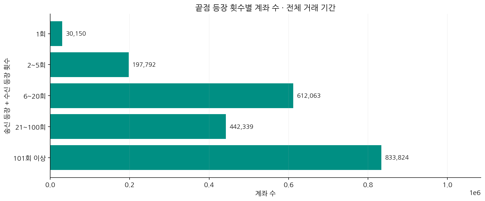

**그래프 해석:** 송신·수신 등장 횟수를 합산한 분포입니다. 자기 이체 한 건은 같은 계좌의 끝점 등장 두 번으로 집계됩니다.

| 끝점 등장 횟수 구간 | 노드 수 |
|---|---|
| 1 | 30,150 |
| 2-5 | 197,792 |
| 6-20 | 612,063 |
| 21-100 | 442,339 |
| 101+ | 833,824 |

끝점 등장 횟수는 송신·수신으로 등장한 횟수 기준이며, 자기 이체에서는 양쪽 끝점이 같은 계좌입니다. 활동이 적거나 수신만 한다는 이유로 노드를 제거하면 실제 양성도 잃습니다.

| 최초 관측 월 | 새로 관측된 노드 |
|---|---|
| 2022-08 | 2,093,929 |
| 2022-09 | 14,715 |
| 2022-10 | 7,428 |
| 2022-11 | 95 |
| 2022-12 | 1 |

노드 대부분이 8월에 처음 관측되므로, 전체 테스트 성능과 신규 계좌 성능을 별도로 비교할 필요가 있습니다. ‘최초 관측’은 실제 계좌 개설일을 뜻하지 않습니다.

## 3. 패턴 데이터 원문 확인

```
  1:BEGIN LAUNDERING ATTEMPT - STACK
  2: 2022/08/09 05:14,00952,8139F54E0,0111632,8062C56E0,5331.44,US Dollar,5331.44,US Dollar,ACH,1
  3: 2022/08/13 13:09,0111632,8062C56E0,008456,81363F620,5602.59,US Dollar,5602.59,US Dollar,ACH,1
  4: 2022/08/15 07:40,0118693,823D5EB90,013729,801CF2E60,1400.54,US Dollar,1400.54,US Dollar,ACH,1
  5: 2022/08/15 14:19,013729,801CF2E60,0123621,81A7090F0,1467.94,US Dollar,1467.94,US Dollar,ACH,1
  6: 2022/08/13 12:40,0024750,81363F410,0213834,808757B00,16898.29,US Dollar,16898.29,US Dollar,ACH,1
  7: 2022/08/22 06:34,0213834,808757B00,000,800073EF0,17607.19,US Dollar,17607.19,US Dollar,ACH,1
  8: END LAUNDERING ATTEMPT - STACK
  9:
 10: BEGIN LAUNDERING ATTEMPT - CYCLE:  Max 12 hops
 11: 2022/08/01 00:19,0134266,814167590,0036925,810E343A0,132713.46,Yuan,132713.46,Yuan,ACH,1
 12: 2022/08/01 13:05,0036925,810E343A0,0119211,814AB4F60,18264.20,US Dollar,18264.20,US Dollar,ACH,1
 13: 2022/08/03 13:28,0119211,814AB4F60,0132965,81B88A230,14567.69,Euro,14567.69,Euro,ACH,1
 14: 2022/08/09 02:32,0132965,81B88A230,0137089,810C71940,114329.26,Yuan,114329.26,Yuan,ACH,1
 15: 2022/08/11 07:16,0137089,810C71940,0216618,81D5302D0,14567.69,Euro,14567.69,Euro,ACH,1
 16: 2022/08/13 05:09,0216618,81D5302D0,0024083,81836B520,13629.75,Euro,13629.75,Euro,ACH,1
 17: 2022/08/15 18:04,0024083,81836B520,0038110,81B868730,97481.96,Yuan,97481.96,Yuan,ACH,1
 18: 2022/08/20 08:57,0038110,81B868730,0225015,81C6EA460,14054.71,US Dollar,14054.71,US Dollar,ACH,1
 19: 2022/08/22 12:08,0225015,81C6EA460,018112,8045CC910,13718.22,US Dollar,13718.22,US Dollar,ACH,1
 20: 2022/08/22 19:53,018112,8045CC910,007818,8037732C0,12908.33,US Dollar,12908.33,US Dollar,ACH,1
 21: 2022/08/27 07:10,007818,8037732C0,0121523,80D1BD2F0,10636.75,Euro,10636.75,Euro,ACH,1
 22: 2022/08/30 11:54,0121523,80D1BD2F0,0134266,814167590,1378736.88,Yen,1378736.88,Yen,ACH,1
 23: END LAUNDERING ATTEMPT - CYCLE

 ...
```

### 3.1 패턴별 규모와 지속시간

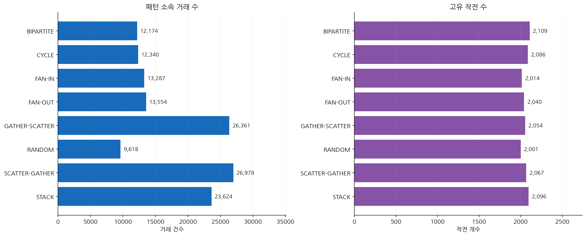

**그래프 해석:** 작전 수가 비슷해도 작전당 거래 수가 달라 패턴별 거래 규모는 다릅니다. 왼쪽은 거래 건수, 오른쪽은 작전 개수입니다.

지속시간은 시도 안의 **마지막 거래 시각 − 첫 거래 시각**입니다. 자금의 실제 체류시간이나 탐지 지연시간을 직접 나타내지 않습니다.

| 패턴 | 시도 수 | 거래 수 | 지속시간 중앙값(일) | 최대(일) | 월 경계 초과 시도 |
|---|---|---|---|---|---|
| BIPARTITE | 2,109 | 12,174 | 10.43 | 16.95 | 524 |
| CYCLE | 2,086 | 12,340 | 29.18 | 35.02 | 1,640 |
| FAN-IN | 2,014 | 13,287 | 28.81 | 35.02 | 1,381 |
| FAN-OUT | 2,040 | 13,554 | 29.13 | 35.01 | 1,410 |
| GATHER-SCATTER | 2,054 | 26,361 | 55.76 | 70.45 | 1,612 |
| RANDOM | 2,001 | 9,618 | 20.52 | 35.00 | 1,055 |
| SCATTER-GATHER | 2,067 | 26,978 | 32.44 | 35.02 | 1,796 |
| STACK | 2,096 | 23,624 | 26.51 | 42.51 | 1,543 |

FAN-IN은 집금, FAN-OUT은 분산, GATHER-SCATTER는 집금 후 분산, SCATTER-GATHER는 분산 후 재집금, CYCLE은 순환, BIPARTITE는 두 집단 사이 연결을 살펴볼 유형입니다. STACK·RANDOM의 세부 생성 규칙은 원본 예시만으로 확정하지 않았습니다.

#### HI-Large 패턴 파싱 결과

| 항목 | 수 |
| --- | ---: |
| 거래 행 | 137,936 |
| Attempt | 16,467 |
| 패턴 종류 | 8 |

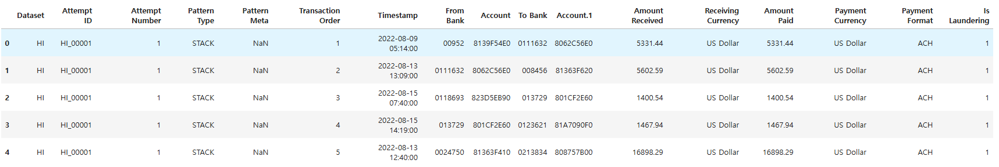

#### 구조와 연결 검사

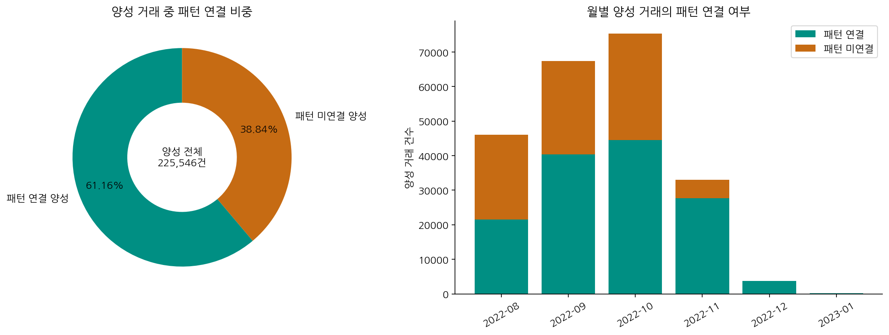

**그래프 해석:** 양성 중 61.16%만 패턴 파일에 연결됩니다. 미연결 38.84%도 이진 라벨은 양성이며 정상 거래로 바꾸면 안 됩니다.

- 구조 오류·빈 시도·시각 오류·금액 오류·라벨 1 이외 거래: **모두 0건**.
- 패턴 거래 **137,936건 전부** 원본 양성 거래와 연결되었습니다. 남은 필드 불일치, 다중 매칭, 여러 시도에 중복 소속된 원본 거래는 0건입니다.
- 전체 양성 중 **87,610건은 패턴 파일에 없습니다.** 이들은 정상으로 바꾸거나 오류로 단정하면 안 됩니다.

전체 양성의 패턴 커버리지는 **61.1565%**입니다. 이진분류 정답은 `Is Laundering`이며, 패턴명은 별도 보조 정답입니다.

### 3.2 2022-10-27 경계 기준 구분

| 구분 | Attempt 수 |
| --- | ---: |
| PRE_ONLY | 10,449 |
| BOUNDARY_CROSSING | 4,105 |
| POST_ONLY | 1,913 |

#### 패턴 종류별 구분

| 패턴 | BOUNDARY_CROSSING | POST_ONLY | PRE_ONLY |
| --- | ---: | ---: | ---: |
| BIPARTITE | 186 | 331 | 1,592 |
| CYCLE | 521 | 195 | 1,370 |
| FAN-IN | 475 | 205 | 1,334 |
| FAN-OUT | 507 | 212 | 1,321 |
| GATHER-SCATTER | 950 | 209 | 895 |
| RANDOM | 331 | 206 | 1,464 |
| SCATTER-GATHER | 585 | 242 | 1,240 |
| STACK | 550 | 313 | 1,233 |

### 3.3 시간 분할 경계와 패턴 끊김

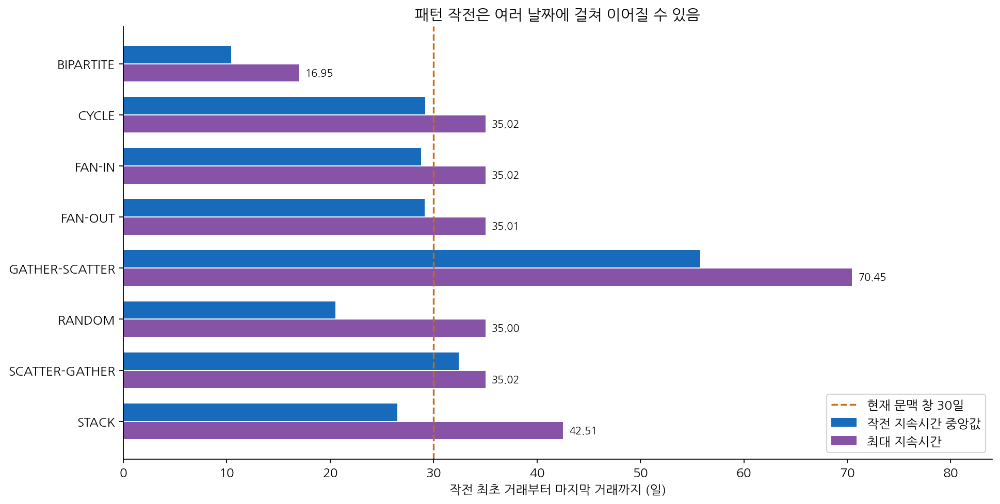

**그래프 해석:** 일부 작전은 30일을 넘습니다. 30일 문맥을 사용해도 모든 작전의 전체 거래 경로가 한 번에 포함된다는 뜻은 아닙니다.

| 패턴 | 8·9월 모두 등장 | 9·10월 모두 등장 | 10월·이후 모두 등장 |
|---|---|---|---|
| BIPARTITE | 168 | 165 | 191 |
| CYCLE | 559 | 548 | 517 |
| FAN-IN | 457 | 488 | 438 |
| FAN-OUT | 453 | 433 | 512 |
| GATHER-SCATTER | 498 | 900 | 961 |
| RANDOM | 356 | 350 | 331 |
| SCATTER-GATHER | 566 | 606 | 617 |
| STACK | 424 | 555 | 534 |

위 열은 해당 두 기간 모두에 거래가 존재하는 시도 수입니다. 한 시도가 여러 경계를 넘을 수 있어 열끼리 합산하면 중복 집계됩니다.

**해석·적용:** 월마다 독립 그래프를 만들면 실제 연결이 끊길 수 있습니다. 현재는 시간순으로 채점 대상을 나누되 과거 30일을 문맥으로 이어 씁니다. 다만 GATHER-SCATTER 최대 약 70.45일, STACK 최대 약 42.51일이므로 **30일 창이 모든 시도의 전체 경로를 보존하지는 않습니다.** 두 층 GNN과 최근 10개 유입 거래 제한의 영향도 별도 검증이 필요합니다.

현재 입력 X는 노드 23개·엣지 18개 피처와 그래프 연결, 정답 Y는 거래별 `Is Laundering`입니다. 패턴 정답과 라벨 기반 집계는 입력에서 제외했습니다.

비율은 각 표의 분모를 기준으로 계산하고 표시 자리수에서 반올림했습니다. 확인되지 않은 원인이나 효과는 관측 결과와 구분해 설명했습니다.

## 4. 날짜별 거래 데이터

| 구분 | 거래 수 |
| --- | ---: |
| 전체 자금세탁 거래 | 225,546 |
| 패턴 자금세탁 | 137,936 |
| 패턴 외 자금세탁 | 87,610 |

### 4.1 월별 자금세탁 거래 수

| 월 | 전체 거래 수 | 자금세탁 거래 수(라벨 1) | 자금세탁 거래 비율 | 패턴 연결 양성 | 미연결 양성 | 양성 중 패턴 커버리지 |
| --- | ---: | ---: | ---: | ---: | ---: | ---: |
| 2022-08 | 59,468,136 | 46,040 | 0.0774% | 21,518 | 24,522 | 46.7376% |
| 2022-09 | 56,137,121 | 67,372 | 0.1200% | 40,338 | 27,034 | 59.8735% |
| 2022-10 | 54,821,376 | 75,263 | 0.1373% | 44,559 | 30,704 | 59.2044% |
| 2022-11 | 9,269,215 | 33,013 | 0.3562% | 27,663 | 5,350 | 83.7943% |
| 2022-12 | 6,132 | 3,704 | 60.4044% | 3,704 | 0 | 100.0000% |
| 2023-01 | 249 | 154 | 61.8474% | 154 | 0 | 100.0000% |

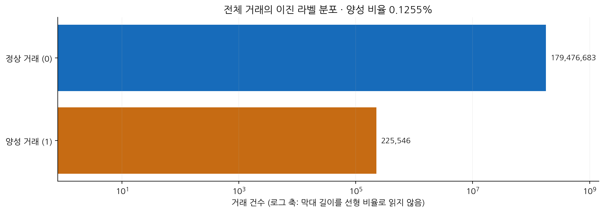

**그래프 해석:** 양성은 전체의 0.1255%입니다. 두 집단의 규모 차이가 커 로그 축으로 표시했으며, 단순 정확도만으로 탐지 성능을 판단하기 어렵습니다.

이 범위에서 거래가 한 건도 없는 달력 날짜는 없습니다. 다만 1월은 12일까지의 부분 기간입니다.

전체 정상 거래는 **179,476,683건**, 양성은 **225,546건**입니다. 정상:양성 비율은 약 **795.7:1**입니다. 모두 정상으로 예측해도 정확도가 **99.8745%**이므로 정확도만으로 모델을 평가하면 안 됩니다.

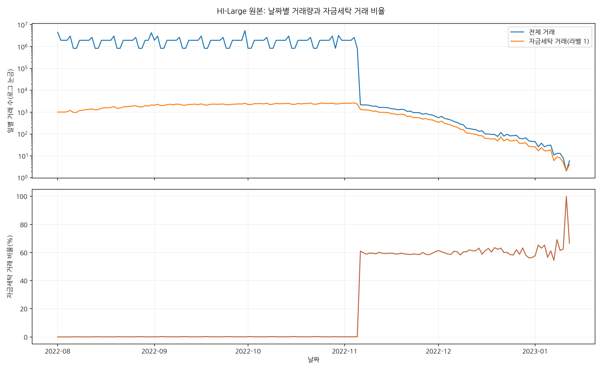

### 4.2 시간대별 자금세탁 거래 수

| 시간대 | 전체 거래 수 | 자금세탁 거래 수(라벨 1) | 자금세탁 거래 비율 |
| ---: | ---: | ---: | ---: |
| 00시 | 18,653,109 | 6,877 | 0.0369% |
| 01시 | 7,012,409 | 6,642 | 0.0947% |
| 02시 | 6,997,571 | 6,637 | 0.0948% |
| 03시 | 6,994,432 | 6,653 | 0.0951% |
| 04시 | 6,996,544 | 6,620 | 0.0946% |
| 05시 | 7,004,779 | 8,510 | 0.1215% |
| 06시 | 7,002,324 | 8,406 | 0.1200% |
| 07시 | 6,999,998 | 8,416 | 0.1202% |
| 08시 | 7,011,128 | 10,364 | 0.1478% |
| 09시 | 7,010,842 | 10,373 | 0.1480% |
| 10시 | 6,993,407 | 10,553 | 0.1509% |
| 11시 | 7,006,371 | 13,978 | 0.1995% |
| 12시 | 7,008,592 | 14,123 | 0.2015% |
| 13시 | 7,009,876 | 13,461 | 0.1920% |
| 14시 | 7,011,067 | 13,041 | 0.1860% |
| 15시 | 7,004,710 | 13,295 | 0.1898% |
| 16시 | 7,007,311 | 13,085 | 0.1867% |
| 17시 | 7,000,558 | 10,570 | 0.1510% |
| 18시 | 7,004,872 | 10,561 | 0.1508% |
| 19시 | 6,996,701 | 10,238 | 0.1463% |
| 20시 | 6,998,368 | 5,870 | 0.0839% |
| 21시 | 6,990,693 | 5,731 | 0.0820% |
| 22시 | 6,995,130 | 5,766 | 0.0824% |
| 23시 | 6,991,437 | 5,776 | 0.0826% |

#### 분 단위 거래 밀집도

| 항목 | 값 | 해석 |
| --- | ---: | --- |
| 거래가 발생한 분 | 157,422분 | 거래 기간 중 한 건 이상의 거래가 발생한 분 수 |
| 1분 내 최대 거래 | 83,002건 | 8월 1일 또는 월말 00:00의 `Reinvestment` 일괄 발생 시점으로 추정 |
| 같은 분에 다른 거래와 함께 발생한 거래 | 179,697,258건 | 전체 179,702,229건 중 동일 분에 다른 거래가 존재하는 거래 |
| 해당 분에 단독으로 발생한 거래 | 4,971건 | 전체 거래 수에서 위 거래 수를 뺀 값 |
| 거래가 2건 이상 발생한 분 | 152,451분 | 거래가 발생한 157,422분 중 2건 이상 발생한 분 |

#### 파일 순서와 분 단위 시간 중첩

| 항목 | 값 |
|---|---|
| 원본 인접 행의 시각 역전 | 85,464,014회 |
| 인접 행의 동일 시각 | 8,709,528회 |

**적용:** 원본 행 순서 대신 파싱한 시각을 사용합니다. 같은 분 안의 실제 선후관계는 알 수 없어, 거래 직전 시간 피처는 이전 분까지 계산합니다. 정렬용 내부 행 ID는 재현성을 제공할 뿐 실제 발생 순서를 증명하지 않습니다.

#### 통화·금액 일치 여부

> 모든 자금세탁 거래는 송금·수취 통화와 금액이 모두 일치한다.

| 통화 일치 | 금액 일치 | 행 수 | 자금세탁 거래 수 | 자금세탁 거래 비율 |
| --- | --- | ---: | ---: | ---: |
| 같음 | 같음 | 176,904,809 | 225,546 | 0.1275% |
| 같음 | 다름 | 0 | 0 | 해당 없음 |
| 다름 | 같음 | 281 | 0 | 0.0000% |
| 다름 | 다름 | 2,796,989 | 0 | 0.0000% |

> **데이터 범위 참고:** 패턴 외 자금세탁 거래는 2022-11-06부터 0건이다. 정상 거래도 같은 시점부터 급감하며 이후 소량만 존재한다.

### 4.3 거래 유형별 일자 추이

#### 정상 거래

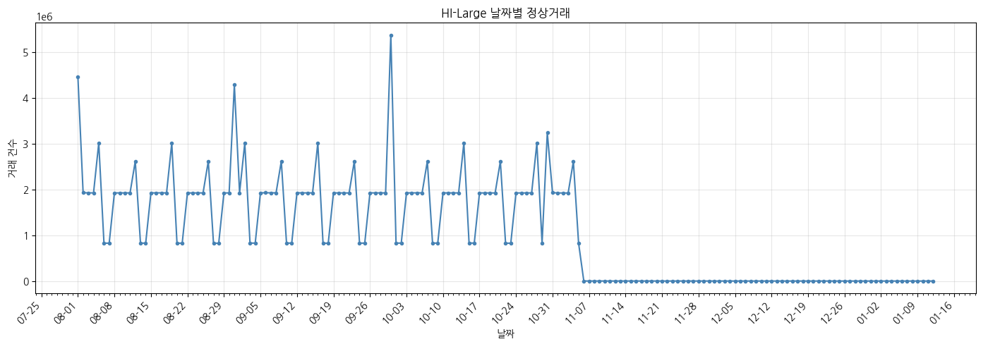

#### 패턴 자금세탁 거래

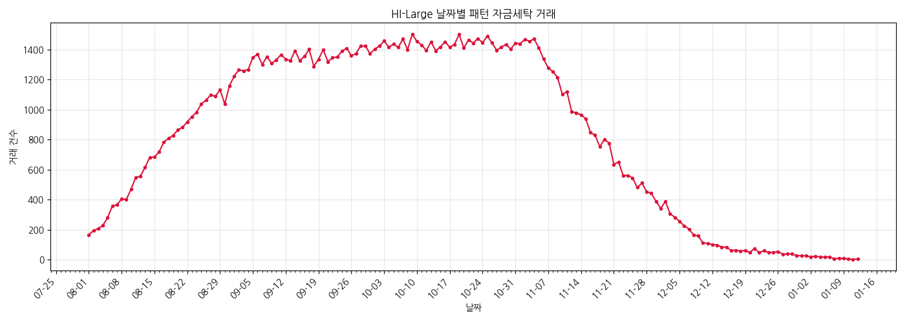

#### 패턴 외 자금세탁 거래

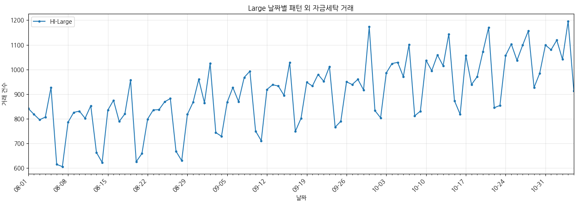

#### 전체 비교

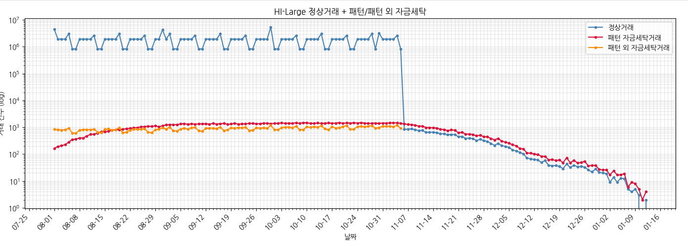

### 4.4 날짜별 거래 방식

- `Reinvestment`는 첫날과 매월 말일에 집중되며, 나머지 날짜에는 거의 발생하지 않는다.

#### 집계 예시

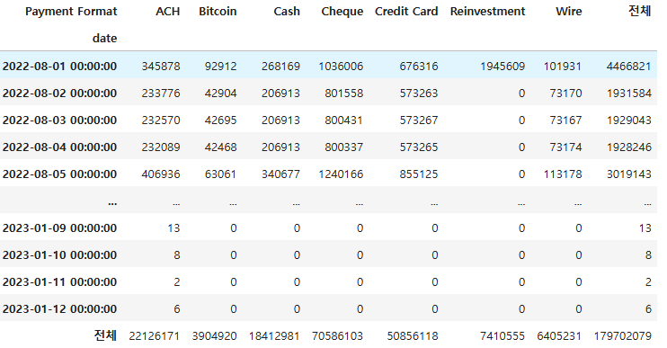

#### 일자 추이

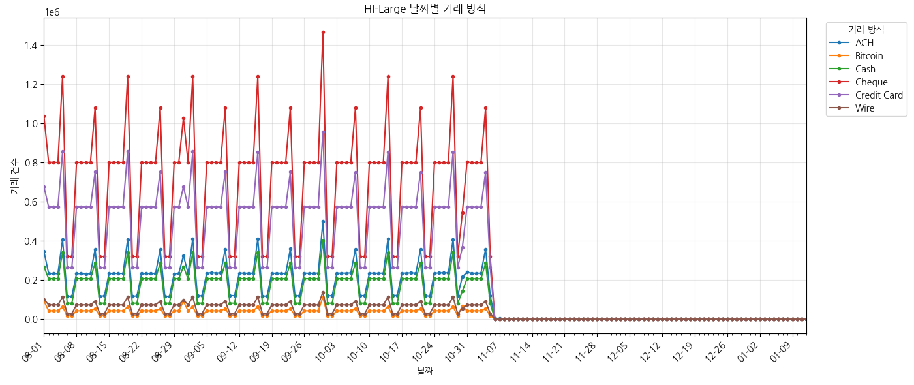

### 4.5 11월 이후 분포 변화

- **11월 5일:** 831,092건 → **11월 6일:** 2,192건. 전일 대비 약 **99.74% 감소**했습니다.
- 11월 6일 양성 비율은 **61.09%**, 12월과 1월도 약 60% 이상입니다.
- 8~10월의 낮은 양성 비율과 전혀 다른 분포입니다. 후반부는 일부 시도의 잔여 거래가 이어지는 구간일 가능성이 있으나, **원본 생성 규칙을 확인하지 않아 원인으로 확정할 수 없습니다.**
- 월별 비율 변화에는 기간·거래 구성 차이가 포함됩니다. 실제 자금세탁 위험이 증가했다고 단정하지 않습니다.

**적용:** 현재 모델은 8월 학습·9월 검증·10월 테스트를 사용합니다. 11월 이후는 해당 실험 범위 밖으로 구분했습니다. 다른 운영 기간을 평가하려면 그 분포를 별도로 검증해야 합니다.

## 5. 패턴 자금세탁과 패턴 외 자금세탁 비교

### 일별 학습 대상의 양성 수와 패턴 수

아래는 **샘플 실험이 아닌 원본 전량·daily_v1 중복 유지 기준**입니다. 학습은 **8월 8~31일**, 검증은 **9월**, 테스트는 **10월**이며 8월 1~7일은 통화 기준 산출에만 사용합니다. 각 행은 그날의 **판정 대상 거래**로, 과거 30일 그래프 문맥을 중복 합산한 수가 아닙니다. 에폭마다 같은 대상 거래를 다시 사용하므로 아래 수에 에폭 수를 곱하지 않았습니다.

| 컬럼 | 집계 기준 |
|---|---|
| 양성 거래 | 원본 `Is Laundering=1` 거래 수 |
| 패턴 거래 | 패턴 TXT에 속하고 원본 양성과 연결된 거래 수. 양성 거래의 부분집합 |
| 미연결 양성 | 양성 거래 − 패턴 거래. 패턴명이 없다고 정상으로 바꾸지 않음 |
| 당일 작전 수 | 그날 거래가 최소 1건 있는 고유 `attempt_id` 수. 같은 작전의 당일 거래가 여러 건이어도 1개 |
| 시작 작전 수 | 해당 작전의 원본 전체 최소 거래일이 그날인 작전 수. 실제 범죄 시작·알람 생성 시각을 뜻하지 않음 |
| 유형 수 | 당일 관측된 패턴 종류 수, 최대 8종. 작전 수와 구별 |

**여러 날 이어지는 작전은 각 날짜의 ‘당일 작전 수’에 다시 포함됩니다. 따라서 일별 작전 수의 합은 고유 작전 수가 아닙니다.** 구간별 고유 작전 수도 같은 작전이 학습·검증·테스트를 걸치면 중복되므로 구간끼리 단순 합산할 수 없습니다. 패턴 수는 모델의 예측·알람 수가 아니라 원본 정답 메타데이터입니다. 패턴 라벨은 X 피처에 넣지 않습니다.

완전 중복 초과분 150건은 모두 음성이므로 **중복 제거 실험에서도 양성 수와 패턴 수는 변하지 않습니다.** 아래 전체 거래 수는 중복 유지 기준이므로 중복 제거 후 일별 전체 건수와는 차이가 날 수 있습니다.

#### 구간별 합계

| 구간 | 날짜 수 | 전체 거래 | 양성 거래 | 패턴 거래 | 미연결 양성 | 구간 내 고유 작전 |
|---|---:|---:|---:|---:|---:|---:|
| 통화 기준 산출 | 7 | 14,933,012 | 7,206 | 1,795 | 5,411 | 1,022 |
| 학습 | 24 | 44,535,124 | 38,834 | 19,723 | 19,111 | 4,815 |
| 검증 | 30 | 56,137,121 | 67,372 | 40,338 | 27,034 | 8,621 |
| 테스트 | 31 | 54,821,376 | 75,263 | 44,559 | 30,704 | 9,334 |
| 실험 범위 밖 | 73 | 9,275,596 | 36,871 | 31,521 | 5,350 | 5,158 |

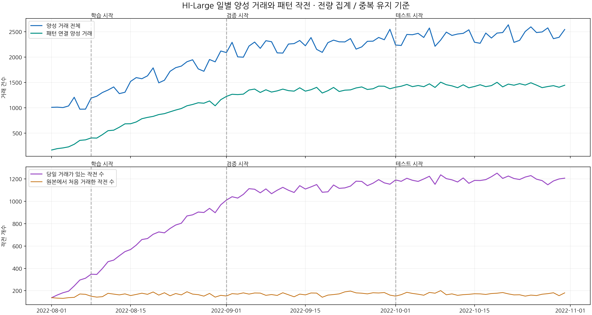

#### 통화 기준 산출 일별 내역 (2022-08-01 ~ 2022-08-07)

| 날짜 | 전체 거래 | 양성 거래 | 패턴 거래 | 미연결 양성 | 당일 작전 수 | 시작 작전 수 | 유형 수 |
|---|---:|---:|---:|---:|---:|---:|---:|
| 2022-08-01 | 4,466,821 | 1,008 | 166 | 842 | 138 | 138 | 8 |
| 2022-08-02 | 1,931,585 | 1,011 | 193 | 818 | 162 | 134 | 8 |
| 2022-08-03 | 1,929,043 | 1,003 | 207 | 796 | 182 | 132 | 8 |
| 2022-08-04 | 1,928,249 | 1,035 | 228 | 807 | 196 | 138 | 8 |
| 2022-08-05 | 3,019,143 | 1,206 | 279 | 927 | 243 | 141 | 8 |
| 2022-08-06 | 828,981 | 971 | 356 | 615 | 296 | 171 | 8 |
| 2022-08-07 | 829,190 | 972 | 366 | 606 | 312 | 168 | 8 |

#### 학습 일별 내역 (2022-08-08 ~ 2022-08-31)

| 날짜 | 전체 거래 | 양성 거래 | 패턴 거래 | 미연결 양성 | 당일 작전 수 | 시작 작전 수 | 유형 수 |
|---|---:|---:|---:|---:|---:|---:|---:|
| 2022-08-08 | 1,928,374 | 1,190 | 404 | 786 | 348 | 151 | 8 |
| 2022-08-09 | 1,928,823 | 1,227 | 401 | 826 | 346 | 143 | 8 |
| 2022-08-10 | 1,927,628 | 1,300 | 469 | 831 | 399 | 147 | 8 |
| 2022-08-11 | 1,929,142 | 1,349 | 547 | 802 | 460 | 177 | 8 |
| 2022-08-12 | 2,621,701 | 1,410 | 557 | 853 | 474 | 170 | 8 |
| 2022-08-13 | 829,920 | 1,278 | 615 | 663 | 513 | 163 | 8 |
| 2022-08-14 | 830,550 | 1,305 | 682 | 623 | 550 | 172 | 8 |
| 2022-08-15 | 1,928,907 | 1,519 | 684 | 835 | 569 | 157 | 8 |
| 2022-08-16 | 1,930,159 | 1,594 | 719 | 875 | 608 | 167 | 8 |
| 2022-08-17 | 1,929,245 | 1,572 | 783 | 789 | 658 | 178 | 8 |
| 2022-08-18 | 1,929,724 | 1,629 | 809 | 820 | 667 | 168 | 8 |
| 2022-08-19 | 3,019,001 | 1,786 | 829 | 957 | 705 | 189 | 8 |
| 2022-08-20 | 828,475 | 1,491 | 865 | 626 | 726 | 161 | 8 |
| 2022-08-21 | 830,799 | 1,542 | 883 | 659 | 718 | 182 | 8 |
| 2022-08-22 | 1,928,432 | 1,718 | 919 | 799 | 757 | 155 | 8 |
| 2022-08-23 | 1,928,708 | 1,790 | 954 | 836 | 788 | 175 | 8 |
| 2022-08-24 | 1,929,742 | 1,821 | 984 | 837 | 804 | 163 | 8 |
| 2022-08-25 | 1,929,035 | 1,907 | 1,038 | 869 | 869 | 191 | 8 |
| 2022-08-26 | 2,621,239 | 1,946 | 1,064 | 882 | 879 | 170 | 8 |
| 2022-08-27 | 828,897 | 1,766 | 1,098 | 668 | 904 | 165 | 8 |
| 2022-08-28 | 828,321 | 1,719 | 1,089 | 630 | 900 | 152 | 8 |
| 2022-08-29 | 1,927,752 | 1,951 | 1,133 | 818 | 937 | 176 | 8 |
| 2022-08-30 | 1,929,584 | 1,905 | 1,038 | 867 | 898 | 143 | 8 |
| 2022-08-31 | 4,290,966 | 2,119 | 1,159 | 960 | 969 | 159 | 8 |

#### 검증 일별 내역 (2022-09-01 ~ 2022-09-30)

| 날짜 | 전체 거래 | 양성 거래 | 패턴 거래 | 미연결 양성 | 당일 작전 수 | 시작 작전 수 | 유형 수 |
|---|---:|---:|---:|---:|---:|---:|---:|
| 2022-09-01 | 1,931,023 | 2,088 | 1,223 | 865 | 1,011 | 153 | 8 |
| 2022-09-02 | 3,021,894 | 2,290 | 1,265 | 1,025 | 1,041 | 174 | 8 |
| 2022-09-03 | 832,028 | 2,003 | 1,259 | 744 | 1,029 | 170 | 8 |
| 2022-09-04 | 831,450 | 1,997 | 1,268 | 729 | 1,062 | 181 | 8 |
| 2022-09-05 | 1,930,514 | 2,216 | 1,349 | 867 | 1,113 | 170 | 8 |
| 2022-09-06 | 1,932,948 | 2,295 | 1,368 | 927 | 1,108 | 180 | 8 |
| 2022-09-07 | 1,931,102 | 2,171 | 1,301 | 870 | 1,076 | 179 | 8 |
| 2022-09-08 | 1,931,683 | 2,322 | 1,354 | 968 | 1,111 | 159 | 8 |
| 2022-09-09 | 2,622,963 | 2,302 | 1,309 | 993 | 1,068 | 166 | 8 |
| 2022-09-10 | 832,706 | 2,082 | 1,332 | 750 | 1,099 | 158 | 8 |
| 2022-09-11 | 831,914 | 2,078 | 1,367 | 711 | 1,125 | 182 | 8 |
| 2022-09-12 | 1,931,230 | 2,256 | 1,337 | 919 | 1,099 | 164 | 8 |
| 2022-09-13 | 1,930,274 | 2,265 | 1,327 | 938 | 1,079 | 146 | 8 |
| 2022-09-14 | 1,929,871 | 2,326 | 1,393 | 933 | 1,140 | 170 | 8 |
| 2022-09-15 | 1,930,507 | 2,222 | 1,327 | 895 | 1,110 | 163 | 8 |
| 2022-09-16 | 3,021,851 | 2,384 | 1,355 | 1,029 | 1,129 | 180 | 8 |
| 2022-09-17 | 829,978 | 2,151 | 1,402 | 749 | 1,150 | 179 | 8 |
| 2022-09-18 | 829,352 | 2,092 | 1,290 | 802 | 1,081 | 142 | 8 |
| 2022-09-19 | 1,930,012 | 2,284 | 1,336 | 948 | 1,085 | 161 | 8 |
| 2022-09-20 | 1,929,666 | 2,333 | 1,400 | 933 | 1,146 | 166 | 8 |
| 2022-09-21 | 1,930,014 | 2,300 | 1,320 | 980 | 1,116 | 172 | 8 |
| 2022-09-22 | 1,928,248 | 2,298 | 1,346 | 952 | 1,120 | 190 | 8 |
| 2022-09-23 | 2,623,289 | 2,364 | 1,352 | 1,012 | 1,136 | 197 | 8 |
| 2022-09-24 | 830,925 | 2,156 | 1,390 | 766 | 1,180 | 181 | 8 |
| 2022-09-25 | 831,749 | 2,200 | 1,410 | 790 | 1,178 | 178 | 8 |
| 2022-09-26 | 1,930,439 | 2,310 | 1,360 | 950 | 1,140 | 172 | 8 |
| 2022-09-27 | 1,929,470 | 2,313 | 1,374 | 939 | 1,162 | 182 | 8 |
| 2022-09-28 | 1,929,725 | 2,386 | 1,426 | 960 | 1,194 | 180 | 8 |
| 2022-09-29 | 1,930,672 | 2,341 | 1,424 | 917 | 1,165 | 184 | 8 |
| 2022-09-30 | 5,379,624 | 2,547 | 1,374 | 1,173 | 1,153 | 161 | 8 |

#### 테스트 일별 내역 (2022-10-01 ~ 2022-10-31)

| 날짜 | 전체 거래 | 양성 거래 | 패턴 거래 | 미연결 양성 | 당일 작전 수 | 시작 작전 수 | 유형 수 |
|---|---:|---:|---:|---:|---:|---:|---:|
| 2022-10-01 | 832,116 | 2,237 | 1,404 | 833 | 1,191 | 152 | 8 |
| 2022-10-02 | 832,369 | 2,228 | 1,424 | 804 | 1,179 | 165 | 8 |
| 2022-10-03 | 1,930,139 | 2,445 | 1,459 | 986 | 1,206 | 186 | 8 |
| 2022-10-04 | 1,930,594 | 2,440 | 1,416 | 1,024 | 1,188 | 176 | 8 |
| 2022-10-05 | 1,930,379 | 2,467 | 1,438 | 1,029 | 1,178 | 169 | 8 |
| 2022-10-06 | 1,931,274 | 2,386 | 1,415 | 971 | 1,200 | 160 | 8 |
| 2022-10-07 | 2,621,858 | 2,572 | 1,471 | 1,101 | 1,224 | 185 | 8 |
| 2022-10-08 | 832,095 | 2,212 | 1,400 | 812 | 1,152 | 178 | 8 |
| 2022-10-09 | 832,173 | 2,335 | 1,504 | 831 | 1,237 | 201 | 8 |
| 2022-10-10 | 1,930,343 | 2,491 | 1,454 | 1,037 | 1,203 | 164 | 8 |
| 2022-10-11 | 1,929,616 | 2,426 | 1,431 | 995 | 1,192 | 172 | 8 |
| 2022-10-12 | 1,929,251 | 2,454 | 1,395 | 1,059 | 1,173 | 159 | 8 |
| 2022-10-13 | 1,929,640 | 2,467 | 1,452 | 1,015 | 1,209 | 165 | 8 |
| 2022-10-14 | 3,019,871 | 2,537 | 1,393 | 1,144 | 1,161 | 168 | 8 |
| 2022-10-15 | 832,532 | 2,292 | 1,419 | 873 | 1,187 | 173 | 8 |
| 2022-10-16 | 833,297 | 2,271 | 1,453 | 818 | 1,186 | 172 | 8 |
| 2022-10-17 | 1,929,391 | 2,473 | 1,416 | 1,057 | 1,194 | 167 | 8 |
| 2022-10-18 | 1,929,604 | 2,375 | 1,436 | 939 | 1,220 | 175 | 8 |
| 2022-10-19 | 1,930,931 | 2,472 | 1,501 | 971 | 1,252 | 178 | 8 |
| 2022-10-20 | 1,928,908 | 2,483 | 1,411 | 1,072 | 1,205 | 184 | 8 |
| 2022-10-21 | 2,619,435 | 2,636 | 1,466 | 1,170 | 1,226 | 172 | 8 |
| 2022-10-22 | 830,740 | 2,289 | 1,444 | 845 | 1,204 | 163 | 8 |
| 2022-10-23 | 829,241 | 2,329 | 1,475 | 854 | 1,195 | 164 | 8 |
| 2022-10-24 | 1,928,801 | 2,504 | 1,447 | 1,057 | 1,217 | 152 | 8 |
| 2022-10-25 | 1,929,619 | 2,595 | 1,492 | 1,103 | 1,230 | 161 | 8 |
| 2022-10-26 | 1,930,729 | 2,483 | 1,446 | 1,037 | 1,198 | 157 | 8 |
| 2022-10-27 | 1,929,976 | 2,495 | 1,396 | 1,099 | 1,185 | 169 | 8 |
| 2022-10-28 | 3,016,403 | 2,575 | 1,418 | 1,157 | 1,148 | 174 | 8 |
| 2022-10-29 | 830,552 | 2,362 | 1,435 | 927 | 1,182 | 182 | 8 |
| 2022-10-30 | 3,243,922 | 2,389 | 1,404 | 985 | 1,200 | 156 | 8 |
| 2022-10-31 | 1,935,577 | 2,543 | 1,444 | 1,099 | 1,207 | 181 | 8 |

11월 이후는 현재 학습·검증·테스트에서 제외됩니다. 전체 EDA는 2022년 8월 1일부터 2023년 1월 12일까지 165일을 포함합니다.

아래 표는 문서 길이를 줄이기 위해 기본적으로 접혀 있다. 펼치면 지원되는 Markdown 렌더러에서 최대 높이 420px의 영역 안에서 세로로 스크롤할 수 있다. 인라인 스타일을 제한하는 렌더러에서는 접기/펼치기만 적용된다.

<details>
<summary><strong>2022-11-01 ~ 2023-01-12 일자별 통계 보기 (73일)</strong></summary>

<div style="max-height: 420px; overflow: auto; margin-top: 0.75rem;">
<table>
  <thead style="position: sticky; top: 0; background: white;">
    <tr>
      <th scope="col">일자</th>
      <th scope="col">패턴 자금세탁</th>
      <th scope="col">패턴 외 자금세탁</th>
    </tr>
  </thead>
  <tbody>
    <tr>
      <th scope="row">2022-11-01</th>
      <td align="right">1,440</td>
      <td align="right">1,080</td>
    </tr>
    <tr>
      <th scope="row">2022-11-02</th>
      <td align="right">1,468</td>
      <td align="right">1,119</td>
    </tr>
    <tr>
      <th scope="row">2022-11-03</th>
      <td align="right">1,457</td>
      <td align="right">1,041</td>
    </tr>
    <tr>
      <th scope="row">2022-11-04</th>
      <td align="right">1,471</td>
      <td align="right">1,196</td>
    </tr>
    <tr>
      <th scope="row">2022-11-05</th>
      <td align="right">1,412</td>
      <td align="right">914</td>
    </tr>
    <tr>
      <th scope="row">2022-11-06</th>
      <td align="right">1,339</td>
      <td align="right">0</td>
    </tr>
    <tr>
      <th scope="row">2022-11-07</th>
      <td align="right">1,278</td>
      <td align="right">0</td>
    </tr>
    <tr>
      <th scope="row">2022-11-08</th>
      <td align="right">1,254</td>
      <td align="right">0</td>
    </tr>
    <tr>
      <th scope="row">2022-11-09</th>
      <td align="right">1,214</td>
      <td align="right">0</td>
    </tr>
    <tr>
      <th scope="row">2022-11-10</th>
      <td align="right">1,103</td>
      <td align="right">0</td>
    </tr>
    <tr>
      <th scope="row">2022-11-11</th>
      <td align="right">1,118</td>
      <td align="right">0</td>
    </tr>
    <tr>
      <th scope="row">2022-11-12</th>
      <td align="right">987</td>
      <td align="right">0</td>
    </tr>
    <tr>
      <th scope="row">2022-11-13</th>
      <td align="right">979</td>
      <td align="right">0</td>
    </tr>
    <tr>
      <th scope="row">2022-11-14</th>
      <td align="right">965</td>
      <td align="right">0</td>
    </tr>
    <tr>
      <th scope="row">2022-11-15</th>
      <td align="right">940</td>
      <td align="right">0</td>
    </tr>
    <tr>
      <th scope="row">2022-11-16</th>
      <td align="right">849</td>
      <td align="right">0</td>
    </tr>
    <tr>
      <th scope="row">2022-11-17</th>
      <td align="right">830</td>
      <td align="right">0</td>
    </tr>
    <tr>
      <th scope="row">2022-11-18</th>
      <td align="right">753</td>
      <td align="right">0</td>
    </tr>
    <tr>
      <th scope="row">2022-11-19</th>
      <td align="right">802</td>
      <td align="right">0</td>
    </tr>
    <tr>
      <th scope="row">2022-11-20</th>
      <td align="right">777</td>
      <td align="right">0</td>
    </tr>
    <tr>
      <th scope="row">2022-11-21</th>
      <td align="right">635</td>
      <td align="right">0</td>
    </tr>
    <tr>
      <th scope="row">2022-11-22</th>
      <td align="right">652</td>
      <td align="right">0</td>
    </tr>
    <tr>
      <th scope="row">2022-11-23</th>
      <td align="right">560</td>
      <td align="right">0</td>
    </tr>
    <tr>
      <th scope="row">2022-11-24</th>
      <td align="right">562</td>
      <td align="right">0</td>
    </tr>
    <tr>
      <th scope="row">2022-11-25</th>
      <td align="right">544</td>
      <td align="right">0</td>
    </tr>
    <tr>
      <th scope="row">2022-11-26</th>
      <td align="right">481</td>
      <td align="right">0</td>
    </tr>
    <tr>
      <th scope="row">2022-11-27</th>
      <td align="right">511</td>
      <td align="right">0</td>
    </tr>
    <tr>
      <th scope="row">2022-11-28</th>
      <td align="right">452</td>
      <td align="right">0</td>
    </tr>
    <tr>
      <th scope="row">2022-11-29</th>
      <td align="right">442</td>
      <td align="right">0</td>
    </tr>
    <tr>
      <th scope="row">2022-11-30</th>
      <td align="right">388</td>
      <td align="right">0</td>
    </tr>
    <tr>
      <th scope="row">2022-12-01</th>
      <td align="right">342</td>
      <td align="right">0</td>
    </tr>
    <tr>
      <th scope="row">2022-12-02</th>
      <td align="right">388</td>
      <td align="right">0</td>
    </tr>
    <tr>
      <th scope="row">2022-12-03</th>
      <td align="right">307</td>
      <td align="right">0</td>
    </tr>
    <tr>
      <th scope="row">2022-12-04</th>
      <td align="right">282</td>
      <td align="right">0</td>
    </tr>
    <tr>
      <th scope="row">2022-12-05</th>
      <td align="right">256</td>
      <td align="right">0</td>
    </tr>
    <tr>
      <th scope="row">2022-12-06</th>
      <td align="right">225</td>
      <td align="right">0</td>
    </tr>
    <tr>
      <th scope="row">2022-12-07</th>
      <td align="right">205</td>
      <td align="right">0</td>
    </tr>
    <tr>
      <th scope="row">2022-12-08</th>
      <td align="right">165</td>
      <td align="right">0</td>
    </tr>
    <tr>
      <th scope="row">2022-12-09</th>
      <td align="right">158</td>
      <td align="right">0</td>
    </tr>
    <tr>
      <th scope="row">2022-12-10</th>
      <td align="right">111</td>
      <td align="right">0</td>
    </tr>
    <tr>
      <th scope="row">2022-12-11</th>
      <td align="right">109</td>
      <td align="right">0</td>
    </tr>
    <tr>
      <th scope="row">2022-12-12</th>
      <td align="right">101</td>
      <td align="right">0</td>
    </tr>
    <tr>
      <th scope="row">2022-12-13</th>
      <td align="right">97</td>
      <td align="right">0</td>
    </tr>
    <tr>
      <th scope="row">2022-12-14</th>
      <td align="right">84</td>
      <td align="right">0</td>
    </tr>
    <tr>
      <th scope="row">2022-12-15</th>
      <td align="right">83</td>
      <td align="right">0</td>
    </tr>
    <tr>
      <th scope="row">2022-12-16</th>
      <td align="right">62</td>
      <td align="right">0</td>
    </tr>
    <tr>
      <th scope="row">2022-12-17</th>
      <td align="right">63</td>
      <td align="right">0</td>
    </tr>
    <tr>
      <th scope="row">2022-12-18</th>
      <td align="right">58</td>
      <td align="right">0</td>
    </tr>
    <tr>
      <th scope="row">2022-12-19</th>
      <td align="right">61</td>
      <td align="right">0</td>
    </tr>
    <tr>
      <th scope="row">2022-12-20</th>
      <td align="right">48</td>
      <td align="right">0</td>
    </tr>
    <tr>
      <th scope="row">2022-12-21</th>
      <td align="right">74</td>
      <td align="right">0</td>
    </tr>
    <tr>
      <th scope="row">2022-12-22</th>
      <td align="right">48</td>
      <td align="right">0</td>
    </tr>
    <tr>
      <th scope="row">2022-12-23</th>
      <td align="right">59</td>
      <td align="right">0</td>
    </tr>
    <tr>
      <th scope="row">2022-12-24</th>
      <td align="right">48</td>
      <td align="right">0</td>
    </tr>
    <tr>
      <th scope="row">2022-12-25</th>
      <td align="right">49</td>
      <td align="right">0</td>
    </tr>
    <tr>
      <th scope="row">2022-12-26</th>
      <td align="right">54</td>
      <td align="right">0</td>
    </tr>
    <tr>
      <th scope="row">2022-12-27</th>
      <td align="right">37</td>
      <td align="right">0</td>
    </tr>
    <tr>
      <th scope="row">2022-12-28</th>
      <td align="right">38</td>
      <td align="right">0</td>
    </tr>
    <tr>
      <th scope="row">2022-12-29</th>
      <td align="right">39</td>
      <td align="right">0</td>
    </tr>
    <tr>
      <th scope="row">2022-12-30</th>
      <td align="right">27</td>
      <td align="right">0</td>
    </tr>
    <tr>
      <th scope="row">2022-12-31</th>
      <td align="right">26</td>
      <td align="right">0</td>
    </tr>
    <tr>
      <th scope="row">2023-01-01</th>
      <td align="right">26</td>
      <td align="right">0</td>
    </tr>
    <tr>
      <th scope="row">2023-01-02</th>
      <td align="right">17</td>
      <td align="right">0</td>
    </tr>
    <tr>
      <th scope="row">2023-01-03</th>
      <td align="right">24</td>
      <td align="right">0</td>
    </tr>
    <tr>
      <th scope="row">2023-01-04</th>
      <td align="right">17</td>
      <td align="right">0</td>
    </tr>
    <tr>
      <th scope="row">2023-01-05</th>
      <td align="right">17</td>
      <td align="right">0</td>
    </tr>
    <tr>
      <th scope="row">2023-01-06</th>
      <td align="right">19</td>
      <td align="right">0</td>
    </tr>
    <tr>
      <th scope="row">2023-01-07</th>
      <td align="right">6</td>
      <td align="right">0</td>
    </tr>
    <tr>
      <th scope="row">2023-01-08</th>
      <td align="right">9</td>
      <td align="right">0</td>
    </tr>
    <tr>
      <th scope="row">2023-01-09</th>
      <td align="right">8</td>
      <td align="right">0</td>
    </tr>
    <tr>
      <th scope="row">2023-01-10</th>
      <td align="right">5</td>
      <td align="right">0</td>
    </tr>
    <tr>
      <th scope="row">2023-01-11</th>
      <td align="right">2</td>
      <td align="right">0</td>
    </tr>
    <tr>
      <th scope="row">2023-01-12</th>
      <td align="right">4</td>
      <td align="right">0</td>
    </tr>
  </tbody>
</table>
</div>
</details>

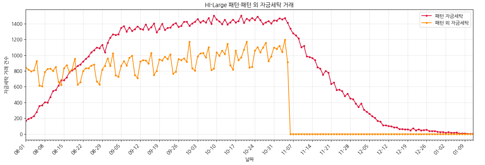

## 6. Payment Format별 자금세탁 일자 추이

### 6.1 전체 자금세탁 결제 방식 통계

| 결제 방식 | 전체 거래 수 | 자금세탁 거래 수(라벨 1) | 자금세탁 거래 비율 |
| --- | ---: | ---: | ---: |
| 수표 (Cheque) | 70,586,103 | 13,260 | 0.0188% |
| 신용카드 (Credit Card) | 50,856,118 | 7,846 | 0.0154% |
| 자동결제망 이체 (ACH) | 22,126,214 | 199,164 | 0.9001% |
| 현금 (Cash) | 18,412,981 | 3,663 | 0.0199% |
| 재투자 (Reinvestment) | 7,410,556 | 0 | 0.0000% |
| 전신 송금 (Wire) | 6,405,236 | 5 | 0.0001% |
| 비트코인 (Bitcoin) | 3,905,021 | 1,608 | 0.0412% |

ACH에 양성 **199,164건**, 전체 양성의 **88.3031%**가 집중되어 있습니다. 이는 데이터에서 관측된 연관성입니다. 결제 방식의 실제 위험성이나 인과관계를 증명하지 않습니다. Wire 양성은 5건으로, 범주별 성능 추정에 표본 수를 함께 제시해야 합니다.

현재 18개 엣지 입력에는 `Payment Format`이 들어 있지 않습니다. 추가 여부는 시간순 검증에서 비교할 실험 후보이며, 현재 성능 저하의 원인으로 확정한 것은 아닙니다.

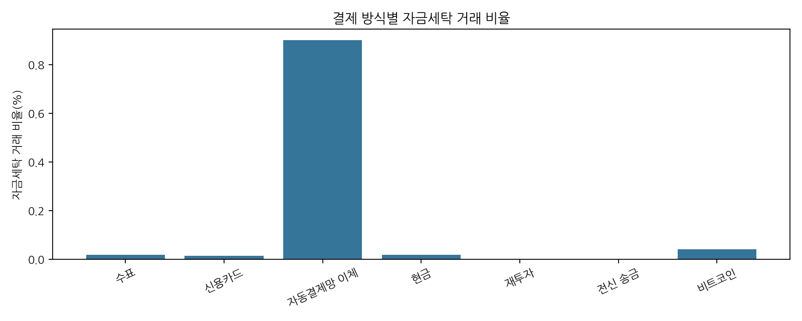

### 6.2 패턴 자금세탁

| Payment Format | 전체 거래 수 |
| --- | ---: |
| ACH | 137,919 |
| Bitcoin | 13 |
| Wire | 4 |
| **전체** | **137,936** |

<details>
<summary><strong>Payment Format별 전체 일자 통계 보기 (합계 포함)</strong></summary>

<div style="max-height: 420px; overflow: auto; margin-top: 0.75rem;">
<table>
  <thead style="position: sticky; top: 0; background: white;">
    <tr>
      <th scope="col">일자</th>
      <th scope="col">ACH</th>
      <th scope="col">Bitcoin</th>
      <th scope="col">Wire</th>
      <th scope="col">전체</th>
    </tr>
  </thead>
  <tbody>
    <tr>
      <th scope="row">2022-08-01</th>
      <td align="right">166</td>
      <td align="right">0</td>
      <td align="right">0</td>
      <td align="right">166</td>
    </tr>
    <tr>
      <th scope="row">2022-08-02</th>
      <td align="right">193</td>
      <td align="right">0</td>
      <td align="right">0</td>
      <td align="right">193</td>
    </tr>
    <tr>
      <th scope="row">2022-08-03</th>
      <td align="right">207</td>
      <td align="right">0</td>
      <td align="right">0</td>
      <td align="right">207</td>
    </tr>
    <tr>
      <th scope="row">2022-08-04</th>
      <td align="right">228</td>
      <td align="right">0</td>
      <td align="right">0</td>
      <td align="right">228</td>
    </tr>
    <tr>
      <th scope="row">2022-08-05</th>
      <td align="right">279</td>
      <td align="right">0</td>
      <td align="right">0</td>
      <td align="right">279</td>
    </tr>
    <tr>
      <th scope="row">2022-08-06</th>
      <td align="right">356</td>
      <td align="right">0</td>
      <td align="right">0</td>
      <td align="right">356</td>
    </tr>
    <tr>
      <th scope="row">2022-08-07</th>
      <td align="right">366</td>
      <td align="right">0</td>
      <td align="right">0</td>
      <td align="right">366</td>
    </tr>
    <tr>
      <th scope="row">2022-08-08</th>
      <td align="right">404</td>
      <td align="right">0</td>
      <td align="right">0</td>
      <td align="right">404</td>
    </tr>
    <tr>
      <th scope="row">2022-08-09</th>
      <td align="right">401</td>
      <td align="right">0</td>
      <td align="right">0</td>
      <td align="right">401</td>
    </tr>
    <tr>
      <th scope="row">2022-08-10</th>
      <td align="right">469</td>
      <td align="right">0</td>
      <td align="right">0</td>
      <td align="right">469</td>
    </tr>
    <tr>
      <th scope="row">2022-08-11</th>
      <td align="right">547</td>
      <td align="right">0</td>
      <td align="right">0</td>
      <td align="right">547</td>
    </tr>
    <tr>
      <th scope="row">2022-08-12</th>
      <td align="right">556</td>
      <td align="right">1</td>
      <td align="right">0</td>
      <td align="right">557</td>
    </tr>
    <tr>
      <th scope="row">2022-08-13</th>
      <td align="right">615</td>
      <td align="right">0</td>
      <td align="right">0</td>
      <td align="right">615</td>
    </tr>
    <tr>
      <th scope="row">2022-08-14</th>
      <td align="right">682</td>
      <td align="right">0</td>
      <td align="right">0</td>
      <td align="right">682</td>
    </tr>
    <tr>
      <th scope="row">2022-08-15</th>
      <td align="right">684</td>
      <td align="right">0</td>
      <td align="right">0</td>
      <td align="right">684</td>
    </tr>
    <tr>
      <th scope="row">2022-08-16</th>
      <td align="right">719</td>
      <td align="right">0</td>
      <td align="right">0</td>
      <td align="right">719</td>
    </tr>
    <tr>
      <th scope="row">2022-08-17</th>
      <td align="right">783</td>
      <td align="right">0</td>
      <td align="right">0</td>
      <td align="right">783</td>
    </tr>
    <tr>
      <th scope="row">2022-08-18</th>
      <td align="right">809</td>
      <td align="right">0</td>
      <td align="right">0</td>
      <td align="right">809</td>
    </tr>
    <tr>
      <th scope="row">2022-08-19</th>
      <td align="right">829</td>
      <td align="right">0</td>
      <td align="right">0</td>
      <td align="right">829</td>
    </tr>
    <tr>
      <th scope="row">2022-08-20</th>
      <td align="right">865</td>
      <td align="right">0</td>
      <td align="right">0</td>
      <td align="right">865</td>
    </tr>
    <tr>
      <th scope="row">2022-08-21</th>
      <td align="right">883</td>
      <td align="right">0</td>
      <td align="right">0</td>
      <td align="right">883</td>
    </tr>
    <tr>
      <th scope="row">2022-08-22</th>
      <td align="right">919</td>
      <td align="right">0</td>
      <td align="right">0</td>
      <td align="right">919</td>
    </tr>
    <tr>
      <th scope="row">2022-08-23</th>
      <td align="right">954</td>
      <td align="right">0</td>
      <td align="right">0</td>
      <td align="right">954</td>
    </tr>
    <tr>
      <th scope="row">2022-08-24</th>
      <td align="right">984</td>
      <td align="right">0</td>
      <td align="right">0</td>
      <td align="right">984</td>
    </tr>
    <tr>
      <th scope="row">2022-08-25</th>
      <td align="right">1,038</td>
      <td align="right">0</td>
      <td align="right">0</td>
      <td align="right">1,038</td>
    </tr>
    <tr>
      <th scope="row">2022-08-26</th>
      <td align="right">1,063</td>
      <td align="right">0</td>
      <td align="right">1</td>
      <td align="right">1,064</td>
    </tr>
    <tr>
      <th scope="row">2022-08-27</th>
      <td align="right">1,098</td>
      <td align="right">0</td>
      <td align="right">0</td>
      <td align="right">1,098</td>
    </tr>
    <tr>
      <th scope="row">2022-08-28</th>
      <td align="right">1,089</td>
      <td align="right">0</td>
      <td align="right">0</td>
      <td align="right">1,089</td>
    </tr>
    <tr>
      <th scope="row">2022-08-29</th>
      <td align="right">1,133</td>
      <td align="right">0</td>
      <td align="right">0</td>
      <td align="right">1,133</td>
    </tr>
    <tr>
      <th scope="row">2022-08-30</th>
      <td align="right">1,037</td>
      <td align="right">0</td>
      <td align="right">1</td>
      <td align="right">1,038</td>
    </tr>
    <tr>
      <th scope="row">2022-08-31</th>
      <td align="right">1,159</td>
      <td align="right">0</td>
      <td align="right">0</td>
      <td align="right">1,159</td>
    </tr>
    <tr>
      <th scope="row">2022-09-01</th>
      <td align="right">1,223</td>
      <td align="right">0</td>
      <td align="right">0</td>
      <td align="right">1,223</td>
    </tr>
    <tr>
      <th scope="row">2022-09-02</th>
      <td align="right">1,265</td>
      <td align="right">0</td>
      <td align="right">0</td>
      <td align="right">1,265</td>
    </tr>
    <tr>
      <th scope="row">2022-09-03</th>
      <td align="right">1,259</td>
      <td align="right">0</td>
      <td align="right">0</td>
      <td align="right">1,259</td>
    </tr>
    <tr>
      <th scope="row">2022-09-04</th>
      <td align="right">1,268</td>
      <td align="right">0</td>
      <td align="right">0</td>
      <td align="right">1,268</td>
    </tr>
    <tr>
      <th scope="row">2022-09-05</th>
      <td align="right">1,349</td>
      <td align="right">0</td>
      <td align="right">0</td>
      <td align="right">1,349</td>
    </tr>
    <tr>
      <th scope="row">2022-09-06</th>
      <td align="right">1,368</td>
      <td align="right">0</td>
      <td align="right">0</td>
      <td align="right">1,368</td>
    </tr>
    <tr>
      <th scope="row">2022-09-07</th>
      <td align="right">1,300</td>
      <td align="right">1</td>
      <td align="right">0</td>
      <td align="right">1,301</td>
    </tr>
    <tr>
      <th scope="row">2022-09-08</th>
      <td align="right">1,354</td>
      <td align="right">0</td>
      <td align="right">0</td>
      <td align="right">1,354</td>
    </tr>
    <tr>
      <th scope="row">2022-09-09</th>
      <td align="right">1,309</td>
      <td align="right">0</td>
      <td align="right">0</td>
      <td align="right">1,309</td>
    </tr>
    <tr>
      <th scope="row">2022-09-10</th>
      <td align="right">1,331</td>
      <td align="right">1</td>
      <td align="right">0</td>
      <td align="right">1,332</td>
    </tr>
    <tr>
      <th scope="row">2022-09-11</th>
      <td align="right">1,366</td>
      <td align="right">1</td>
      <td align="right">0</td>
      <td align="right">1,367</td>
    </tr>
    <tr>
      <th scope="row">2022-09-12</th>
      <td align="right">1,337</td>
      <td align="right">0</td>
      <td align="right">0</td>
      <td align="right">1,337</td>
    </tr>
    <tr>
      <th scope="row">2022-09-13</th>
      <td align="right">1,327</td>
      <td align="right">0</td>
      <td align="right">0</td>
      <td align="right">1,327</td>
    </tr>
    <tr>
      <th scope="row">2022-09-14</th>
      <td align="right">1,393</td>
      <td align="right">0</td>
      <td align="right">0</td>
      <td align="right">1,393</td>
    </tr>
    <tr>
      <th scope="row">2022-09-15</th>
      <td align="right">1,326</td>
      <td align="right">0</td>
      <td align="right">1</td>
      <td align="right">1,327</td>
    </tr>
    <tr>
      <th scope="row">2022-09-16</th>
      <td align="right">1,355</td>
      <td align="right">0</td>
      <td align="right">0</td>
      <td align="right">1,355</td>
    </tr>
    <tr>
      <th scope="row">2022-09-17</th>
      <td align="right">1,402</td>
      <td align="right">0</td>
      <td align="right">0</td>
      <td align="right">1,402</td>
    </tr>
    <tr>
      <th scope="row">2022-09-18</th>
      <td align="right">1,290</td>
      <td align="right">0</td>
      <td align="right">0</td>
      <td align="right">1,290</td>
    </tr>
    <tr>
      <th scope="row">2022-09-19</th>
      <td align="right">1,336</td>
      <td align="right">0</td>
      <td align="right">0</td>
      <td align="right">1,336</td>
    </tr>
    <tr>
      <th scope="row">2022-09-20</th>
      <td align="right">1,400</td>
      <td align="right">0</td>
      <td align="right">0</td>
      <td align="right">1,400</td>
    </tr>
    <tr>
      <th scope="row">2022-09-21</th>
      <td align="right">1,320</td>
      <td align="right">0</td>
      <td align="right">0</td>
      <td align="right">1,320</td>
    </tr>
    <tr>
      <th scope="row">2022-09-22</th>
      <td align="right">1,346</td>
      <td align="right">0</td>
      <td align="right">0</td>
      <td align="right">1,346</td>
    </tr>
    <tr>
      <th scope="row">2022-09-23</th>
      <td align="right">1,352</td>
      <td align="right">0</td>
      <td align="right">0</td>
      <td align="right">1,352</td>
    </tr>
    <tr>
      <th scope="row">2022-09-24</th>
      <td align="right">1,390</td>
      <td align="right">0</td>
      <td align="right">0</td>
      <td align="right">1,390</td>
    </tr>
    <tr>
      <th scope="row">2022-09-25</th>
      <td align="right">1,410</td>
      <td align="right">0</td>
      <td align="right">0</td>
      <td align="right">1,410</td>
    </tr>
    <tr>
      <th scope="row">2022-09-26</th>
      <td align="right">1,358</td>
      <td align="right">2</td>
      <td align="right">0</td>
      <td align="right">1,360</td>
    </tr>
    <tr>
      <th scope="row">2022-09-27</th>
      <td align="right">1,374</td>
      <td align="right">0</td>
      <td align="right">0</td>
      <td align="right">1,374</td>
    </tr>
    <tr>
      <th scope="row">2022-09-28</th>
      <td align="right">1,426</td>
      <td align="right">0</td>
      <td align="right">0</td>
      <td align="right">1,426</td>
    </tr>
    <tr>
      <th scope="row">2022-09-29</th>
      <td align="right">1,424</td>
      <td align="right">0</td>
      <td align="right">0</td>
      <td align="right">1,424</td>
    </tr>
    <tr>
      <th scope="row">2022-09-30</th>
      <td align="right">1,374</td>
      <td align="right">0</td>
      <td align="right">0</td>
      <td align="right">1,374</td>
    </tr>
    <tr>
      <th scope="row">2022-10-01</th>
      <td align="right">1,404</td>
      <td align="right">0</td>
      <td align="right">0</td>
      <td align="right">1,404</td>
    </tr>
    <tr>
      <th scope="row">2022-10-02</th>
      <td align="right">1,424</td>
      <td align="right">0</td>
      <td align="right">0</td>
      <td align="right">1,424</td>
    </tr>
    <tr>
      <th scope="row">2022-10-03</th>
      <td align="right">1,459</td>
      <td align="right">0</td>
      <td align="right">0</td>
      <td align="right">1,459</td>
    </tr>
    <tr>
      <th scope="row">2022-10-04</th>
      <td align="right">1,416</td>
      <td align="right">0</td>
      <td align="right">0</td>
      <td align="right">1,416</td>
    </tr>
    <tr>
      <th scope="row">2022-10-05</th>
      <td align="right">1,437</td>
      <td align="right">1</td>
      <td align="right">0</td>
      <td align="right">1,438</td>
    </tr>
    <tr>
      <th scope="row">2022-10-06</th>
      <td align="right">1,415</td>
      <td align="right">0</td>
      <td align="right">0</td>
      <td align="right">1,415</td>
    </tr>
    <tr>
      <th scope="row">2022-10-07</th>
      <td align="right">1,471</td>
      <td align="right">0</td>
      <td align="right">0</td>
      <td align="right">1,471</td>
    </tr>
    <tr>
      <th scope="row">2022-10-08</th>
      <td align="right">1,399</td>
      <td align="right">1</td>
      <td align="right">0</td>
      <td align="right">1,400</td>
    </tr>
    <tr>
      <th scope="row">2022-10-09</th>
      <td align="right">1,504</td>
      <td align="right">0</td>
      <td align="right">0</td>
      <td align="right">1,504</td>
    </tr>
    <tr>
      <th scope="row">2022-10-10</th>
      <td align="right">1,454</td>
      <td align="right">0</td>
      <td align="right">0</td>
      <td align="right">1,454</td>
    </tr>
    <tr>
      <th scope="row">2022-10-11</th>
      <td align="right">1,431</td>
      <td align="right">0</td>
      <td align="right">0</td>
      <td align="right">1,431</td>
    </tr>
    <tr>
      <th scope="row">2022-10-12</th>
      <td align="right">1,395</td>
      <td align="right">0</td>
      <td align="right">0</td>
      <td align="right">1,395</td>
    </tr>
    <tr>
      <th scope="row">2022-10-13</th>
      <td align="right">1,452</td>
      <td align="right">0</td>
      <td align="right">0</td>
      <td align="right">1,452</td>
    </tr>
    <tr>
      <th scope="row">2022-10-14</th>
      <td align="right">1,393</td>
      <td align="right">0</td>
      <td align="right">0</td>
      <td align="right">1,393</td>
    </tr>
    <tr>
      <th scope="row">2022-10-15</th>
      <td align="right">1,419</td>
      <td align="right">0</td>
      <td align="right">0</td>
      <td align="right">1,419</td>
    </tr>
    <tr>
      <th scope="row">2022-10-16</th>
      <td align="right">1,452</td>
      <td align="right">1</td>
      <td align="right">0</td>
      <td align="right">1,453</td>
    </tr>
    <tr>
      <th scope="row">2022-10-17</th>
      <td align="right">1,416</td>
      <td align="right">0</td>
      <td align="right">0</td>
      <td align="right">1,416</td>
    </tr>
    <tr>
      <th scope="row">2022-10-18</th>
      <td align="right">1,436</td>
      <td align="right">0</td>
      <td align="right">0</td>
      <td align="right">1,436</td>
    </tr>
    <tr>
      <th scope="row">2022-10-19</th>
      <td align="right">1,501</td>
      <td align="right">0</td>
      <td align="right">0</td>
      <td align="right">1,501</td>
    </tr>
    <tr>
      <th scope="row">2022-10-20</th>
      <td align="right">1,411</td>
      <td align="right">0</td>
      <td align="right">0</td>
      <td align="right">1,411</td>
    </tr>
    <tr>
      <th scope="row">2022-10-21</th>
      <td align="right">1,466</td>
      <td align="right">0</td>
      <td align="right">0</td>
      <td align="right">1,466</td>
    </tr>
    <tr>
      <th scope="row">2022-10-22</th>
      <td align="right">1,444</td>
      <td align="right">0</td>
      <td align="right">0</td>
      <td align="right">1,444</td>
    </tr>
    <tr>
      <th scope="row">2022-10-23</th>
      <td align="right">1,475</td>
      <td align="right">0</td>
      <td align="right">0</td>
      <td align="right">1,475</td>
    </tr>
    <tr>
      <th scope="row">2022-10-24</th>
      <td align="right">1,447</td>
      <td align="right">0</td>
      <td align="right">0</td>
      <td align="right">1,447</td>
    </tr>
    <tr>
      <th scope="row">2022-10-25</th>
      <td align="right">1,492</td>
      <td align="right">0</td>
      <td align="right">0</td>
      <td align="right">1,492</td>
    </tr>
    <tr>
      <th scope="row">2022-10-26</th>
      <td align="right">1,446</td>
      <td align="right">0</td>
      <td align="right">0</td>
      <td align="right">1,446</td>
    </tr>
    <tr>
      <th scope="row">2022-10-27</th>
      <td align="right">1,396</td>
      <td align="right">0</td>
      <td align="right">0</td>
      <td align="right">1,396</td>
    </tr>
    <tr>
      <th scope="row">2022-10-28</th>
      <td align="right">1,418</td>
      <td align="right">0</td>
      <td align="right">0</td>
      <td align="right">1,418</td>
    </tr>
    <tr>
      <th scope="row">2022-10-29</th>
      <td align="right">1,435</td>
      <td align="right">0</td>
      <td align="right">0</td>
      <td align="right">1,435</td>
    </tr>
    <tr>
      <th scope="row">2022-10-30</th>
      <td align="right">1,404</td>
      <td align="right">0</td>
      <td align="right">0</td>
      <td align="right">1,404</td>
    </tr>
    <tr>
      <th scope="row">2022-10-31</th>
      <td align="right">1,444</td>
      <td align="right">0</td>
      <td align="right">0</td>
      <td align="right">1,444</td>
    </tr>
    <tr>
      <th scope="row">2022-11-01</th>
      <td align="right">1,439</td>
      <td align="right">1</td>
      <td align="right">0</td>
      <td align="right">1,440</td>
    </tr>
    <tr>
      <th scope="row">2022-11-02</th>
      <td align="right">1,468</td>
      <td align="right">0</td>
      <td align="right">0</td>
      <td align="right">1,468</td>
    </tr>
    <tr>
      <th scope="row">2022-11-03</th>
      <td align="right">1,457</td>
      <td align="right">0</td>
      <td align="right">0</td>
      <td align="right">1,457</td>
    </tr>
    <tr>
      <th scope="row">2022-11-04</th>
      <td align="right">1,471</td>
      <td align="right">0</td>
      <td align="right">0</td>
      <td align="right">1,471</td>
    </tr>
    <tr>
      <th scope="row">2022-11-05</th>
      <td align="right">1,412</td>
      <td align="right">0</td>
      <td align="right">0</td>
      <td align="right">1,412</td>
    </tr>
    <tr>
      <th scope="row">2022-11-06</th>
      <td align="right">1,339</td>
      <td align="right">0</td>
      <td align="right">0</td>
      <td align="right">1,339</td>
    </tr>
    <tr>
      <th scope="row">2022-11-07</th>
      <td align="right">1,278</td>
      <td align="right">0</td>
      <td align="right">0</td>
      <td align="right">1,278</td>
    </tr>
    <tr>
      <th scope="row">2022-11-08</th>
      <td align="right">1,254</td>
      <td align="right">0</td>
      <td align="right">0</td>
      <td align="right">1,254</td>
    </tr>
    <tr>
      <th scope="row">2022-11-09</th>
      <td align="right">1,214</td>
      <td align="right">0</td>
      <td align="right">0</td>
      <td align="right">1,214</td>
    </tr>
    <tr>
      <th scope="row">2022-11-10</th>
      <td align="right">1,102</td>
      <td align="right">1</td>
      <td align="right">0</td>
      <td align="right">1,103</td>
    </tr>
    <tr>
      <th scope="row">2022-11-11</th>
      <td align="right">1,118</td>
      <td align="right">0</td>
      <td align="right">0</td>
      <td align="right">1,118</td>
    </tr>
    <tr>
      <th scope="row">2022-11-12</th>
      <td align="right">986</td>
      <td align="right">0</td>
      <td align="right">1</td>
      <td align="right">987</td>
    </tr>
    <tr>
      <th scope="row">2022-11-13</th>
      <td align="right">979</td>
      <td align="right">0</td>
      <td align="right">0</td>
      <td align="right">979</td>
    </tr>
    <tr>
      <th scope="row">2022-11-14</th>
      <td align="right">965</td>
      <td align="right">0</td>
      <td align="right">0</td>
      <td align="right">965</td>
    </tr>
    <tr>
      <th scope="row">2022-11-15</th>
      <td align="right">939</td>
      <td align="right">1</td>
      <td align="right">0</td>
      <td align="right">940</td>
    </tr>
    <tr>
      <th scope="row">2022-11-16</th>
      <td align="right">849</td>
      <td align="right">0</td>
      <td align="right">0</td>
      <td align="right">849</td>
    </tr>
    <tr>
      <th scope="row">2022-11-17</th>
      <td align="right">830</td>
      <td align="right">0</td>
      <td align="right">0</td>
      <td align="right">830</td>
    </tr>
    <tr>
      <th scope="row">2022-11-18</th>
      <td align="right">753</td>
      <td align="right">0</td>
      <td align="right">0</td>
      <td align="right">753</td>
    </tr>
    <tr>
      <th scope="row">2022-11-19</th>
      <td align="right">802</td>
      <td align="right">0</td>
      <td align="right">0</td>
      <td align="right">802</td>
    </tr>
    <tr>
      <th scope="row">2022-11-20</th>
      <td align="right">777</td>
      <td align="right">0</td>
      <td align="right">0</td>
      <td align="right">777</td>
    </tr>
    <tr>
      <th scope="row">2022-11-21</th>
      <td align="right">635</td>
      <td align="right">0</td>
      <td align="right">0</td>
      <td align="right">635</td>
    </tr>
    <tr>
      <th scope="row">2022-11-22</th>
      <td align="right">652</td>
      <td align="right">0</td>
      <td align="right">0</td>
      <td align="right">652</td>
    </tr>
    <tr>
      <th scope="row">2022-11-23</th>
      <td align="right">560</td>
      <td align="right">0</td>
      <td align="right">0</td>
      <td align="right">560</td>
    </tr>
    <tr>
      <th scope="row">2022-11-24</th>
      <td align="right">562</td>
      <td align="right">0</td>
      <td align="right">0</td>
      <td align="right">562</td>
    </tr>
    <tr>
      <th scope="row">2022-11-25</th>
      <td align="right">543</td>
      <td align="right">1</td>
      <td align="right">0</td>
      <td align="right">544</td>
    </tr>
    <tr>
      <th scope="row">2022-11-26</th>
      <td align="right">481</td>
      <td align="right">0</td>
      <td align="right">0</td>
      <td align="right">481</td>
    </tr>
    <tr>
      <th scope="row">2022-11-27</th>
      <td align="right">511</td>
      <td align="right">0</td>
      <td align="right">0</td>
      <td align="right">511</td>
    </tr>
    <tr>
      <th scope="row">2022-11-28</th>
      <td align="right">452</td>
      <td align="right">0</td>
      <td align="right">0</td>
      <td align="right">452</td>
    </tr>
    <tr>
      <th scope="row">2022-11-29</th>
      <td align="right">442</td>
      <td align="right">0</td>
      <td align="right">0</td>
      <td align="right">442</td>
    </tr>
    <tr>
      <th scope="row">2022-11-30</th>
      <td align="right">388</td>
      <td align="right">0</td>
      <td align="right">0</td>
      <td align="right">388</td>
    </tr>
    <tr>
      <th scope="row">2022-12-01</th>
      <td align="right">342</td>
      <td align="right">0</td>
      <td align="right">0</td>
      <td align="right">342</td>
    </tr>
    <tr>
      <th scope="row">2022-12-02</th>
      <td align="right">388</td>
      <td align="right">0</td>
      <td align="right">0</td>
      <td align="right">388</td>
    </tr>
    <tr>
      <th scope="row">2022-12-03</th>
      <td align="right">307</td>
      <td align="right">0</td>
      <td align="right">0</td>
      <td align="right">307</td>
    </tr>
    <tr>
      <th scope="row">2022-12-04</th>
      <td align="right">282</td>
      <td align="right">0</td>
      <td align="right">0</td>
      <td align="right">282</td>
    </tr>
    <tr>
      <th scope="row">2022-12-05</th>
      <td align="right">256</td>
      <td align="right">0</td>
      <td align="right">0</td>
      <td align="right">256</td>
    </tr>
    <tr>
      <th scope="row">2022-12-06</th>
      <td align="right">225</td>
      <td align="right">0</td>
      <td align="right">0</td>
      <td align="right">225</td>
    </tr>
    <tr>
      <th scope="row">2022-12-07</th>
      <td align="right">205</td>
      <td align="right">0</td>
      <td align="right">0</td>
      <td align="right">205</td>
    </tr>
    <tr>
      <th scope="row">2022-12-08</th>
      <td align="right">165</td>
      <td align="right">0</td>
      <td align="right">0</td>
      <td align="right">165</td>
    </tr>
    <tr>
      <th scope="row">2022-12-09</th>
      <td align="right">158</td>
      <td align="right">0</td>
      <td align="right">0</td>
      <td align="right">158</td>
    </tr>
    <tr>
      <th scope="row">2022-12-10</th>
      <td align="right">111</td>
      <td align="right">0</td>
      <td align="right">0</td>
      <td align="right">111</td>
    </tr>
    <tr>
      <th scope="row">2022-12-11</th>
      <td align="right">109</td>
      <td align="right">0</td>
      <td align="right">0</td>
      <td align="right">109</td>
    </tr>
    <tr>
      <th scope="row">2022-12-12</th>
      <td align="right">101</td>
      <td align="right">0</td>
      <td align="right">0</td>
      <td align="right">101</td>
    </tr>
    <tr>
      <th scope="row">2022-12-13</th>
      <td align="right">97</td>
      <td align="right">0</td>
      <td align="right">0</td>
      <td align="right">97</td>
    </tr>
    <tr>
      <th scope="row">2022-12-14</th>
      <td align="right">84</td>
      <td align="right">0</td>
      <td align="right">0</td>
      <td align="right">84</td>
    </tr>
    <tr>
      <th scope="row">2022-12-15</th>
      <td align="right">83</td>
      <td align="right">0</td>
      <td align="right">0</td>
      <td align="right">83</td>
    </tr>
    <tr>
      <th scope="row">2022-12-16</th>
      <td align="right">62</td>
      <td align="right">0</td>
      <td align="right">0</td>
      <td align="right">62</td>
    </tr>
    <tr>
      <th scope="row">2022-12-17</th>
      <td align="right">63</td>
      <td align="right">0</td>
      <td align="right">0</td>
      <td align="right">63</td>
    </tr>
    <tr>
      <th scope="row">2022-12-18</th>
      <td align="right">58</td>
      <td align="right">0</td>
      <td align="right">0</td>
      <td align="right">58</td>
    </tr>
    <tr>
      <th scope="row">2022-12-19</th>
      <td align="right">61</td>
      <td align="right">0</td>
      <td align="right">0</td>
      <td align="right">61</td>
    </tr>
    <tr>
      <th scope="row">2022-12-20</th>
      <td align="right">48</td>
      <td align="right">0</td>
      <td align="right">0</td>
      <td align="right">48</td>
    </tr>
    <tr>
      <th scope="row">2022-12-21</th>
      <td align="right">74</td>
      <td align="right">0</td>
      <td align="right">0</td>
      <td align="right">74</td>
    </tr>
    <tr>
      <th scope="row">2022-12-22</th>
      <td align="right">48</td>
      <td align="right">0</td>
      <td align="right">0</td>
      <td align="right">48</td>
    </tr>
    <tr>
      <th scope="row">2022-12-23</th>
      <td align="right">59</td>
      <td align="right">0</td>
      <td align="right">0</td>
      <td align="right">59</td>
    </tr>
    <tr>
      <th scope="row">2022-12-24</th>
      <td align="right">48</td>
      <td align="right">0</td>
      <td align="right">0</td>
      <td align="right">48</td>
    </tr>
    <tr>
      <th scope="row">2022-12-25</th>
      <td align="right">49</td>
      <td align="right">0</td>
      <td align="right">0</td>
      <td align="right">49</td>
    </tr>
    <tr>
      <th scope="row">2022-12-26</th>
      <td align="right">54</td>
      <td align="right">0</td>
      <td align="right">0</td>
      <td align="right">54</td>
    </tr>
    <tr>
      <th scope="row">2022-12-27</th>
      <td align="right">37</td>
      <td align="right">0</td>
      <td align="right">0</td>
      <td align="right">37</td>
    </tr>
    <tr>
      <th scope="row">2022-12-28</th>
      <td align="right">38</td>
      <td align="right">0</td>
      <td align="right">0</td>
      <td align="right">38</td>
    </tr>
    <tr>
      <th scope="row">2022-12-29</th>
      <td align="right">39</td>
      <td align="right">0</td>
      <td align="right">0</td>
      <td align="right">39</td>
    </tr>
    <tr>
      <th scope="row">2022-12-30</th>
      <td align="right">27</td>
      <td align="right">0</td>
      <td align="right">0</td>
      <td align="right">27</td>
    </tr>
    <tr>
      <th scope="row">2022-12-31</th>
      <td align="right">26</td>
      <td align="right">0</td>
      <td align="right">0</td>
      <td align="right">26</td>
    </tr>
    <tr>
      <th scope="row">2023-01-01</th>
      <td align="right">26</td>
      <td align="right">0</td>
      <td align="right">0</td>
      <td align="right">26</td>
    </tr>
    <tr>
      <th scope="row">2023-01-02</th>
      <td align="right">17</td>
      <td align="right">0</td>
      <td align="right">0</td>
      <td align="right">17</td>
    </tr>
    <tr>
      <th scope="row">2023-01-03</th>
      <td align="right">24</td>
      <td align="right">0</td>
      <td align="right">0</td>
      <td align="right">24</td>
    </tr>
    <tr>
      <th scope="row">2023-01-04</th>
      <td align="right">17</td>
      <td align="right">0</td>
      <td align="right">0</td>
      <td align="right">17</td>
    </tr>
    <tr>
      <th scope="row">2023-01-05</th>
      <td align="right">17</td>
      <td align="right">0</td>
      <td align="right">0</td>
      <td align="right">17</td>
    </tr>
    <tr>
      <th scope="row">2023-01-06</th>
      <td align="right">19</td>
      <td align="right">0</td>
      <td align="right">0</td>
      <td align="right">19</td>
    </tr>
    <tr>
      <th scope="row">2023-01-07</th>
      <td align="right">6</td>
      <td align="right">0</td>
      <td align="right">0</td>
      <td align="right">6</td>
    </tr>
    <tr>
      <th scope="row">2023-01-08</th>
      <td align="right">9</td>
      <td align="right">0</td>
      <td align="right">0</td>
      <td align="right">9</td>
    </tr>
    <tr>
      <th scope="row">2023-01-09</th>
      <td align="right">8</td>
      <td align="right">0</td>
      <td align="right">0</td>
      <td align="right">8</td>
    </tr>
    <tr>
      <th scope="row">2023-01-10</th>
      <td align="right">5</td>
      <td align="right">0</td>
      <td align="right">0</td>
      <td align="right">5</td>
    </tr>
    <tr>
      <th scope="row">2023-01-11</th>
      <td align="right">2</td>
      <td align="right">0</td>
      <td align="right">0</td>
      <td align="right">2</td>
    </tr>
    <tr>
      <th scope="row">2023-01-12</th>
      <td align="right">4</td>
      <td align="right">0</td>
      <td align="right">0</td>
      <td align="right">4</td>
    </tr>
    <tr style="font-weight: 700;">
      <th scope="row">전체</th>
      <td align="right">137,919</td>
      <td align="right">13</td>
      <td align="right">4</td>
      <td align="right">137,936</td>
    </tr>
  </tbody>
</table>
</div>
</details>

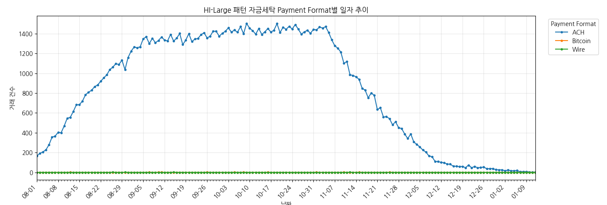

### 6.3 패턴 외 자금세탁

| Payment Format | 전체 거래 수 |
| --- | ---: |
| ACH | 61,245 |
| Bitcoin | 1,595 |
| Cash | 3,663 |
| Cheque | 13,260 |
| Credit Card | 7,846 |
| Wire | 1 |
| **전체** | **87,610** |

<details>
<summary><strong>Payment Format별 전체 일자 통계 보기 (합계 포함)</strong></summary>

<div style="max-height: 420px; overflow: auto; margin-top: 0.75rem;">
<table>
  <thead style="position: sticky; top: 0; background: white;">
    <tr>
      <th scope="col">일자</th>
      <th scope="col">ACH</th>
      <th scope="col">Bitcoin</th>
      <th scope="col">Cash</th>
      <th scope="col">Cheque</th>
      <th scope="col">Credit Card</th>
      <th scope="col">Wire</th>
      <th scope="col">전체</th>
    </tr>
  </thead>
  <tbody>
    <tr>
      <th scope="row">2022-08-01</th>
      <td align="right">476</td>
      <td align="right">17</td>
      <td align="right">53</td>
      <td align="right">183</td>
      <td align="right">113</td>
      <td align="right">0</td>
      <td align="right">842</td>
    </tr>
    <tr>
      <th scope="row">2022-08-02</th>
      <td align="right">509</td>
      <td align="right">9</td>
      <td align="right">40</td>
      <td align="right">153</td>
      <td align="right">107</td>
      <td align="right">0</td>
      <td align="right">818</td>
    </tr>
    <tr>
      <th scope="row">2022-08-03</th>
      <td align="right">494</td>
      <td align="right">17</td>
      <td align="right">37</td>
      <td align="right">161</td>
      <td align="right">87</td>
      <td align="right">0</td>
      <td align="right">796</td>
    </tr>
    <tr>
      <th scope="row">2022-08-04</th>
      <td align="right">509</td>
      <td align="right">13</td>
      <td align="right">37</td>
      <td align="right">153</td>
      <td align="right">95</td>
      <td align="right">0</td>
      <td align="right">807</td>
    </tr>
    <tr>
      <th scope="row">2022-08-05</th>
      <td align="right">525</td>
      <td align="right">16</td>
      <td align="right">55</td>
      <td align="right">208</td>
      <td align="right">123</td>
      <td align="right">0</td>
      <td align="right">927</td>
    </tr>
    <tr>
      <th scope="row">2022-08-06</th>
      <td align="right">449</td>
      <td align="right">15</td>
      <td align="right">23</td>
      <td align="right">75</td>
      <td align="right">53</td>
      <td align="right">0</td>
      <td align="right">615</td>
    </tr>
    <tr>
      <th scope="row">2022-08-07</th>
      <td align="right">490</td>
      <td align="right">11</td>
      <td align="right">17</td>
      <td align="right">52</td>
      <td align="right">36</td>
      <td align="right">0</td>
      <td align="right">606</td>
    </tr>
    <tr>
      <th scope="row">2022-08-08</th>
      <td align="right">479</td>
      <td align="right">21</td>
      <td align="right">42</td>
      <td align="right">159</td>
      <td align="right">85</td>
      <td align="right">0</td>
      <td align="right">786</td>
    </tr>
    <tr>
      <th scope="row">2022-08-09</th>
      <td align="right">527</td>
      <td align="right">14</td>
      <td align="right">45</td>
      <td align="right">150</td>
      <td align="right">90</td>
      <td align="right">0</td>
      <td align="right">826</td>
    </tr>
    <tr>
      <th scope="row">2022-08-10</th>
      <td align="right">521</td>
      <td align="right">24</td>
      <td align="right">42</td>
      <td align="right">165</td>
      <td align="right">79</td>
      <td align="right">0</td>
      <td align="right">831</td>
    </tr>
    <tr>
      <th scope="row">2022-08-11</th>
      <td align="right">494</td>
      <td align="right">20</td>
      <td align="right">40</td>
      <td align="right">155</td>
      <td align="right">93</td>
      <td align="right">0</td>
      <td align="right">802</td>
    </tr>
    <tr>
      <th scope="row">2022-08-12</th>
      <td align="right">508</td>
      <td align="right">18</td>
      <td align="right">52</td>
      <td align="right">165</td>
      <td align="right">110</td>
      <td align="right">0</td>
      <td align="right">853</td>
    </tr>
    <tr>
      <th scope="row">2022-08-13</th>
      <td align="right">515</td>
      <td align="right">20</td>
      <td align="right">12</td>
      <td align="right">71</td>
      <td align="right">45</td>
      <td align="right">0</td>
      <td align="right">663</td>
    </tr>
    <tr>
      <th scope="row">2022-08-14</th>
      <td align="right">492</td>
      <td align="right">16</td>
      <td align="right">13</td>
      <td align="right">62</td>
      <td align="right">40</td>
      <td align="right">0</td>
      <td align="right">623</td>
    </tr>
    <tr>
      <th scope="row">2022-08-15</th>
      <td align="right">526</td>
      <td align="right">17</td>
      <td align="right">34</td>
      <td align="right">153</td>
      <td align="right">105</td>
      <td align="right">0</td>
      <td align="right">835</td>
    </tr>
    <tr>
      <th scope="row">2022-08-16</th>
      <td align="right">565</td>
      <td align="right">23</td>
      <td align="right">44</td>
      <td align="right">146</td>
      <td align="right">97</td>
      <td align="right">0</td>
      <td align="right">875</td>
    </tr>
    <tr>
      <th scope="row">2022-08-17</th>
      <td align="right">500</td>
      <td align="right">16</td>
      <td align="right">38</td>
      <td align="right">154</td>
      <td align="right">81</td>
      <td align="right">0</td>
      <td align="right">789</td>
    </tr>
    <tr>
      <th scope="row">2022-08-18</th>
      <td align="right">543</td>
      <td align="right">17</td>
      <td align="right">33</td>
      <td align="right">158</td>
      <td align="right">69</td>
      <td align="right">0</td>
      <td align="right">820</td>
    </tr>
    <tr>
      <th scope="row">2022-08-19</th>
      <td align="right">536</td>
      <td align="right">19</td>
      <td align="right">59</td>
      <td align="right">209</td>
      <td align="right">134</td>
      <td align="right">0</td>
      <td align="right">957</td>
    </tr>
    <tr>
      <th scope="row">2022-08-20</th>
      <td align="right">498</td>
      <td align="right">6</td>
      <td align="right">18</td>
      <td align="right">70</td>
      <td align="right">34</td>
      <td align="right">0</td>
      <td align="right">626</td>
    </tr>
    <tr>
      <th scope="row">2022-08-21</th>
      <td align="right">533</td>
      <td align="right">11</td>
      <td align="right">19</td>
      <td align="right">63</td>
      <td align="right">33</td>
      <td align="right">0</td>
      <td align="right">659</td>
    </tr>
    <tr>
      <th scope="row">2022-08-22</th>
      <td align="right">523</td>
      <td align="right">18</td>
      <td align="right">40</td>
      <td align="right">128</td>
      <td align="right">90</td>
      <td align="right">0</td>
      <td align="right">799</td>
    </tr>
    <tr>
      <th scope="row">2022-08-23</th>
      <td align="right">529</td>
      <td align="right">15</td>
      <td align="right">47</td>
      <td align="right">161</td>
      <td align="right">84</td>
      <td align="right">0</td>
      <td align="right">836</td>
    </tr>
    <tr>
      <th scope="row">2022-08-24</th>
      <td align="right">540</td>
      <td align="right">21</td>
      <td align="right">42</td>
      <td align="right">156</td>
      <td align="right">78</td>
      <td align="right">0</td>
      <td align="right">837</td>
    </tr>
    <tr>
      <th scope="row">2022-08-25</th>
      <td align="right">569</td>
      <td align="right">13</td>
      <td align="right">35</td>
      <td align="right">169</td>
      <td align="right">83</td>
      <td align="right">0</td>
      <td align="right">869</td>
    </tr>
    <tr>
      <th scope="row">2022-08-26</th>
      <td align="right">529</td>
      <td align="right">13</td>
      <td align="right">52</td>
      <td align="right">182</td>
      <td align="right">106</td>
      <td align="right">0</td>
      <td align="right">882</td>
    </tr>
    <tr>
      <th scope="row">2022-08-27</th>
      <td align="right">565</td>
      <td align="right">11</td>
      <td align="right">17</td>
      <td align="right">46</td>
      <td align="right">29</td>
      <td align="right">0</td>
      <td align="right">668</td>
    </tr>
    <tr>
      <th scope="row">2022-08-28</th>
      <td align="right">494</td>
      <td align="right">14</td>
      <td align="right">17</td>
      <td align="right">72</td>
      <td align="right">33</td>
      <td align="right">0</td>
      <td align="right">630</td>
    </tr>
    <tr>
      <th scope="row">2022-08-29</th>
      <td align="right">536</td>
      <td align="right">8</td>
      <td align="right">41</td>
      <td align="right">153</td>
      <td align="right">80</td>
      <td align="right">0</td>
      <td align="right">818</td>
    </tr>
    <tr>
      <th scope="row">2022-08-30</th>
      <td align="right">583</td>
      <td align="right">14</td>
      <td align="right">31</td>
      <td align="right">136</td>
      <td align="right">103</td>
      <td align="right">0</td>
      <td align="right">867</td>
    </tr>
    <tr>
      <th scope="row">2022-08-31</th>
      <td align="right">592</td>
      <td align="right">15</td>
      <td align="right">52</td>
      <td align="right">204</td>
      <td align="right">97</td>
      <td align="right">0</td>
      <td align="right">960</td>
    </tr>
    <tr>
      <th scope="row">2022-09-01</th>
      <td align="right">590</td>
      <td align="right">14</td>
      <td align="right">40</td>
      <td align="right">143</td>
      <td align="right">78</td>
      <td align="right">0</td>
      <td align="right">865</td>
    </tr>
    <tr>
      <th scope="row">2022-09-02</th>
      <td align="right">605</td>
      <td align="right">20</td>
      <td align="right">73</td>
      <td align="right">201</td>
      <td align="right">125</td>
      <td align="right">1</td>
      <td align="right">1,025</td>
    </tr>
    <tr>
      <th scope="row">2022-09-03</th>
      <td align="right">601</td>
      <td align="right">9</td>
      <td align="right">29</td>
      <td align="right">71</td>
      <td align="right">34</td>
      <td align="right">0</td>
      <td align="right">744</td>
    </tr>
    <tr>
      <th scope="row">2022-09-04</th>
      <td align="right">600</td>
      <td align="right">17</td>
      <td align="right">12</td>
      <td align="right">60</td>
      <td align="right">40</td>
      <td align="right">0</td>
      <td align="right">729</td>
    </tr>
    <tr>
      <th scope="row">2022-09-05</th>
      <td align="right">542</td>
      <td align="right">16</td>
      <td align="right">56</td>
      <td align="right">162</td>
      <td align="right">91</td>
      <td align="right">0</td>
      <td align="right">867</td>
    </tr>
    <tr>
      <th scope="row">2022-09-06</th>
      <td align="right">606</td>
      <td align="right">16</td>
      <td align="right">50</td>
      <td align="right">157</td>
      <td align="right">98</td>
      <td align="right">0</td>
      <td align="right">927</td>
    </tr>
    <tr>
      <th scope="row">2022-09-07</th>
      <td align="right">582</td>
      <td align="right">19</td>
      <td align="right">40</td>
      <td align="right">138</td>
      <td align="right">91</td>
      <td align="right">0</td>
      <td align="right">870</td>
    </tr>
    <tr>
      <th scope="row">2022-09-08</th>
      <td align="right">645</td>
      <td align="right">14</td>
      <td align="right">56</td>
      <td align="right">160</td>
      <td align="right">93</td>
      <td align="right">0</td>
      <td align="right">968</td>
    </tr>
    <tr>
      <th scope="row">2022-09-09</th>
      <td align="right">620</td>
      <td align="right">19</td>
      <td align="right">49</td>
      <td align="right">209</td>
      <td align="right">96</td>
      <td align="right">0</td>
      <td align="right">993</td>
    </tr>
    <tr>
      <th scope="row">2022-09-10</th>
      <td align="right">620</td>
      <td align="right">14</td>
      <td align="right">21</td>
      <td align="right">62</td>
      <td align="right">33</td>
      <td align="right">0</td>
      <td align="right">750</td>
    </tr>
    <tr>
      <th scope="row">2022-09-11</th>
      <td align="right">579</td>
      <td align="right">8</td>
      <td align="right">19</td>
      <td align="right">69</td>
      <td align="right">36</td>
      <td align="right">0</td>
      <td align="right">711</td>
    </tr>
    <tr>
      <th scope="row">2022-09-12</th>
      <td align="right">654</td>
      <td align="right">12</td>
      <td align="right">45</td>
      <td align="right">126</td>
      <td align="right">82</td>
      <td align="right">0</td>
      <td align="right">919</td>
    </tr>
    <tr>
      <th scope="row">2022-09-13</th>
      <td align="right">594</td>
      <td align="right">20</td>
      <td align="right">45</td>
      <td align="right">162</td>
      <td align="right">117</td>
      <td align="right">0</td>
      <td align="right">938</td>
    </tr>
    <tr>
      <th scope="row">2022-09-14</th>
      <td align="right">631</td>
      <td align="right">12</td>
      <td align="right">59</td>
      <td align="right">150</td>
      <td align="right">81</td>
      <td align="right">0</td>
      <td align="right">933</td>
    </tr>
    <tr>
      <th scope="row">2022-09-15</th>
      <td align="right">586</td>
      <td align="right">13</td>
      <td align="right">47</td>
      <td align="right">164</td>
      <td align="right">85</td>
      <td align="right">0</td>
      <td align="right">895</td>
    </tr>
    <tr>
      <th scope="row">2022-09-16</th>
      <td align="right">637</td>
      <td align="right">16</td>
      <td align="right">74</td>
      <td align="right">192</td>
      <td align="right">110</td>
      <td align="right">0</td>
      <td align="right">1,029</td>
    </tr>
    <tr>
      <th scope="row">2022-09-17</th>
      <td align="right">619</td>
      <td align="right">13</td>
      <td align="right">14</td>
      <td align="right">68</td>
      <td align="right">35</td>
      <td align="right">0</td>
      <td align="right">749</td>
    </tr>
    <tr>
      <th scope="row">2022-09-18</th>
      <td align="right">668</td>
      <td align="right">14</td>
      <td align="right">16</td>
      <td align="right">73</td>
      <td align="right">31</td>
      <td align="right">0</td>
      <td align="right">802</td>
    </tr>
    <tr>
      <th scope="row">2022-09-19</th>
      <td align="right">649</td>
      <td align="right">16</td>
      <td align="right">34</td>
      <td align="right">146</td>
      <td align="right">103</td>
      <td align="right">0</td>
      <td align="right">948</td>
    </tr>
    <tr>
      <th scope="row">2022-09-20</th>
      <td align="right">634</td>
      <td align="right">13</td>
      <td align="right">46</td>
      <td align="right">148</td>
      <td align="right">92</td>
      <td align="right">0</td>
      <td align="right">933</td>
    </tr>
    <tr>
      <th scope="row">2022-09-21</th>
      <td align="right">676</td>
      <td align="right">21</td>
      <td align="right">49</td>
      <td align="right">153</td>
      <td align="right">81</td>
      <td align="right">0</td>
      <td align="right">980</td>
    </tr>
    <tr>
      <th scope="row">2022-09-22</th>
      <td align="right">622</td>
      <td align="right">11</td>
      <td align="right">46</td>
      <td align="right">189</td>
      <td align="right">84</td>
      <td align="right">0</td>
      <td align="right">952</td>
    </tr>
    <tr>
      <th scope="row">2022-09-23</th>
      <td align="right">651</td>
      <td align="right">17</td>
      <td align="right">48</td>
      <td align="right">189</td>
      <td align="right">107</td>
      <td align="right">0</td>
      <td align="right">1,012</td>
    </tr>
    <tr>
      <th scope="row">2022-09-24</th>
      <td align="right">644</td>
      <td align="right">9</td>
      <td align="right">15</td>
      <td align="right">54</td>
      <td align="right">44</td>
      <td align="right">0</td>
      <td align="right">766</td>
    </tr>
    <tr>
      <th scope="row">2022-09-25</th>
      <td align="right">643</td>
      <td align="right">11</td>
      <td align="right">26</td>
      <td align="right">65</td>
      <td align="right">45</td>
      <td align="right">0</td>
      <td align="right">790</td>
    </tr>
    <tr>
      <th scope="row">2022-09-26</th>
      <td align="right">645</td>
      <td align="right">22</td>
      <td align="right">56</td>
      <td align="right">135</td>
      <td align="right">92</td>
      <td align="right">0</td>
      <td align="right">950</td>
    </tr>
    <tr>
      <th scope="row">2022-09-27</th>
      <td align="right">640</td>
      <td align="right">19</td>
      <td align="right">35</td>
      <td align="right">156</td>
      <td align="right">89</td>
      <td align="right">0</td>
      <td align="right">939</td>
    </tr>
    <tr>
      <th scope="row">2022-09-28</th>
      <td align="right">643</td>
      <td align="right">12</td>
      <td align="right">58</td>
      <td align="right">158</td>
      <td align="right">89</td>
      <td align="right">0</td>
      <td align="right">960</td>
    </tr>
    <tr>
      <th scope="row">2022-09-29</th>
      <td align="right">662</td>
      <td align="right">8</td>
      <td align="right">34</td>
      <td align="right">114</td>
      <td align="right">99</td>
      <td align="right">0</td>
      <td align="right">917</td>
    </tr>
    <tr>
      <th scope="row">2022-09-30</th>
      <td align="right">708</td>
      <td align="right">21</td>
      <td align="right">71</td>
      <td align="right">231</td>
      <td align="right">142</td>
      <td align="right">0</td>
      <td align="right">1,173</td>
    </tr>
    <tr>
      <th scope="row">2022-10-01</th>
      <td align="right">686</td>
      <td align="right">19</td>
      <td align="right">16</td>
      <td align="right">70</td>
      <td align="right">42</td>
      <td align="right">0</td>
      <td align="right">833</td>
    </tr>
    <tr>
      <th scope="row">2022-10-02</th>
      <td align="right">674</td>
      <td align="right">13</td>
      <td align="right">17</td>
      <td align="right">66</td>
      <td align="right">34</td>
      <td align="right">0</td>
      <td align="right">804</td>
    </tr>
    <tr>
      <th scope="row">2022-10-03</th>
      <td align="right">696</td>
      <td align="right">17</td>
      <td align="right">32</td>
      <td align="right">155</td>
      <td align="right">86</td>
      <td align="right">0</td>
      <td align="right">986</td>
    </tr>
    <tr>
      <th scope="row">2022-10-04</th>
      <td align="right">711</td>
      <td align="right">16</td>
      <td align="right">36</td>
      <td align="right">172</td>
      <td align="right">89</td>
      <td align="right">0</td>
      <td align="right">1,024</td>
    </tr>
    <tr>
      <th scope="row">2022-10-05</th>
      <td align="right">709</td>
      <td align="right">19</td>
      <td align="right">41</td>
      <td align="right">157</td>
      <td align="right">103</td>
      <td align="right">0</td>
      <td align="right">1,029</td>
    </tr>
    <tr>
      <th scope="row">2022-10-06</th>
      <td align="right">678</td>
      <td align="right">19</td>
      <td align="right">46</td>
      <td align="right">124</td>
      <td align="right">104</td>
      <td align="right">0</td>
      <td align="right">971</td>
    </tr>
    <tr>
      <th scope="row">2022-10-07</th>
      <td align="right">709</td>
      <td align="right">21</td>
      <td align="right">60</td>
      <td align="right">203</td>
      <td align="right">108</td>
      <td align="right">0</td>
      <td align="right">1,101</td>
    </tr>
    <tr>
      <th scope="row">2022-10-08</th>
      <td align="right">665</td>
      <td align="right">19</td>
      <td align="right">11</td>
      <td align="right">72</td>
      <td align="right">45</td>
      <td align="right">0</td>
      <td align="right">812</td>
    </tr>
    <tr>
      <th scope="row">2022-10-09</th>
      <td align="right">688</td>
      <td align="right">20</td>
      <td align="right">13</td>
      <td align="right">78</td>
      <td align="right">32</td>
      <td align="right">0</td>
      <td align="right">831</td>
    </tr>
    <tr>
      <th scope="row">2022-10-10</th>
      <td align="right">722</td>
      <td align="right">16</td>
      <td align="right">43</td>
      <td align="right">159</td>
      <td align="right">97</td>
      <td align="right">0</td>
      <td align="right">1,037</td>
    </tr>
    <tr>
      <th scope="row">2022-10-11</th>
      <td align="right">683</td>
      <td align="right">21</td>
      <td align="right">44</td>
      <td align="right">151</td>
      <td align="right">96</td>
      <td align="right">0</td>
      <td align="right">995</td>
    </tr>
    <tr>
      <th scope="row">2022-10-12</th>
      <td align="right">754</td>
      <td align="right">13</td>
      <td align="right">44</td>
      <td align="right">141</td>
      <td align="right">107</td>
      <td align="right">0</td>
      <td align="right">1,059</td>
    </tr>
    <tr>
      <th scope="row">2022-10-13</th>
      <td align="right">717</td>
      <td align="right">18</td>
      <td align="right">36</td>
      <td align="right">150</td>
      <td align="right">94</td>
      <td align="right">0</td>
      <td align="right">1,015</td>
    </tr>
    <tr>
      <th scope="row">2022-10-14</th>
      <td align="right">738</td>
      <td align="right">19</td>
      <td align="right">57</td>
      <td align="right">204</td>
      <td align="right">126</td>
      <td align="right">0</td>
      <td align="right">1,144</td>
    </tr>
    <tr>
      <th scope="row">2022-10-15</th>
      <td align="right">737</td>
      <td align="right">16</td>
      <td align="right">20</td>
      <td align="right">61</td>
      <td align="right">39</td>
      <td align="right">0</td>
      <td align="right">873</td>
    </tr>
    <tr>
      <th scope="row">2022-10-16</th>
      <td align="right">691</td>
      <td align="right">22</td>
      <td align="right">7</td>
      <td align="right">63</td>
      <td align="right">35</td>
      <td align="right">0</td>
      <td align="right">818</td>
    </tr>
    <tr>
      <th scope="row">2022-10-17</th>
      <td align="right">749</td>
      <td align="right">16</td>
      <td align="right">41</td>
      <td align="right">153</td>
      <td align="right">98</td>
      <td align="right">0</td>
      <td align="right">1,057</td>
    </tr>
    <tr>
      <th scope="row">2022-10-18</th>
      <td align="right">662</td>
      <td align="right">12</td>
      <td align="right">40</td>
      <td align="right">142</td>
      <td align="right">83</td>
      <td align="right">0</td>
      <td align="right">939</td>
    </tr>
    <tr>
      <th scope="row">2022-10-19</th>
      <td align="right">680</td>
      <td align="right">25</td>
      <td align="right">36</td>
      <td align="right">139</td>
      <td align="right">91</td>
      <td align="right">0</td>
      <td align="right">971</td>
    </tr>
    <tr>
      <th scope="row">2022-10-20</th>
      <td align="right">758</td>
      <td align="right">20</td>
      <td align="right">43</td>
      <td align="right">150</td>
      <td align="right">101</td>
      <td align="right">0</td>
      <td align="right">1,072</td>
    </tr>
    <tr>
      <th scope="row">2022-10-21</th>
      <td align="right">793</td>
      <td align="right">15</td>
      <td align="right">47</td>
      <td align="right">189</td>
      <td align="right">126</td>
      <td align="right">0</td>
      <td align="right">1,170</td>
    </tr>
    <tr>
      <th scope="row">2022-10-22</th>
      <td align="right">718</td>
      <td align="right">14</td>
      <td align="right">19</td>
      <td align="right">65</td>
      <td align="right">29</td>
      <td align="right">0</td>
      <td align="right">845</td>
    </tr>
    <tr>
      <th scope="row">2022-10-23</th>
      <td align="right">711</td>
      <td align="right">18</td>
      <td align="right">24</td>
      <td align="right">66</td>
      <td align="right">35</td>
      <td align="right">0</td>
      <td align="right">854</td>
    </tr>
    <tr>
      <th scope="row">2022-10-24</th>
      <td align="right">730</td>
      <td align="right">15</td>
      <td align="right">46</td>
      <td align="right">172</td>
      <td align="right">94</td>
      <td align="right">0</td>
      <td align="right">1,057</td>
    </tr>
    <tr>
      <th scope="row">2022-10-25</th>
      <td align="right">785</td>
      <td align="right">20</td>
      <td align="right">38</td>
      <td align="right">158</td>
      <td align="right">102</td>
      <td align="right">0</td>
      <td align="right">1,103</td>
    </tr>
    <tr>
      <th scope="row">2022-10-26</th>
      <td align="right">728</td>
      <td align="right">16</td>
      <td align="right">43</td>
      <td align="right">161</td>
      <td align="right">89</td>
      <td align="right">0</td>
      <td align="right">1,037</td>
    </tr>
    <tr>
      <th scope="row">2022-10-27</th>
      <td align="right">763</td>
      <td align="right">18</td>
      <td align="right">46</td>
      <td align="right">180</td>
      <td align="right">92</td>
      <td align="right">0</td>
      <td align="right">1,099</td>
    </tr>
    <tr>
      <th scope="row">2022-10-28</th>
      <td align="right">748</td>
      <td align="right">23</td>
      <td align="right">65</td>
      <td align="right">197</td>
      <td align="right">124</td>
      <td align="right">0</td>
      <td align="right">1,157</td>
    </tr>
    <tr>
      <th scope="row">2022-10-29</th>
      <td align="right">771</td>
      <td align="right">16</td>
      <td align="right">11</td>
      <td align="right">86</td>
      <td align="right">43</td>
      <td align="right">0</td>
      <td align="right">927</td>
    </tr>
    <tr>
      <th scope="row">2022-10-30</th>
      <td align="right">791</td>
      <td align="right">18</td>
      <td align="right">24</td>
      <td align="right">91</td>
      <td align="right">61</td>
      <td align="right">0</td>
      <td align="right">985</td>
    </tr>
    <tr>
      <th scope="row">2022-10-31</th>
      <td align="right">777</td>
      <td align="right">20</td>
      <td align="right">36</td>
      <td align="right">159</td>
      <td align="right">107</td>
      <td align="right">0</td>
      <td align="right">1,099</td>
    </tr>
    <tr>
      <th scope="row">2022-11-01</th>
      <td align="right">787</td>
      <td align="right">23</td>
      <td align="right">32</td>
      <td align="right">145</td>
      <td align="right">93</td>
      <td align="right">0</td>
      <td align="right">1,080</td>
    </tr>
    <tr>
      <th scope="row">2022-11-02</th>
      <td align="right">791</td>
      <td align="right">25</td>
      <td align="right">38</td>
      <td align="right">167</td>
      <td align="right">98</td>
      <td align="right">0</td>
      <td align="right">1,119</td>
    </tr>
    <tr>
      <th scope="row">2022-11-03</th>
      <td align="right">722</td>
      <td align="right">26</td>
      <td align="right">39</td>
      <td align="right">168</td>
      <td align="right">86</td>
      <td align="right">0</td>
      <td align="right">1,041</td>
    </tr>
    <tr>
      <th scope="row">2022-11-04</th>
      <td align="right">813</td>
      <td align="right">21</td>
      <td align="right">58</td>
      <td align="right">193</td>
      <td align="right">111</td>
      <td align="right">0</td>
      <td align="right">1,196</td>
    </tr>
    <tr>
      <th scope="row">2022-11-05</th>
      <td align="right">765</td>
      <td align="right">18</td>
      <td align="right">24</td>
      <td align="right">76</td>
      <td align="right">31</td>
      <td align="right">0</td>
      <td align="right">914</td>
    </tr>
    <tr>
      <th scope="row">2022-11-06</th>
      <td align="right">0</td>
      <td align="right">0</td>
      <td align="right">0</td>
      <td align="right">0</td>
      <td align="right">0</td>
      <td align="right">0</td>
      <td align="right">0</td>
    </tr>
    <tr>
      <th scope="row">2022-11-07</th>
      <td align="right">0</td>
      <td align="right">0</td>
      <td align="right">0</td>
      <td align="right">0</td>
      <td align="right">0</td>
      <td align="right">0</td>
      <td align="right">0</td>
    </tr>
    <tr>
      <th scope="row">2022-11-08</th>
      <td align="right">0</td>
      <td align="right">0</td>
      <td align="right">0</td>
      <td align="right">0</td>
      <td align="right">0</td>
      <td align="right">0</td>
      <td align="right">0</td>
    </tr>
    <tr>
      <th scope="row">2022-11-09</th>
      <td align="right">0</td>
      <td align="right">0</td>
      <td align="right">0</td>
      <td align="right">0</td>
      <td align="right">0</td>
      <td align="right">0</td>
      <td align="right">0</td>
    </tr>
    <tr>
      <th scope="row">2022-11-10</th>
      <td align="right">0</td>
      <td align="right">0</td>
      <td align="right">0</td>
      <td align="right">0</td>
      <td align="right">0</td>
      <td align="right">0</td>
      <td align="right">0</td>
    </tr>
    <tr>
      <th scope="row">2022-11-11</th>
      <td align="right">0</td>
      <td align="right">0</td>
      <td align="right">0</td>
      <td align="right">0</td>
      <td align="right">0</td>
      <td align="right">0</td>
      <td align="right">0</td>
    </tr>
    <tr>
      <th scope="row">2022-11-12</th>
      <td align="right">0</td>
      <td align="right">0</td>
      <td align="right">0</td>
      <td align="right">0</td>
      <td align="right">0</td>
      <td align="right">0</td>
      <td align="right">0</td>
    </tr>
    <tr>
      <th scope="row">2022-11-13</th>
      <td align="right">0</td>
      <td align="right">0</td>
      <td align="right">0</td>
      <td align="right">0</td>
      <td align="right">0</td>
      <td align="right">0</td>
      <td align="right">0</td>
    </tr>
    <tr>
      <th scope="row">2022-11-14</th>
      <td align="right">0</td>
      <td align="right">0</td>
      <td align="right">0</td>
      <td align="right">0</td>
      <td align="right">0</td>
      <td align="right">0</td>
      <td align="right">0</td>
    </tr>
    <tr>
      <th scope="row">2022-11-15</th>
      <td align="right">0</td>
      <td align="right">0</td>
      <td align="right">0</td>
      <td align="right">0</td>
      <td align="right">0</td>
      <td align="right">0</td>
      <td align="right">0</td>
    </tr>
    <tr>
      <th scope="row">2022-11-16</th>
      <td align="right">0</td>
      <td align="right">0</td>
      <td align="right">0</td>
      <td align="right">0</td>
      <td align="right">0</td>
      <td align="right">0</td>
      <td align="right">0</td>
    </tr>
    <tr>
      <th scope="row">2022-11-17</th>
      <td align="right">0</td>
      <td align="right">0</td>
      <td align="right">0</td>
      <td align="right">0</td>
      <td align="right">0</td>
      <td align="right">0</td>
      <td align="right">0</td>
    </tr>
    <tr>
      <th scope="row">2022-11-18</th>
      <td align="right">0</td>
      <td align="right">0</td>
      <td align="right">0</td>
      <td align="right">0</td>
      <td align="right">0</td>
      <td align="right">0</td>
      <td align="right">0</td>
    </tr>
    <tr>
      <th scope="row">2022-11-19</th>
      <td align="right">0</td>
      <td align="right">0</td>
      <td align="right">0</td>
      <td align="right">0</td>
      <td align="right">0</td>
      <td align="right">0</td>
      <td align="right">0</td>
    </tr>
    <tr>
      <th scope="row">2022-11-20</th>
      <td align="right">0</td>
      <td align="right">0</td>
      <td align="right">0</td>
      <td align="right">0</td>
      <td align="right">0</td>
      <td align="right">0</td>
      <td align="right">0</td>
    </tr>
    <tr>
      <th scope="row">2022-11-21</th>
      <td align="right">0</td>
      <td align="right">0</td>
      <td align="right">0</td>
      <td align="right">0</td>
      <td align="right">0</td>
      <td align="right">0</td>
      <td align="right">0</td>
    </tr>
    <tr>
      <th scope="row">2022-11-22</th>
      <td align="right">0</td>
      <td align="right">0</td>
      <td align="right">0</td>
      <td align="right">0</td>
      <td align="right">0</td>
      <td align="right">0</td>
      <td align="right">0</td>
    </tr>
    <tr>
      <th scope="row">2022-11-23</th>
      <td align="right">0</td>
      <td align="right">0</td>
      <td align="right">0</td>
      <td align="right">0</td>
      <td align="right">0</td>
      <td align="right">0</td>
      <td align="right">0</td>
    </tr>
    <tr>
      <th scope="row">2022-11-24</th>
      <td align="right">0</td>
      <td align="right">0</td>
      <td align="right">0</td>
      <td align="right">0</td>
      <td align="right">0</td>
      <td align="right">0</td>
      <td align="right">0</td>
    </tr>
    <tr>
      <th scope="row">2022-11-25</th>
      <td align="right">0</td>
      <td align="right">0</td>
      <td align="right">0</td>
      <td align="right">0</td>
      <td align="right">0</td>
      <td align="right">0</td>
      <td align="right">0</td>
    </tr>
    <tr>
      <th scope="row">2022-11-26</th>
      <td align="right">0</td>
      <td align="right">0</td>
      <td align="right">0</td>
      <td align="right">0</td>
      <td align="right">0</td>
      <td align="right">0</td>
      <td align="right">0</td>
    </tr>
    <tr>
      <th scope="row">2022-11-27</th>
      <td align="right">0</td>
      <td align="right">0</td>
      <td align="right">0</td>
      <td align="right">0</td>
      <td align="right">0</td>
      <td align="right">0</td>
      <td align="right">0</td>
    </tr>
    <tr>
      <th scope="row">2022-11-28</th>
      <td align="right">0</td>
      <td align="right">0</td>
      <td align="right">0</td>
      <td align="right">0</td>
      <td align="right">0</td>
      <td align="right">0</td>
      <td align="right">0</td>
    </tr>
    <tr>
      <th scope="row">2022-11-29</th>
      <td align="right">0</td>
      <td align="right">0</td>
      <td align="right">0</td>
      <td align="right">0</td>
      <td align="right">0</td>
      <td align="right">0</td>
      <td align="right">0</td>
    </tr>
    <tr>
      <th scope="row">2022-11-30</th>
      <td align="right">0</td>
      <td align="right">0</td>
      <td align="right">0</td>
      <td align="right">0</td>
      <td align="right">0</td>
      <td align="right">0</td>
      <td align="right">0</td>
    </tr>
    <tr>
      <th scope="row">2022-12-01</th>
      <td align="right">0</td>
      <td align="right">0</td>
      <td align="right">0</td>
      <td align="right">0</td>
      <td align="right">0</td>
      <td align="right">0</td>
      <td align="right">0</td>
    </tr>
    <tr>
      <th scope="row">2022-12-02</th>
      <td align="right">0</td>
      <td align="right">0</td>
      <td align="right">0</td>
      <td align="right">0</td>
      <td align="right">0</td>
      <td align="right">0</td>
      <td align="right">0</td>
    </tr>
    <tr>
      <th scope="row">2022-12-03</th>
      <td align="right">0</td>
      <td align="right">0</td>
      <td align="right">0</td>
      <td align="right">0</td>
      <td align="right">0</td>
      <td align="right">0</td>
      <td align="right">0</td>
    </tr>
    <tr>
      <th scope="row">2022-12-04</th>
      <td align="right">0</td>
      <td align="right">0</td>
      <td align="right">0</td>
      <td align="right">0</td>
      <td align="right">0</td>
      <td align="right">0</td>
      <td align="right">0</td>
    </tr>
    <tr>
      <th scope="row">2022-12-05</th>
      <td align="right">0</td>
      <td align="right">0</td>
      <td align="right">0</td>
      <td align="right">0</td>
      <td align="right">0</td>
      <td align="right">0</td>
      <td align="right">0</td>
    </tr>
    <tr>
      <th scope="row">2022-12-06</th>
      <td align="right">0</td>
      <td align="right">0</td>
      <td align="right">0</td>
      <td align="right">0</td>
      <td align="right">0</td>
      <td align="right">0</td>
      <td align="right">0</td>
    </tr>
    <tr>
      <th scope="row">2022-12-07</th>
      <td align="right">0</td>
      <td align="right">0</td>
      <td align="right">0</td>
      <td align="right">0</td>
      <td align="right">0</td>
      <td align="right">0</td>
      <td align="right">0</td>
    </tr>
    <tr>
      <th scope="row">2022-12-08</th>
      <td align="right">0</td>
      <td align="right">0</td>
      <td align="right">0</td>
      <td align="right">0</td>
      <td align="right">0</td>
      <td align="right">0</td>
      <td align="right">0</td>
    </tr>
    <tr>
      <th scope="row">2022-12-09</th>
      <td align="right">0</td>
      <td align="right">0</td>
      <td align="right">0</td>
      <td align="right">0</td>
      <td align="right">0</td>
      <td align="right">0</td>
      <td align="right">0</td>
    </tr>
    <tr>
      <th scope="row">2022-12-10</th>
      <td align="right">0</td>
      <td align="right">0</td>
      <td align="right">0</td>
      <td align="right">0</td>
      <td align="right">0</td>
      <td align="right">0</td>
      <td align="right">0</td>
    </tr>
    <tr>
      <th scope="row">2022-12-11</th>
      <td align="right">0</td>
      <td align="right">0</td>
      <td align="right">0</td>
      <td align="right">0</td>
      <td align="right">0</td>
      <td align="right">0</td>
      <td align="right">0</td>
    </tr>
    <tr>
      <th scope="row">2022-12-12</th>
      <td align="right">0</td>
      <td align="right">0</td>
      <td align="right">0</td>
      <td align="right">0</td>
      <td align="right">0</td>
      <td align="right">0</td>
      <td align="right">0</td>
    </tr>
    <tr>
      <th scope="row">2022-12-13</th>
      <td align="right">0</td>
      <td align="right">0</td>
      <td align="right">0</td>
      <td align="right">0</td>
      <td align="right">0</td>
      <td align="right">0</td>
      <td align="right">0</td>
    </tr>
    <tr>
      <th scope="row">2022-12-14</th>
      <td align="right">0</td>
      <td align="right">0</td>
      <td align="right">0</td>
      <td align="right">0</td>
      <td align="right">0</td>
      <td align="right">0</td>
      <td align="right">0</td>
    </tr>
    <tr>
      <th scope="row">2022-12-15</th>
      <td align="right">0</td>
      <td align="right">0</td>
      <td align="right">0</td>
      <td align="right">0</td>
      <td align="right">0</td>
      <td align="right">0</td>
      <td align="right">0</td>
    </tr>
    <tr>
      <th scope="row">2022-12-16</th>
      <td align="right">0</td>
      <td align="right">0</td>
      <td align="right">0</td>
      <td align="right">0</td>
      <td align="right">0</td>
      <td align="right">0</td>
      <td align="right">0</td>
    </tr>
    <tr>
      <th scope="row">2022-12-17</th>
      <td align="right">0</td>
      <td align="right">0</td>
      <td align="right">0</td>
      <td align="right">0</td>
      <td align="right">0</td>
      <td align="right">0</td>
      <td align="right">0</td>
    </tr>
    <tr>
      <th scope="row">2022-12-18</th>
      <td align="right">0</td>
      <td align="right">0</td>
      <td align="right">0</td>
      <td align="right">0</td>
      <td align="right">0</td>
      <td align="right">0</td>
      <td align="right">0</td>
    </tr>
    <tr>
      <th scope="row">2022-12-19</th>
      <td align="right">0</td>
      <td align="right">0</td>
      <td align="right">0</td>
      <td align="right">0</td>
      <td align="right">0</td>
      <td align="right">0</td>
      <td align="right">0</td>
    </tr>
    <tr>
      <th scope="row">2022-12-20</th>
      <td align="right">0</td>
      <td align="right">0</td>
      <td align="right">0</td>
      <td align="right">0</td>
      <td align="right">0</td>
      <td align="right">0</td>
      <td align="right">0</td>
    </tr>
    <tr>
      <th scope="row">2022-12-21</th>
      <td align="right">0</td>
      <td align="right">0</td>
      <td align="right">0</td>
      <td align="right">0</td>
      <td align="right">0</td>
      <td align="right">0</td>
      <td align="right">0</td>
    </tr>
    <tr>
      <th scope="row">2022-12-22</th>
      <td align="right">0</td>
      <td align="right">0</td>
      <td align="right">0</td>
      <td align="right">0</td>
      <td align="right">0</td>
      <td align="right">0</td>
      <td align="right">0</td>
    </tr>
    <tr>
      <th scope="row">2022-12-23</th>
      <td align="right">0</td>
      <td align="right">0</td>
      <td align="right">0</td>
      <td align="right">0</td>
      <td align="right">0</td>
      <td align="right">0</td>
      <td align="right">0</td>
    </tr>
    <tr>
      <th scope="row">2022-12-24</th>
      <td align="right">0</td>
      <td align="right">0</td>
      <td align="right">0</td>
      <td align="right">0</td>
      <td align="right">0</td>
      <td align="right">0</td>
      <td align="right">0</td>
    </tr>
    <tr>
      <th scope="row">2022-12-25</th>
      <td align="right">0</td>
      <td align="right">0</td>
      <td align="right">0</td>
      <td align="right">0</td>
      <td align="right">0</td>
      <td align="right">0</td>
      <td align="right">0</td>
    </tr>
    <tr>
      <th scope="row">2022-12-26</th>
      <td align="right">0</td>
      <td align="right">0</td>
      <td align="right">0</td>
      <td align="right">0</td>
      <td align="right">0</td>
      <td align="right">0</td>
      <td align="right">0</td>
    </tr>
    <tr>
      <th scope="row">2022-12-27</th>
      <td align="right">0</td>
      <td align="right">0</td>
      <td align="right">0</td>
      <td align="right">0</td>
      <td align="right">0</td>
      <td align="right">0</td>
      <td align="right">0</td>
    </tr>
    <tr>
      <th scope="row">2022-12-28</th>
      <td align="right">0</td>
      <td align="right">0</td>
      <td align="right">0</td>
      <td align="right">0</td>
      <td align="right">0</td>
      <td align="right">0</td>
      <td align="right">0</td>
    </tr>
    <tr>
      <th scope="row">2022-12-29</th>
      <td align="right">0</td>
      <td align="right">0</td>
      <td align="right">0</td>
      <td align="right">0</td>
      <td align="right">0</td>
      <td align="right">0</td>
      <td align="right">0</td>
    </tr>
    <tr>
      <th scope="row">2022-12-30</th>
      <td align="right">0</td>
      <td align="right">0</td>
      <td align="right">0</td>
      <td align="right">0</td>
      <td align="right">0</td>
      <td align="right">0</td>
      <td align="right">0</td>
    </tr>
    <tr>
      <th scope="row">2022-12-31</th>
      <td align="right">0</td>
      <td align="right">0</td>
      <td align="right">0</td>
      <td align="right">0</td>
      <td align="right">0</td>
      <td align="right">0</td>
      <td align="right">0</td>
    </tr>
    <tr>
      <th scope="row">2023-01-01</th>
      <td align="right">0</td>
      <td align="right">0</td>
      <td align="right">0</td>
      <td align="right">0</td>
      <td align="right">0</td>
      <td align="right">0</td>
      <td align="right">0</td>
    </tr>
    <tr>
      <th scope="row">2023-01-02</th>
      <td align="right">0</td>
      <td align="right">0</td>
      <td align="right">0</td>
      <td align="right">0</td>
      <td align="right">0</td>
      <td align="right">0</td>
      <td align="right">0</td>
    </tr>
    <tr>
      <th scope="row">2023-01-03</th>
      <td align="right">0</td>
      <td align="right">0</td>
      <td align="right">0</td>
      <td align="right">0</td>
      <td align="right">0</td>
      <td align="right">0</td>
      <td align="right">0</td>
    </tr>
    <tr>
      <th scope="row">2023-01-04</th>
      <td align="right">0</td>
      <td align="right">0</td>
      <td align="right">0</td>
      <td align="right">0</td>
      <td align="right">0</td>
      <td align="right">0</td>
      <td align="right">0</td>
    </tr>
    <tr>
      <th scope="row">2023-01-05</th>
      <td align="right">0</td>
      <td align="right">0</td>
      <td align="right">0</td>
      <td align="right">0</td>
      <td align="right">0</td>
      <td align="right">0</td>
      <td align="right">0</td>
    </tr>
    <tr>
      <th scope="row">2023-01-06</th>
      <td align="right">0</td>
      <td align="right">0</td>
      <td align="right">0</td>
      <td align="right">0</td>
      <td align="right">0</td>
      <td align="right">0</td>
      <td align="right">0</td>
    </tr>
    <tr>
      <th scope="row">2023-01-07</th>
      <td align="right">0</td>
      <td align="right">0</td>
      <td align="right">0</td>
      <td align="right">0</td>
      <td align="right">0</td>
      <td align="right">0</td>
      <td align="right">0</td>
    </tr>
    <tr>
      <th scope="row">2023-01-08</th>
      <td align="right">0</td>
      <td align="right">0</td>
      <td align="right">0</td>
      <td align="right">0</td>
      <td align="right">0</td>
      <td align="right">0</td>
      <td align="right">0</td>
    </tr>
    <tr>
      <th scope="row">2023-01-09</th>
      <td align="right">0</td>
      <td align="right">0</td>
      <td align="right">0</td>
      <td align="right">0</td>
      <td align="right">0</td>
      <td align="right">0</td>
      <td align="right">0</td>
    </tr>
    <tr>
      <th scope="row">2023-01-10</th>
      <td align="right">0</td>
      <td align="right">0</td>
      <td align="right">0</td>
      <td align="right">0</td>
      <td align="right">0</td>
      <td align="right">0</td>
      <td align="right">0</td>
    </tr>
    <tr>
      <th scope="row">2023-01-11</th>
      <td align="right">0</td>
      <td align="right">0</td>
      <td align="right">0</td>
      <td align="right">0</td>
      <td align="right">0</td>
      <td align="right">0</td>
      <td align="right">0</td>
    </tr>
    <tr>
      <th scope="row">2023-01-12</th>
      <td align="right">0</td>
      <td align="right">0</td>
      <td align="right">0</td>
      <td align="right">0</td>
      <td align="right">0</td>
      <td align="right">0</td>
      <td align="right">0</td>
    </tr>
    <tr style="font-weight: 700;">
      <th scope="row">전체</th>
      <td align="right">61,245</td>
      <td align="right">1,595</td>
      <td align="right">3,663</td>
      <td align="right">13,260</td>
      <td align="right">7,846</td>
      <td align="right">1</td>
      <td align="right">87,610</td>
    </tr>
  </tbody>
</table>
</div>
</details>

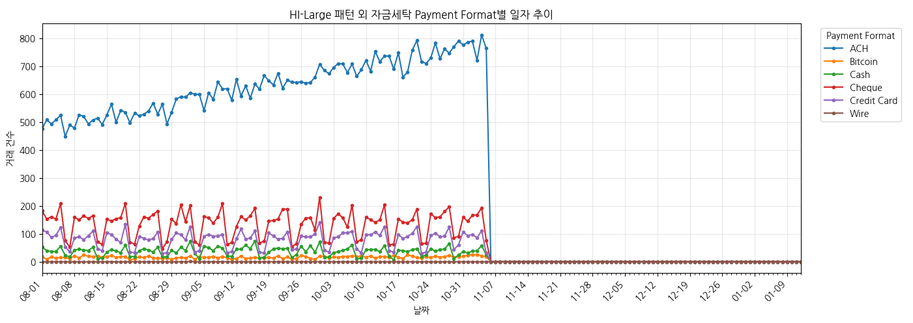

## 7. 통화별 자금세탁 거래 통계

| 항목 | 확인 결과 | 의미 |
|---|---|---|
| 통화 | 15종, 통화 변경 거래 2,797,318건 | 원금액을 통화 구분 없이 합산하면 안 됨 |

| 송금 통화 | 수취 통화 | 전체 거래 수 | 자금세탁 거래 수(라벨 1) |
| --- | --- | ---: | ---: |
| 미국 달러 (US Dollar) | 미국 달러 (US Dollar) | 64,350,622 | 90,439 |
| 유로 (Euro) | 유로 (Euro) | 40,606,576 | 63,086 |
| 위안 (Yuan) | 위안 (Yuan) | 12,704,822 | 17,468 |
| 셰켈 (Shekel) | 셰켈 (Shekel) | 7,928,960 | 4,615 |
| 캐나다 달러 (Canadian Dollar) | 캐나다 달러 (Canadian Dollar) | 6,043,417 | 3,532 |
| 영국 파운드 (UK Pound) | 영국 파운드 (UK Pound) | 5,651,676 | 10,221 |
| 루블 (Ruble) | 루블 (Ruble) | 5,478,283 | 9,089 |
| 호주 달러 (Australian Dollar) | 호주 달러 (Australian Dollar) | 5,173,060 | 5,212 |
| 엔 (Yen) | 엔 (Yen) | 4,756,246 | 7,288 |
| 스위스 프랑 (Swiss Franc) | 스위스 프랑 (Swiss Franc) | 4,750,775 | 2,326 |
| 멕시코 페소 (Mexican Peso) | 멕시코 페소 (Mexican Peso) | 4,724,684 | 2,165 |
| 루피 (Rupee) | 루피 (Rupee) | 4,112,617 | 5,249 |
| 비트코인 (Bitcoin) | 비트코인 (Bitcoin) | 3,903,065 | 1,608 |
| 브라질 헤알 (Brazil Real) | 브라질 헤알 (Brazil Real) | 3,540,841 | 1,806 |
| 사우디 리얄 (Saudi Riyal) | 사우디 리얄 (Saudi Riyal) | 3,179,267 | 1,442 |

### 7.1 송금 통화별 규모

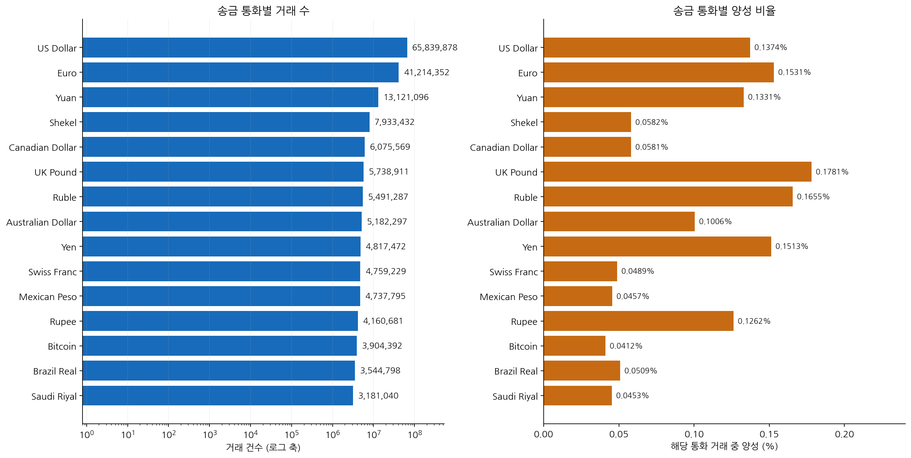

**그래프 해석:** 거래량이 많은 통화와 양성 비율이 높은 통화는 구별해야 합니다. 각 비율의 분모는 해당 송금 통화 거래 수입니다.

아래 수치는 **송금 통화** 기준입니다. 송금 또는 수취 어느 쪽이든 해당 통화인 거래 수와는 다릅니다.

| 송금 통화 | 거래 수 | 양성 수 | 양성 비율 |
|---|---|---|---|
| US Dollar | 65,839,878 | 90,439 | 0.1374% |
| Euro | 41,214,352 | 63,086 | 0.1531% |
| Yuan | 13,121,096 | 17,468 | 0.1331% |
| Shekel | 7,933,432 | 4,615 | 0.0582% |
| Canadian Dollar | 6,075,569 | 3,532 | 0.0581% |
| UK Pound | 5,738,911 | 10,221 | 0.1781% |
| Ruble | 5,491,287 | 9,089 | 0.1655% |
| Australian Dollar | 5,182,297 | 5,212 | 0.1006% |
| Yen | 4,817,472 | 7,288 | 0.1513% |
| Swiss Franc | 4,759,229 | 2,326 | 0.0489% |
| Mexican Peso | 4,737,795 | 2,165 | 0.0457% |
| Rupee | 4,160,681 | 5,249 | 0.1262% |
| Bitcoin | 3,904,392 | 1,608 | 0.0412% |
| Brazil Real | 3,544,798 | 1,806 | 0.0509% |
| Saudi Riyal | 3,181,040 | 1,442 | 0.0453% |

### 7.2 대표 통화의 금액 범위

각 값은 **그 통화의 단위**이며 통화 간 경제적 가치를 직접 비교하면 안 됩니다. 중앙값은 근사값입니다.

| 통화 | 라벨 | 최소 | 근사 중앙값 | 평균 | 최대 |
|---|---|---|---|---|---|
| Bitcoin | 정상 | 1e-06 | 0.0677059 | 18.9514 | 2.61396e+06 |
| Bitcoin | 양성 | 8.1e-05 | 0.209392 | 582.513 | 434,553 |
| Euro | 정상 | 0.01 | 717.459 | 231,463 | 8.94884e+10 |
| Euro | 양성 | 0.03 | 5,411.46 | 5.75645e+06 | 6.13706e+10 |
| US Dollar | 정상 | 0.01 | 832.234 | 317,579 | 1.08172e+11 |
| US Dollar | 양성 | 0.04 | 6,091.82 | 4.82962e+06 | 3.31446e+10 |
| Yen | 정상 | 0.01 | 85,184.4 | 5.60605e+07 | 2.04616e+12 |
| Yen | 양성 | 18.69 | 727,824 | 5.28226e+08 | 1.05574e+12 |

평균과 중앙값의 큰 차이는 긴 오른쪽 꼬리를 보여줍니다. 큰 금액이 있다는 이유만으로 오류 또는 세탁 거래라고 단정할 수 없습니다. 로그 변환·통화별 정규화를 적용하고 범주별 성능을 확인해야 합니다.

### 7.3 비트코인 처리

- 송금 또는 수취 통화가 비트코인인 거래: **3,959,480건**, 양성 **1,608건**.
- 결제 방식이 `Bitcoin`인 거래는 **3,905,021건**으로, 통화 기준 집계와 다릅니다.
- 작은 단위라는 이유로 제거하면 해당 거래군 전체를 평가 대상에서 잃습니다. 현재는 비트코인을 유지합니다.
- 10월 활동 노드 1,989,150개 중 **60,249개(3.0289%)**가 여러 통화를 사용하며 최대 8종입니다. 계좌별 원금액 단순 합산은 단위가 섞입니다.

### 7.4 고정환율을 확정할 수 있나요?

수취 금액 ÷ 송금 금액의 관측 비율은 환산의 단서이지만 공식 환율표가 아닙니다.

| 방향 | 거래 수 | 최소 비율 | 중앙 비율 | 최대 비율 |
|---|---|---|---|---|
| US Dollar → Euro | 602,533 | 0.5 | 0.8534 | 1 |
| US Dollar → Yuan | 176,511 | 6.6060606 | 6.6976 | 6.875 |
| US Dollar → Bitcoin | 42,169 | 5e-05 | 8.4179964e-05 | 0.0001 |

소액 반올림 등이 비율 차이를 만들 수 있지만, 이 EDA로 환율의 시간 일관성·수수료·생성 규칙을 확정하지 않았습니다. **관측 중앙값을 곧바로 고정환율로 쓰지 않았습니다.**

현재 전처리는 8월 1~7일의 통화별 양수 금액 중앙값을 기준으로 `log1p(금액 / 기준 금액)`을 계산하고, 같은 기준 기간의 중앙값·IQR로 정규화해 ±8로 제한합니다. 이는 통화 내 상대 규모이며 공통 통화 환산 금액이 아닙니다. 기준 기간에 없는 통화는 중립 점수와 별도 플래그로 처리합니다.

### 7.5 금액 정밀도

원금액을 곧바로 float32로 바꾸면 송금 **172,615,812건**, 수취 **172,620,847건**의 수치가 달라졌습니다. 송금 최대 절대 차이는 float64 기준 비교에서 약 **216,122.28 원통화 단위**였습니다. 이는 비교 방법상 근사 오차 규모이며, 모든 작은 표현 차이가 업무적으로 중대한 오류라는 뜻은 아닙니다.

**적용:** 원문·DECIMAL 금액은 조인과 감사에 보존하고, 변환·정규화 후 모델 입력만 float32로 사용합니다.
