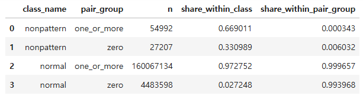
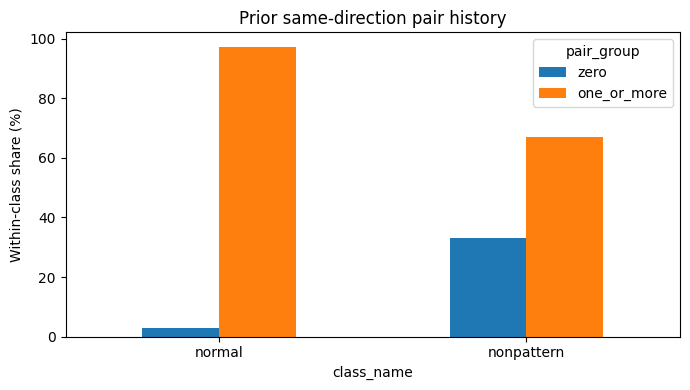
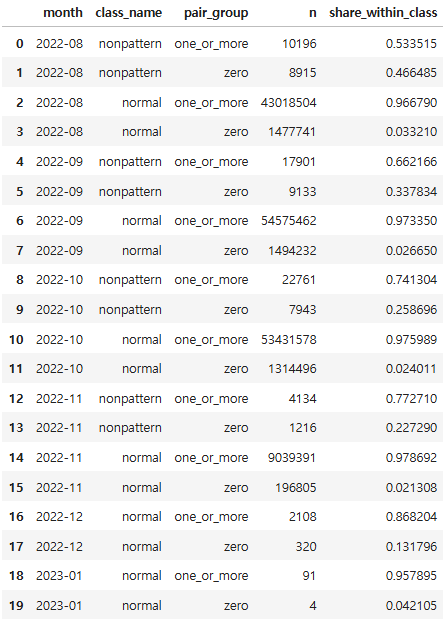
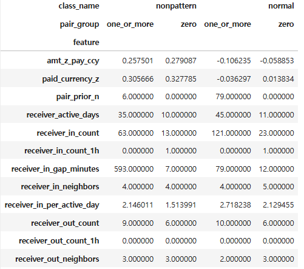
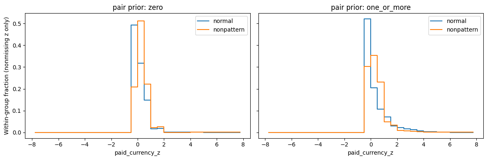
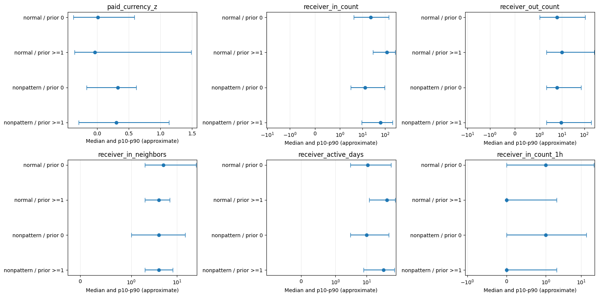

# 정상 vs 무패턴 비교

## 1. 분석 범위와 계산 기준

실행한 `02_pair_history_amount_receiver_analysis.ipynb`의 저장 결과를 정리했다. 정상 **164,550,732건**, 무패턴 **82,199건**, 합계 **164,632,931건**을 비교했다. 분포 비교이며, 분류 성능이나 인과관계를 검증한 결과는 아니다.

| 항목 | 기준 |
|---|---|
| 정상 | `is_laundering = False` |
| 무패턴 | 자금세탁 라벨이 1이면서 패턴 정보에 연결되지 않은 거래 |
| 분석 대상 | 2022년 8월 8일 이후 정상·무패턴 거래. 패턴 양성은 비교 대상에서 제외 |
| 이력 원장 | 2022년 8월 1일부터 관측한 정상·패턴·무패턴 전체 거래 |
| 시간 기준 | 현재 시각보다 이른 거래만 포함. 같은 분 거래는 서로의 과거 이력에서 제외 |
| 금액 보정 | 2022년 8월 1~7일의 통화별 전체 거래로 고정 |
| 표본 처리 | 샘플링 없음. 기존 전처리에서 제거한 완전 중복 150건은 복원하지 않음 |
| 통계 | 건수는 정확 집계, 피처 분위수는 근사값 |

`pair_group`은 **같은 방향의 송신 계좌 → 수신 계좌** 사이의 과거 거래 유무다. A → B의 이력에 B → A는 포함하지 않는다. `zero`는 계좌 자체가 신규라는 뜻이 아니다.

| 값 | 의미 |
|---|---|
| `zero` | 이전 동일 방향 계좌쌍 거래 0건 |
| `one_or_more` | 이전 동일 방향 계좌쌍 거래 1건 이상 |

`pair_prior_n`은 원래 건수이고, `pair_prior_count`는 `log1p(pair_prior_n)`이다. 구간 분류는 로그값이 아닌 원래 건수로 한다.

## 2. 네 집단의 규모

정상 중 이력 없는 거래는 **2.72%**, 무패턴 중에서는 **33.10%**다. 무패턴은 정상보다 이력 없는 거래 비중이 높지만, 무패턴의 **66.90%는 반복 거래**다. 반복 거래 내부의 차이도 확인해야 한다.

같은 이력 구간 안에서 무패턴이 차지하는 비율은 `zero`에서 **0.603%**, `one_or_more`에서 **0.0343%**로 약 **17.6배** 차이가 난다. 다만 `zero` 집단도 약 **99.4%는 정상**이며 정상 약 448만 건이 포함된다. 이력 없음만으로 세탁을 판정하기에는 부족하다.

## 3. 월별 변화

### 3.1 무패턴에서도 반복 거래 비중이 증가한다

| 관측 기간 | 정상 중 과거 거래 1건 이상 | 무패턴 중 과거 거래 1건 이상 |
|---|---:|---:|
| 8월 8~31일 | 96.68% | **53.35%** |
| 9월 | 97.33% | **66.22%** |
| 10월 | 97.60% | **74.13%** |
| 11월 1~5일¹ | 97.87% | **77.27%** |

¹ 11월 관측 범위는 사용자가 확인한 1~5일 기준이다. 월별 집계표만으로 마지막 날짜를 확인할 수는 없으며, 다음 분석에서 월별 최초·최종 시각과 관측 일수를 별도로 출력한다.

정상은 처음부터 대부분 반복 거래인 반면, 무패턴은 반복 거래 비중이 **23.92%p 증가**한다. 다만 이력이 8월 1일부터 누적되므로 시간이 지날수록 이전 거래가 관측될 기회도 늘어난다. 동일 계좌쌍의 반복, 거래 대상 구성 변화, 관측 기간 누적 효과를 이 표만으로 분리할 수 없다.

### 3.2 이력 없는 구간의 무패턴 비율은 8~11월 관측 기간에서 약 0.6%다

분모는 **해당 월의 정상 zero + 무패턴 zero**다. 패턴 양성은 분모에 포함하지 않는다. `share_within_class`처럼 무패턴 전체를 분모로 삼는 비율과 구분한다.

`무패턴 비율 = 무패턴 zero 건수 / (정상 zero 건수 + 무패턴 zero 건수) × 100`

예를 들어 8월은 `8,915 / (1,477,741 + 8,915) × 100 = 0.5997%`다.

| 관측 기간 | 과거 거래 0건 중 무패턴 비율 | 과거 거래 1건 이상 중 무패턴 비율 | 두 비율의 배수 |
|---|---:|---:|---:|
| 8월 8~31일 | **0.600%** | 0.0237% | 25.3배 |
| 9월 | **0.608%** | 0.0328% | 18.5배 |
| 10월 | **0.601%** | 0.0426% | 14.1배 |
| 11월 1~5일 | **0.614%** | 0.0457% | 13.4배 |

이력 없는 거래에 무패턴이 상대적으로 많이 포함되는 현상은 각 기간에서 공통으로 나타난다. 반복 거래 구간의 무패턴 비율도 상승하므로 반복 거래라는 이유만으로 정상에 가깝다고 처리하면 무패턴을 놓칠 수 있다. 위 비율은 실제 관측 건수로 계산했으며 한 달 전체로 환산한 값이 아니다.

### 3.3 관측 기간과 거래 규모가 달라 직접 비교에 주의한다

| 관측 기간 | 정상·무패턴 분석 대상 거래 수 | 무패턴 거래 수 |
|---|---:|---:|
| 8월 8~31일 | 44,515,356 | 19,111 |
| 9월 | 56,096,728 | 27,034 |
| 10월 | 54,776,778 | 30,704 |
| 11월 1~5일 | 9,241,546 | 5,350 |
| 12월 관측분 | 2,428 | 0 |
| 2023년 1월 관측분 | 95 | 0 |

11월은 관측 기간이 짧으므로 건수 감소를 실제 거래 활동의 급감으로 단정하지 않는다. 기간 길이와 요일 구성도 다르다. 12~1월은 거래량이 매우 적고 무패턴이 없어 해당 월의 정상·무패턴 비교는 해석하지 않는다. **12~1월 거래는 전체 건수와 피처 통계에는 포함돼 있다.**

## 4. 금액 z와 수신 계좌 활동량

### 4.1 피처의 의미

| 피처 | 의미 |
|---|---|
| `paid_currency_z` | 통화별 기준 금액 중앙값으로 금액을 나눈 뒤 `log1p` 변환하고, 변환값의 중앙값·IQR로 보정. ±8 제한 |
| `amt_z_pay_ccy` | 통화별 `log1p(금액)`을 평균·표준편차로 보정. ±10 제한 |
| `receiver_in_count` | 수신 계좌가 현재 분 이전에 받은 전체 입금 건수 |
| `receiver_active_days` | 수신 계좌의 입금 또는 출금이 과거에 관측된 고유 날짜 수 |
| `receiver_in_gap_minutes` | 수신 계좌의 직전 입금 이후 경과한 분. 송신 상대·정상/세탁 여부와 무관하며 이전 입금이 없으면 NULL |
| `receiver_in_per_active_day` | 누적 입금 수 / 과거 활동일 수 |

금액 z가 양수면 해당 통화 기준 중심보다 크다는 의미이며, 금액 증가율이나 자금세탁 확률이 아니다. `paid_currency_z`의 0은 기준 중앙값, `amt_z_pay_ccy`의 0은 기준 로그 금액 평균에 해당한다. 이번 보정값은 V10 패키지의 임계값과 그대로 대응하지 않는다.

### 4.2 반복 거래 안에서도 거래 수와 입금 간격에 차이가 있다

아래 수치는 중앙값이다. 직전 입금 간격은 과거 입금이 있는 거래에서 계산한 값이다.

| 피처 | 정상: 과거 0건 | 무패턴: 과거 0건 | 정상: 과거 1건 이상 | 무패턴: 과거 1건 이상 |
|---|---:|---:|---:|---:|
| 동일 계좌쌍 과거 거래 수 | 0 | 0 | **79건** | **6건** |
| 금액 `paid_currency_z` | 0.014 | **0.328** | −0.036 | **0.306** |
| 수신 계좌 누적 입금 수 | 23건 | **13건** | 121건 | **63건** |
| 수신 계좌 활동일 수 | 11일 | 10일 | 45일 | 35일 |
| 직전 입금 후 경과 시간 | 12분 | **7분** | **79분** | **593분** |
| 활동일당 입금 수 | 2.13건 | 1.51건 | 2.72건 | 2.15건 |

**과거 동일 계좌쌍 거래가 1건 이상인 집단에서는** 무패턴의 동일 상대 거래 수와 수신 계좌 누적 입금 수가 정상보다 적고, 직전 입금 후 경과 시간의 중앙값은 더 크다. 반면 **0건 집단에서는 입금 간격이 정상 12분, 무패턴 7분으로 방향이 반대**다. 두 집단을 섞어 하나의 규칙으로 해석하지 않는다.

`pair_prior_n`을 0/1건 이상으로만 나누면 반복 거래 중앙값 6건과 79건의 차이가 가려지므로 반복 거래를 더 세분화할 필요가 있다.

### 4.3 금액 중앙값은 높지만, 클수록 무패턴인 것은 아니다

두 이력 집단 모두 무패턴의 금액 z 중앙값이 높고 `amt_z_pay_ccy`도 같은 방향이다. 그러나 반복 거래의 `paid_currency_z` 90백분위는 정상 **1.484**, 무패턴 **1.136**으로 정상이 더 높다. 분포가 상당히 겹치므로 금액 z에 단독 임계값을 두기보다 이력·입금 활동량과 조합할 후보로 본다. 그림의 세로축은 각 집단 내부에서 z가 존재하는 거래의 비중이다.

### 4.4 활동량 분포도 겹치며 모든 피처에서 차이가 큰 것은 아니다

점은 중앙값, 선은 10~90백분위 범위다. 신뢰구간이 아니며 활동량 축은 큰 값을 함께 보기 위한 symlog 축이다.

- 수신 계좌 누적 출금 수는 정상·무패턴 중앙값이 비슷하다.
- 고유 입금 상대 수는 반복 거래에서 둘 다 중앙값 4개 계좌다.
- 최근 1시간 입금 수는 중앙값만으로 두 집단이 구분되지 않는다.

중앙값이 같다는 이유로 피처가 무의미하다고 확정하지 않는다. 꼬리 분포와 다른 피처와의 조합에서는 차이가 있을 수 있다.

## 5. 다음 분석 — 아직 실행 결과 없음

[03번 분석 노트북](../../code/nonpaten_vs_normal/03_pair_bins_same_minute_analysis.ipynb)에서 다음 항목을 확인한다.

1. 기존 `pair_prior_n`을 **0 / 1 / 2~5 / 6~20 / 21건 이상**으로 나눠 각 구간의 건수·무패턴 비율·금액 z·입금 간격을 비교한다.
2. 기존 과거 이력은 그대로 유지하고, **동일 분의 다른 거래 활동**을 별도 피처로 추가한다. 같은 계좌쌍 거래 수, 수신 계좌 입금 수·고유 송신 계좌 수·출금 수를 비교한다.
3. 동일 분 집계는 패턴 거래도 포함하고 현재 거래 자신은 제외한다. 실제 순서를 알 수 없으므로 **그 분이 끝난 뒤 확인 가능한 정보**로 해석한다.
4. 월별 최초·최종 거래 시각과 관측 일수를 출력하고, 월별·통화·결제 방식별로 차이가 유지되는지 확인한다.

새 분석은 02번의 저장된 피처를 재사용하므로 과거 이력·금액 보정값을 바꾸지 않는다. 분포 차이가 이후 기간의 탐지 성능으로 이어지는지는 별도의 시간 분리 평가가 필요하다.
