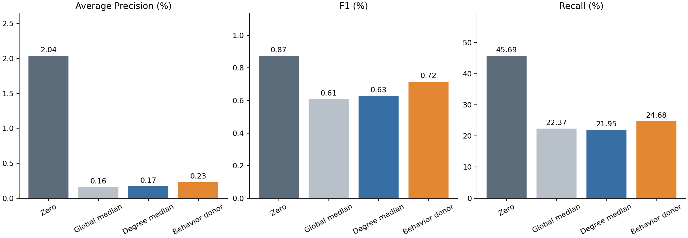

# SAML-D Test 최종 보고서

**팀 공유용 · 2026-11-06 · Multi-FraudGT 외부 데이터 평가 및 결측 처리 진단**

대상 독자: 모델 개발·데이터 전처리·실험 결과를 공유받는 팀원  
정리 범위: 2026-11-06 07:21 UTC까지 완료된 실험. 이 문서 작성 중 추가 학습이나 Test 실행은 하지 않았다.  
읽는 순서: 결론과 결과는 1~3절, 실험 흐름과 원인은 4~6절, 후속 과제는 7절, 전체 패턴·입력 표는 부록을 보면 된다.

## 1. 먼저 알아야 할 결론

**HI-Large에서 학습한 현재 Multi-FraudGT를 SAML-D 전체에 그대로 적용했을 때, 정상 거래의 오탐이 크게 늘고 사기 탐지 성능이 하락했다. 소유관계 결측에 대한 모델의 취약성은 확인했으나, 시험한 세 가지 대체 방식으로는 SAML-D 성능을 회복하지 못했다.**

| 팀이 확인해야 할 질문 | 현재 답 |
|---|---|
| SAML-D에서도 기존 HI 수준의 성능이 나왔는가? | 아니다. AP는 HI 전체 Test 66.88%에서 SAML 전체 2.04%로 하락했다. |
| 데이터에 NaN이 남아서 계산이 실패했는가? | 검사한 입력에 NaN/Inf는 없었다. 없는 정보를 숫자 0으로 넣은 것이 문제 후보였다. |
| 결측 처리의 영향은 확인했는가? | HI의 같은 거래에서 소유관계 3종만 0으로 바꾸자 F1이 72.33%에서 17.95%로 하락했다. |
| 다른 값으로 채우면 나아지는가? | 전체 중앙값·차수 구간별 중앙값·유사 계좌 대체 모두 SAML에서는 기존 0 대체보다 Precision·Recall·F1·AP가 낮았다. |
| 그러면 결측은 원인이 아닌가? | 그렇게 결론 낼 수 없다. 실제 소유관계를 복원한 실험이 아니라, 세 가지 추정 대체 방식을 시험한 결과다. |
| 현재 어떤 설정을 채택하는가? | 추가 대체 방식은 채택하지 않는다. 기존 0 대체는 비교 기준으로 보존하며, 이 성능을 배포에 충분한 결과로 판단하지 않는다. |
| 다음 검증은 무엇인가? | 공통으로 관측되는 23종 피처로 처음부터 학습하는 대조를 우선한다. 아직 실행하지 않았다. |

여기서 ‘최종’은 **현재까지 수행한 진단의 정리**를 뜻한다. SAML-D 전용 모델의 개발이나 성능 개선이 완료됐다는 뜻은 아니다.

## 2. 무엇을 평가했는가

Multi-FraudGT는 계좌를 점, 거래를 연결선으로 표현한 그래프에서 각 거래를 **정상 또는 사기**로 판단하는 모델이다. HI-Large에서 이미 학습한 모델을 고정하고, SAML-D 거래에 적용했다. SAML-D로 모델을 다시 학습하지 않았다.

### 데이터와 평가 범위

| 구분 | HI-Large | SAML-D |
| --- | --- | --- |
| 모델에서 사용한 전체 거래 | 170,426,489건 | 9,504,852건 |
| 기간 | 2022-08-01~2022-10-31 | 2022-10-07~2023-08-23 |
| 역할 | 학습·검증·Test로 분리 | 전체를 외부 평가 대상으로 사용 |
| 학습(Train) | 102,505,233건 · 08-01~09-25 | 이번 실험에서 별도 분할·학습 없음 |
| 검증(Validation) | 34,491,749건 · 09-26~10-13 | 이번 실험에서 별도 분할 없음 |
| 성능표의 평가 대상 | Test 33,429,507건 · 10-14~10-31 | 전체 9,504,852건 |
| 평가 대상 중 실제 사기 | 44,103건 | 9,873건 |
| 평가 대상의 사기 비율 | 0.1319% | 0.1039% |
| 전체 거래에 등장한 계좌 | 2,116,072개 | 855,460개 |

HI-Large의 전체 건수는 현재 모델이 사용하는 **관측 필드 기준 중복 제거 후 모집단**이다. 배포 원본 파일의 행 수와 구분한다. HI 전체 데이터의 입력 통계와 HI Test 성능 지표도 서로 다른 범위다.

모든 SAML 비교에서 학습된 가중치(epoch 280), 그래프·샘플링 방식, 거래 순서, 판정 기준을 고정했다. **모델 점수가 0.5를 초과하면 사기로 판정**했다. ‘0 대체’의 0은 입력값이고, ‘임계값 0.5’는 출력 점수의 판정 기준이다.

### 지표를 읽는 방법

| 지표 | 쉬운 의미 | 방향 |
| --- | --- | --- |
| Precision · 정밀도 | 사기라고 경보를 낸 거래 중 실제 사기의 비율 | 높을수록 좋음 |
| Recall · 탐지율 | 실제 사기 중 모델이 찾아낸 비율 | 높을수록 좋음 |
| F1 | 정밀도와 탐지율을 함께 반영한 지표 | 높을수록 좋음 |
| AP · Average Precision | 점수가 높은 순서로 거래를 확인할 때 사기를 얼마나 잘 위쪽에 모으는지 보는 지표 | 높을수록 좋음 |
| FPR · 오탐률 | 실제 정상 거래 중 사기로 잘못 경보한 비율 | 낮을수록 좋음 |
| 미탐 | 실제 사기인데 정상으로 판단한 거래 | 적을수록 좋음 |

AP 2.04%는 ‘사기의 2.04%를 탐지했다’는 뜻이 아니다. 실제 탐지 비율은 Recall에서 읽는다. AP는 Average Precision 방식으로 계산했으며 단일 임계값의 Precision이나 PR 곡선의 사다리꼴 적분값과 구분한다. pp는 두 백분율의 차이인 퍼센트포인트다.

## 3. 최종 성능 비교

### 최초 외부 평가: HI Test 대비 SAML 전체

| 지표 | HI 전체 Test | SAML 전체 · 기존 0 대체 |
| --- | --- | --- |
| Precision | 89.22% | 0.44% |
| Recall | 57.78% | 45.69% |
| F1 | 70.14% | 0.87% |
| AP | 66.88% | 2.04% |
| FPR | 0.00922% | 10.7241% |

SAML에서는 사기 **9,873건 중 4,511건을 탐지**했지만, 정상 거래 **1,018,255건에도 경보**를 냈다. 총 경보 1,022,766건 중 실제 사기가 4,511건이므로 Precision은 0.44%다. 높은 오탐이 운영 부담으로 이어지는 상태다.

### 결측 처리 네 조건의 최종 결과

아래 네 조건은 모두 **같은 SAML 전체 9,504,852건**을 평가했다. ①이 비교 기준이고, ②~④는 소유관계 결측 3종의 대체 방법만 바꾼 조건이다.

| 입력 처리 | Precision | Recall | F1 | AP | 정상 오탐 | 사기 미탐 |
| --- | --- | --- | --- | --- | --- | --- |
| 1. 기존 0 대체 | 0.44% | 45.69% | 0.87% | 2.04% | 1,018,255 | 5,362 |
| 2. 전체 중앙값 | 0.31% | 22.37% | 0.61% | 0.16% | 712,843 | 7,664 |
| 3. 차수 구간별 중앙값 | 0.32% | 21.95% | 0.63% | 0.17% | 676,670 | 7,706 |
| 4. 유사 계좌 대체 | 0.36% | 24.68% | 0.72% | 0.23% | 668,211 | 7,436 |

세 가지 대체 방법에서 오탐은 줄었지만, 사기 탐지율과 AP도 함께 하락했다. **경보 수가 줄었다는 사실만으로 모델이 개선됐다고 볼 수 없다.** 이번에 시험한 추가 대체 방식은 모두 채택하지 않는다.

*그림의 Zero는 기존 0 대체, Global median은 전체 중앙값, Degree median은 차수 구간별 중앙값, Behavior donor는 유사 계좌 대체다. 세 패널의 세로축 범위는 서로 다르다.*

근거: [최초 전체 지표](results/01_baseline/result.json), [네 조건 최종 지표](results/04_additional_imputation/saml_metrics.csv).

## 4. 실험을 어떤 순서로 진행했는가

모든 완료 시각은 2026-11-06 UTC 기준이다.

| 단계 | 질문과 수행 내용 | 확인한 결과 | 다음 단계로 이어진 이유 |
| --- | --- | --- | --- |
| 1 · 05:08 | HI 학습 모델로 SAML 전체 최초 평가 | AP 2.04%, F1 0.87%; 정상 오탐 약 102만 건 | 모델 입력과 데이터 차이를 점검할 필요 |
| 2 · 05:30 | HI의 동일 거래에서 일부 피처를 0으로 바꾸는 대조 | 소유관계 3종의 0 대체에 큰 취약성 확인 | 소유관계 대체 방법을 검증 |
| 3 · 06:02 | HI Validation에서 중앙값 후보를 비교한 뒤 전체 중앙값으로 SAML 전체 평가 | HI Validation AP는 68.21%로 회복; SAML AP는 0.16%로 악화 | HI에서 좋은 대체가 SAML에도 통하는지 추가 분석 |
| 4 · 06:27~06:45 | 전체 입력 통계와 28개 패턴별 저장 점수를 집계 | 결측 외 분포 차이, 현금 인출·Smurfing 미탐, 정상 Group 오탐 확인 | 행동이 유사한 계좌를 이용하는 대체 방식 추가 |
| 5 · 07:22 | 차수 구간별 중앙값과 유사 계좌 대체를 HI Validation 및 SAML 전체에서 비교 | SAML AP 0.17%, 0.23%; 기존 0 대체보다 낮음 | 대체값만 바꾸는 접근의 개선은 확인하지 못함 |

### 4-1. 결측 자체의 영향을 어떻게 확인했는가

**HI Test 표본 262,144건, 사기 332건**에서 같은 모델·거래·그래프를 유지하고 특정 피처만 가렸다. ‘원래 정보를 알고 있는 거래’에서 정보를 없앴을 때 얼마나 달라지는지 보는 실험이다. 이 표는 SAML 평가가 아니며 HI 전체 Test 지표도 아니다.

| HI 대조 조건 | F1 | AP | 정상 오탐 |
| --- | --- | --- | --- |
| 원본 입력 | 72.33% | 69.15% | 21 |
| 계좌 유형 6종만 0 | 71.91% | 69.34% | 26 |
| 소유관계 3종만 0 | 17.95% | 62.58% | 2,143 |
| 국가 2종만 0 | 72.69% | 68.93% | 20 |
| 미제공 11종 모두 0 | 12.98% | 61.34% | 3,413 |
| 결제방식 약 31%를 Unknown | 72.13% | 68.31% | 19 |
| 미제공 11종 + Unknown 약 31% | 12.75% | 56.80% | 3,281 |

소유관계 3종만 0으로 만들었을 때 오탐은 **21건 → 2,143건**, F1은 **72.33% → 17.95%**로 변했다. 소유관계의 0 대체가 이 모델에 큰 영향을 준다는 근거다. AP 변화 -6.57 pp의 배치 재표집 95% 구간은 [-8.31, -4.88] pp였다.

하지만 미제공 11종과 Unknown을 함께 재현해도 HI 표본 AP는 **56.80%**였다. 실제 SAML의 **2.04%** 수준까지 하락하지 않았다. 이 실험만으로 SAML 저하 전체를 결측으로 설명하거나, 두 AP의 차이를 빼서 원인별 기여율을 계산할 수는 없다. Unknown 대조는 무작위로 결제방식을 가린 민감도 시험이며 실제 SAML 결제방식의 의미를 그대로 재현한 것은 아니다.

### 4-2. 대체값을 어떻게 만들었는가

대체 대상은 소유 엔터티의 **관측 계좌 수·송신 다양성·수신 다양성** 3종이다. 예를 들어 ‘계좌 주체가 몇 개의 계좌를 쓰고 얼마나 다양한 상대와 거래하는가’를 나타내는 정보다. SAML에는 같은 정의의 소유관계 정보가 없었다.

| 방법 | 쉬운 설명 | 계산에 쓴 정보 |
| --- | --- | --- |
| 전체 중앙값 | 모든 계좌에 HI에서의 전형적인 소유관계 값을 넣음 | HI Train 활동 계좌 2,100,893개의 피처별 중앙값 |
| 차수 구간별 중앙값 | 송신·수신 상대계좌 수가 비슷한 계좌들을 묶어 중앙값을 넣음 | HI Train 구간별 통계; 128계좌 미만 구간은 전체 중앙값 |
| 유사 계좌 대체 | 거래 행동이 비슷한 HI 계좌 한 개를 찾아 소유관계 3종을 함께 복사 | HI Train에서 추출한 65,536개 계좌; 행동 피처 10종으로 비교 |

대체 기준을 만드는 데 사기 정답이나 SAML 정답을 쓰지 않았다. 가중치는 다시 학습하지 않았으며 계좌 유형 6종·국가 2종의 결측은 계속 0으로 남았다. 대체값은 **추정값**이며 실제 SAML 소유관계를 알아낸 결과가 아니다.

### 4-3. HI Validation에서는 왜 좋아 보였는가

별도 **HI Validation 표본 262,144건, 사기 340건**에 SAML과 같은 결측 상황을 만들고 비교했다. 위 HI Test 대조와 건수는 같지만 다른 거래 집합이다.

| HI Validation 입력 | F1 | AP | 같은 방식의 SAML 전체 AP |
| --- | --- | --- | --- |
| 원래 정보가 있는 HI 입력 | 72.40% | 68.55% | 해당 조건 없음 |
| 기존 0 대체 | 13.69% | 58.55% | 2.04% |
| 전체 중앙값 | 71.10% | 68.21% | 0.16% |
| 차수 구간별 중앙값 | 69.86% | 68.05% | 0.17% |
| 유사 계좌 대체 | 69.98% | 67.46% | 0.23% |

HI Validation에서는 세 대체 방식 모두 0 대체보다 좋아졌다. 그러나 SAML에서는 반대 결과가 나왔다. **HI 안에서 결측을 보완하는 것과, 다른 데이터의 실제 관계를 추정하는 것은 서로 다른 문제**라는 점을 보여준다.

첫 실험은 HI Validation AP로 전체 중앙값을 선택해 SAML 전체를 평가했다. 추가 실험은 차수 구간별 중앙값과 유사 계좌 대체를 둘 다 SAML 전체에서 비교하기로 미리 정했고, 그 전에 HI Validation의 우선 후보를 차수 구간별 중앙값으로 기록했다. 두 후보 간 Validation AP 차이의 95% 구간은 0을 포함했다. SAML 결과를 보고 새 임계값을 고르지는 않았다.

근거: [HI 결측 대조](results/02_missingness_controls/control_metrics.csv), [첫 대체 실험](reports/04_전체중앙값대체.md), [추가 실험과 검증](reports/06_추가결측대체실험.md).

## 5. 입력과 패턴에서 발견한 차이

### 5-1. 같은 입력 차원이어도 들어가는 정보가 다르다

현재 모델의 기본 피처는 **34종**이다. ‘피처’는 모델에 넣는 입력 정보의 종류를 뜻한다. 아래 표는 34종을 겹치지 않게 나눈 것이다.

| 입력 정보 | 종류 수 | HI-Large | SAML-D |
| --- | --- | --- | --- |
| 계좌의 거래 행동 | 10 | 거래 이력에서 계산 | 거래 이력에서 계산하나 분포가 다름 |
| 계좌 유형 | 6 | 계좌 유형 정보 사용 | 미제공 → 모두 0 |
| 계좌 소유관계 통계 | 3 | 소유관계 정보 사용 | 미제공 → 0 또는 이번 대체값 |
| 국가 관련 거래 정보 | 2 | 같은 알려진 소유국가·국가 가용성 | 미제공 → 모두 0 |
| 나머지 거래 숫자 정보 | 12 | 시간 간격·횟수·금액·통화 등 | 대응되는 관측 정보에서 계산 |
| 결제방식 | 1 | 7개 알려진 범주 | 일부 결제방식은 Unknown |
| 합계 | 34 | 원래 스키마 | 동일 스키마 중 11종 미제공 |

**숫자 0은 결측값 표시(null)와 다르다.** 예를 들어 소유관계 정보가 없어 넣은 0과 실제 관측된 작은 통계값을 모델이 같은 숫자로 받을 수 있다. 국가에는 `both_countries_known=0`이라는 기존 가용성 표시가 있지만, 소유관계 등의 결측을 구분하는 신규 공통 표시는 추가하지 않았다.

반대로 SAML의 자기거래 수가 0인 것은 실제 관측 결과다. 모든 0을 결측으로 바꾸면 안 된다. 입력 통계표의 ‘0 비율’도 결측률과 같지 않다.

전체 거래를 집계했을 때 결제방식 Unknown은 HI에서 **0건**, SAML에서 **2,946,034건(31.00%)**이었다. SAML의 Debit card·Cross-border가 Unknown에 대응한다. 다만 알려진 결제방식만 보아도 SAML 오탐률은 **11.40%**였으므로 Unknown 하나로 전체 저하를 설명할 수 없다.

### 5-2. 원인이 될 수 있는 분포 차이도 남아 있다

| 관측한 사실 | 의미와 해석 범위 |
|---|---|
| HI Train의 알려진 패턴 사기 54,898건 중 54,891건(99.987%)이 ACH | 특정 결제방식과 패턴의 결합에 치우친 학습 환경. 전체 사기의 99.987%라는 뜻은 아님 |
| SAML 현금 입출금 사기는 전체 사기의 27.74%지만 탐지율은 1.53% | HI에서 강했던 탐지 특성이 SAML의 다른 사기에 그대로 통하지 않음. 이는 결제방식 기준 집계 |
| HI Train 누적 이력 56일, HI Test 92일, SAML 321일 | 활동일과 누적 거래 통계의 의미·규모가 달라질 수 있음 |
| 전체 거래 기준 송신 Port 평균: HI 1,246.82, SAML 11.23 | 상대계좌 순번을 나타내는 구조 입력의 분포도 다름. 평균 차이가 곧 인과 효과라는 뜻은 아님 |

관측 기간과 분포 차이는 확인했지만, 그것이 성능에 미친 기여량을 분리한 재학습 대조는 하지 않았다. 사기 비율 차이도 있지만 정상 거래를 분모로 하는 FPR 자체가 HI 대비 약 **1,163배** 늘어, 사기 비율이 낮아진 것만으로는 설명이 부족하다.

### 5-3. 어떤 패턴을 놓치고 어떤 정상 패턴에 오탐하는가

SAML-D는 **사기 패턴 17종(9,873건), 정상 패턴 11종(9,494,979건)**으로 구성된다. 패턴명은 정답 메타데이터를 이용한 사후 분석 구분이다. 모델이 28개 패턴명을 분류하도록 학습한 것은 아니다.

| 패턴 | 평가 지표 | 대상 건수 | 기존 0 대체 | 전체 중앙값 | 차수 구간별 중앙값 | 유사 계좌 대체 |
| --- | --- | --- | --- | --- | --- | --- |
| Structuring | 탐지율 ↑ | 1,870 | 74.01% | 36.15% | 33.16% | 41.82% |
| Deposit-Send | 탐지율 ↑ | 945 | 35.24% | 4.76% | 7.09% | 8.99% |
| Cash_Withdrawal | 탐지율 ↑ | 1,334 | 0.00% | 0.00% | 0.00% | 0.00% |
| Smurfing | 탐지율 ↑ | 932 | 0.00% | 0.00% | 0.00% | 0.00% |
| Normal_Group | 오탐률 ↓ | 528,351 | 76.4414% | 99.9975% | 99.9947% | 99.8917% |
| Normal_Fan_In | 오탐률 ↓ | 2,104,285 | 6.2760% | 0.0730% | 0.0755% | 0.1985% |

`Cash_Withdrawal` 1,334건과 `Smurfing` 932건은 **네 조건 모두 탐지율 0%**였다. 기존 0 대체의 전체 미탐 중 **42.26%**가 이 두 패턴에 속한다. 정상 `Normal_Group`은 대체 후 거의 전부 사기로 오판했다. 한편 정상 `Normal_Fan_In`의 오탐은 줄어, 대체값의 영향이 패턴마다 달랐다.

추가 두 방식은 사기 17종 중 15종에서 기존 0 대체보다 탐지율이 낮아졌고, 나머지 2종은 0%에 머물렀다. 전체 패턴 표는 부록 A에 있다. ‘현금 결제방식’과 `Cash_Withdrawal`이라는 ‘패턴명’은 서로 다른 분류 기준이므로 건수를 합쳐 해석하지 않는다.

## 6. 어디까지 결론 내릴 수 있는가

| 근거 수준 | 결론 |
|---|---|
| 실험으로 확인 | 이 모델은 HI에서 소유관계 3종을 0으로 바꾸는 변화에 취약하다. |
| 전체 평가로 확인 | SAML 기존 0 대체에서 오탐이 많았고, 시험한 세 대체 방식은 Precision·Recall·F1·AP를 모두 더 낮췄다. |
| 데이터로 확인 | HI와 SAML의 정보 가용성, 결제방식·사기 패턴의 구성, 거래 행동·구조 입력 분포가 다르다. |
| 가능한 설명 | HI 통계·유사 계좌의 소유관계가 SAML 행동 피처와 맞지 않아 유효한 대체가 되지 않았을 수 있다. |
| 아직 미확정 | 실제 SAML 소유관계를 확보하면 얼마나 회복되는지, 각 원인이 하락의 몇 %를 설명하는지. |

현재 판단은 **“결측의 영향을 무시할 수 없지만, 단순 대체나 행동 기반 대체만으로 해결하지 못했다”**다. “결측 때문에 전부 낮아졌다” 또는 “대체가 실패했으니 결측 때문이 아니다”라는 두 단정 모두 현재 증거를 넘어선다.

고정 임계값의 문제도 일부 있을 수 있으나 AP 자체가 낮으므로 임계값을 바꾸는 것만으로 현재 점수의 순위 성능을 회복할 수는 없다. 이번 실험에서는 SAML 정답으로 임계값을 조절하지 않았다.

## 7. 다음 실험과 팀 작업 제안

아래는 계획이며 **아직 실행하지 않았다.** 담당은 개인 지정이 아니라 역할 기준의 제안이다.

| 우선순위 | 질문 | 실험·작업 | 담당 역할 제안 | 확인할 산출물 |
| --- | --- | --- | --- | --- |
| 1 | 애초에 없는 정보 없이 학습하면 이전 성능이 나아지는가? | 미제공 11종을 뺀 공통 23종으로 재학습; 원래 34종 모델과 구조·학습 예산을 맞춰 비교 | 데이터 + 모델 개발 | 피처 명세, HI 검증 성능, 별도 평가 성능 |
| 2 | 결측을 학습 중 경험하면 견고해지는가? | 소유관계 피처를 일부 가리는 masking과 명시적 결측 표시를 학습에 적용 | 모델 개발 | 정보가 있는 조건·없는 조건 양쪽 성능 |
| 3 | 결제방식 의존이 큰가? | 다른 조건을 맞춘 결제방식 포함/제외 모델 비교 | 모델 개발 + 평가 | 전체 및 결제방식·패턴별 오류 |
| 4 | 이력 길이 차이가 영향을 주는가? | 학습·평가의 관측 기간을 맞추거나 기간 기준 통계를 사용 | 데이터 개발 | 같은 기간 기준의 입력 통계·성능 |

피처를 추론 때만 0으로 바꾸는 것과 **처음부터 그 피처 없이 학습하는 것**은 다른 실험이다. 따라서 공통 23종 재학습이 우선 대조가 된다. 그래프나 패턴 차이까지 없어지는 것은 아니므로 개선을 보장하지는 않는다.

평가는 전체 AP·Precision·Recall·F1·FPR, 같은 경보 건수에서의 탐지율, 17개 사기·11개 정상 패턴의 오류를 함께 확인한다. 모델·임계값 선택에는 별도 Validation을 사용한다. 이미 진단에 사용한 SAML 전체의 반복 결과는 탐색 결과로 남기고, 최종 일반화 판단에는 새로 보존한 미사용 평가 데이터가 필요하다.

## 8. 결과의 신뢰 범위와 현재 상태

- **전체 커버리지:** SAML 네 조건 모두 9,504,852건을 중복·누락 없이 평가했다. 패턴별 합계도 전체 지표와 일치했다.
- **구현 확인:** CPU·GPU 입력 및 점수 일치, 기존 저장 점수 재현, 대체 대상 외 입력 보존을 검사했다. AP는 독립 계산과 scikit-learn으로 교차 검산했다.
- **모델 비교 범위:** 동일한 구현의 epoch 280과 all_targets 전체 평가를 비교했다. 다른 readout·표본 범위의 과거 점수나 논문 수치와 섞지 않았다.
- **시간 조건:** 그래프와 노드 상태는 각 기간 말 누적 기준이다. 개별 거래보다 나중 발생한 거래가 문맥에 들어갈 수 있어 실시간 탐지 성능을 의미하지 않는다.
- **외부 검증의 한계:** SAML은 이전 외부 평가와 이번 원인 분석에서 이미 사용했다. 이번 후속 대체 실험은 완전히 새로운 미사용 Test 검증이 아니다.
- **검사 통과의 의미:** 입력·평가 계산의 재현성을 확인했다. 데이터 정의의 모든 차이가 없거나 모든 원인을 규명했다는 증명은 아니다.
- **작업 상태:** 원본 가중치·체크포인트·기존 결과를 보존했다. SALT-GNN은 별도 요청대로 중단 상태를 유지했고, 이번 보고서 작성 중 재개하지 않았다.

## 9. 팀원이 찾아볼 자료

| 자료 | 내용 |
| --- | --- |
| [최초 SAML 전체 평가](reports/01_최초전체평가.md) | 고정 조건, 최초 전체 지표, CPU/GPU 실행 검증 |
| [피처 대응](reports/02_입력피처대응.md) | 34종 입력 구성과 0·Unknown의 의미 |
| [결측·분포 대조](reports/03_결측분포진단.md) | HI 입력을 가린 7조건, 분포·결제방식 분석 |
| [전체 중앙값 실험](reports/04_전체중앙값대체.md) | 첫 대체값 적합·Validation 선택·SAML 결과 |
| [추가 두 대체 방식](reports/06_추가결측대체실험.md) | 네 조건 최종 비교와 패턴별 결과 |
| [전체 입력 상세 통계](results/05_full_input_statistics/edge_full_statistics.csv) | 구간별 거래·Port 평균·표준편차·범위·0 비율 |
| [노드 전체 통계](results/05_full_input_statistics/node_query_full_statistics.csv) | 거래 빈도로 가중한 송신·수신 계좌 입력 |
| [네 조건 패턴별 CSV](results/04_additional_imputation/pattern_comparison.csv) | 패턴별 대상·사기 예측 건수·비율 |
| [종합 원인 분석](reports/05_성능하락원인상세.md) | 진단의 상세 근거와 이전 단계의 기록 |
| [실험 최종 검산](metadata/04_additional_imputation/final_verification.json) | 커버리지·지표·원본 보존 확인 |

이 문서의 HTML은 그림을 파일 안에 포함해 단독으로 읽을 수 있다. Markdown의 그림과 상세 CSV·로그 링크까지 공유하려면 현재 실험 폴더 구조를 함께 유지한다.

## 부록 A. 전체 패턴별 탐지·오탐 비교

### 사기 패턴 17종

탐지율은 높을수록 좋다. ‘기존 탐지’는 기존 0 대체 조건에서의 탐지 건수다. 나머지 조건의 탐지 건수는 연결된 CSV에 있다. 원본 패턴명을 유지했다.

| 사기 패턴 | 사기 건수 | 기존 탐지 | 기존 0 대체 탐지율 | 전체 중앙값 탐지율 | 차수 구간별 중앙값 탐지율 | 유사 계좌 대체 탐지율 |
| --- | --- | --- | --- | --- | --- | --- |
| Behavioural_Change_2 | 345 | 283 | 82.03% | 90.43% | 81.45% | 67.25% |
| Structuring | 1,870 | 1,384 | 74.01% | 36.15% | 33.16% | 41.82% |
| Behavioural_Change_1 | 394 | 283 | 71.83% | 75.89% | 69.80% | 59.39% |
| Scatter-Gather | 338 | 211 | 62.43% | 22.19% | 22.78% | 25.44% |
| Layered_Fan_In | 656 | 374 | 57.01% | 24.39% | 26.68% | 30.64% |
| Gather-Scatter | 354 | 200 | 56.50% | 24.29% | 24.86% | 29.66% |
| Layered_Fan_Out | 529 | 295 | 55.77% | 20.60% | 20.42% | 28.36% |
| Over-Invoicing | 54 | 30 | 55.56% | 12.96% | 14.81% | 18.52% |
| Fan_In | 364 | 197 | 54.12% | 30.77% | 29.67% | 34.89% |
| Bipartite | 383 | 205 | 53.52% | 20.37% | 21.93% | 26.37% |
| Fan_Out | 237 | 126 | 53.16% | 18.14% | 21.52% | 22.36% |
| Cycle | 382 | 203 | 53.14% | 13.87% | 14.40% | 20.94% |
| Stacked Bipartite | 506 | 268 | 52.96% | 24.90% | 27.87% | 30.24% |
| Single_large | 250 | 119 | 47.60% | 11.20% | 11.60% | 15.20% |
| Deposit-Send | 945 | 333 | 35.24% | 4.76% | 7.09% | 8.99% |
| Cash_Withdrawal | 1,334 | 0 | 0.00% | 0.00% | 0.00% | 0.00% |
| Smurfing | 932 | 0 | 0.00% | 0.00% | 0.00% | 0.00% |

### 정상 패턴 11종

오탐률은 낮을수록 좋다. 정상 패턴에서 높은 사기 예측 비율은 좋은 탐지 성능이 아니라 많은 오탐을 뜻한다. 각 패턴의 정답이 한 종류이므로 패턴 내부의 Precision·AP를 별도 성능 비교 지표로 사용하지 않았다.

| 정상 패턴 | 정상 건수 | 기존 오탐 | 기존 0 대체 오탐률 | 전체 중앙값 오탐률 | 차수 구간별 중앙값 오탐률 | 유사 계좌 대체 오탐률 |
| --- | --- | --- | --- | --- | --- | --- |
| Normal_Group | 528,351 | 403,879 | 76.4414% | 99.9975% | 99.9947% | 99.8917% |
| Normal_single_large | 20,641 | 10,217 | 49.4986% | 63.1607% | 61.0629% | 57.7831% |
| Normal_Foward | 42,031 | 12,607 | 29.9945% | 29.5829% | 28.5884% | 26.5994% |
| Normal_Mutual | 125,335 | 32,576 | 25.9911% | 4.8733% | 4.6643% | 5.5890% |
| Normal_Plus_Mutual | 155,041 | 33,011 | 21.2918% | 5.9668% | 5.9733% | 5.8275% |
| Normal_Small_Fan_Out | 3,477,717 | 245,356 | 7.0551% | 2.2130% | 1.6505% | 1.9753% |
| Normal_Periodical | 210,526 | 13,565 | 6.4434% | 4.0879% | 3.4552% | 2.5541% |
| Normal_Fan_In | 2,104,285 | 132,064 | 6.2760% | 0.0730% | 0.0755% | 0.1985% |
| Normal_Fan_Out | 2,302,220 | 134,974 | 5.8628% | 2.4572% | 1.8399% | 1.0005% |
| Normal_Cash_Deposits | 223,801 | 6 | 0.0027% | 0.0000% | 0.0000% | 0.0000% |
| Normal_Cash_Withdrawal | 305,031 | 0 | 0.0000% | 0.0000% | 0.0000% | 0.0000% |

## 부록 B. 전체 입력 피처별 비교

표본이 아닌 **HI 전체 170,426,489건과 SAML 전체 9,504,852건**의 입력 통계다. 정상·사기를 모두 포함한다. SAML은 기존 0 대체 기준이다. 로그·정규화 등이 적용된 모델 입력 공간의 평균이므로 원래 거래 수·일수·금액과 구분한다.

계좌 평균은 각 거래의 송신·수신 계좌가 등장한 횟수로 가중했다. HI는 Train·Validation·Test별 실제 기간 말 스냅샷을 각 거래에 적용하고 합산했다. SAML은 전체 기간 말 상태다. 0 비율은 실제 0·이진 피처의 거짓·결측 대체 등을 모두 포함한다.

### 계좌 피처 19종

각 칸의 ‘송 / 수’는 송신 계좌 / 수신 계좌 순서다.

| 입력 피처·의미 | HI 평균 송 / 수 | SAML 평균 송 / 수 | HI 0 비율 송 / 수 | SAML 0 비율 송 / 수 |
| --- | --- | --- | --- | --- |
| `log_out_count` 송신 거래 수(log1p) | 6.1291 / 3.2473 | 4.9567 / 1.7441 | 0.00% / 3.97% | 0.00% / 66.70% |
| `log_in_count` 수신 거래 수(log1p) | 4.5354 / 4.9560 | 3.2740 / 3.4304 | 2.98% / 0.00% | 25.15% / 0.00% |
| `log_out_neighbors` 송신 상대계좌 수(log1p) | 2.5740 / 1.1945 | 2.7012 / 0.9765 | 0.00% / 3.97% | 0.00% / 66.70% |
| `log_in_neighbors` 수신 상대계좌 수(log1p) | 2.0246 / 1.7305 | 1.7241 / 1.3261 | 2.98% / 0.00% | 25.15% / 0.00% |
| `log_self_count` 자기거래 수(log1p) | 1.2933 / 1.4001 | 0 / 0 | 25.96% / 13.61% | 100.00% / 100.00% |
| `log_reciprocal_neighbors` 쌍방향 거래 상대계좌 수(log1p) | 0.1217 / 0.1559 | 0.8241 / 0.3828 | 85.54% / 82.40% | 30.91% / 69.16% |
| `mean_paid_currency_z` 송금액 통화별 z-score 평균 | 0.3332 / 0.5927 | 0.7342 / 0.2207 | 0.00% / 3.97% | 0.46% / 66.77% |
| `paid_outlier_fraction` 송금액 이상치 비율 | 0.0285 / 0.0479 | 0.0010 / 0.0015 | 66.97% / 82.14% | 72.63% / 89.20% |
| `log_currency_count` 사용 통화 수(log1p) | 0.7517 / 0.7178 | 1.4430 / 1.0164 | 0.00% / 0.00% | 0.00% / 0.00% |
| `log_active_days` 활동일 수(log1p) | 4.0119 / 3.9742 | 3.9572 / 2.8267 | 0.00% / 0.00% | 0.00% / 0.00% |
| `type_Corporation` 법인 유형 표시 | 0.2859 / 0.2992 | 0 / 0 | 71.41% / 70.08% | 100.00% / 100.00% |
| `type_Partnership` 파트너십 유형 표시 | 0.3282 / 0.3438 | 0 / 0 | 67.18% / 65.62% | 100.00% / 100.00% |
| `type_Sole Proprietorship` 개인사업 유형 표시 | 0.3793 / 0.3534 | 0 / 0 | 62.07% / 64.66% | 100.00% / 100.00% |
| `type_Individual` 개인 유형 표시 | 0.0007 / 0.0006 | 0 / 0 | 99.93% / 99.94% | 100.00% / 100.00% |
| `type_Country` Country 유형 표시 | 0.0059 / 0.0030 | 0 / 0 | 99.41% / 99.70% | 100.00% / 100.00% |
| `type_Direct` Direct 유형 표시 | 1.284e-05 / 9.846e-06 | 0 / 0 | 100.00% / 100.00% | 100.00% / 100.00% |
| `log_entity_observed_accounts` 동일 소유 엔터티 관측 계좌 수(log1p) | 1.9896 / 1.6528 | 0 / 0 | 0.00% / 0.00% | 100.00% / 100.00% |
| `log_entity_out_diversity` 소유 엔터티 송신 다양성(log1p) | 3.4259 / 2.1620 | 0 / 0 | 0.00% / 2.64% | 100.00% / 100.00% |
| `log_entity_in_diversity` 소유 엔터티 수신 다양성(log1p) | 2.9929 / 2.4426 | 0 / 0 | 0.05% / 0.00% | 100.00% / 100.00% |

### 거래 숫자 피처 14종

| 입력 피처·의미 | HI 평균 | SAML 평균 | HI 0 비율 | SAML 0 비율 |
| --- | --- | --- | --- | --- |
| `pair_prior_count` 계좌 쌍의 과거 거래 수 | 3.6885 | 1.7568 | 4.8734% | 9.3474% |
| `pair_gap_minutes` 계좌 쌍의 직전 거래 이후 간격 | 4.8196 | 6.2637 | 4.8734% | 9.3474% |
| `pair_count_1h` 계좌 쌍의 최근 1시간 거래 수 | 0.3784 | 0.1757 | 54.1316% | 78.4377% |
| `sender_gap_minutes` 송신 계좌의 직전 거래 이후 간격 | 4.1708 | 5.0400 | 1.2321% | 3.0846% |
| `sender_count_1h` 송신 계좌의 최근 1시간 거래 수 | 1.0621 | 0.6410 | 45.7041% | 63.6259% |
| `receiver_gap_minutes` 수신 계좌의 직전 거래 이후 간격 | 4.5638 | 5.8499 | 1.0238% | 6.8680% |
| `receiver_count_1h` 수신 계좌의 최근 1시간 거래 수 | 0.4394 | 0.5769 | 50.5417% | 65.9336% |
| `paid_currency_z` 송금액의 HI 통화별 z-score | 0.3356 | 0.7342 | 0.0006% | 1.6809% |
| `reverse_history_count` 역방향 거래 이력 수 | 0.1244 | 0.1893 | 94.3396% | 92.4240% |
| `pair_age_at_day_start` 일 시작 시 계좌 쌍의 이력 기간 | 6.4884 | 4.4311 | 6.1306% | 54.0942% |
| `same_known_country` 같은 알려진 소유국가 여부 | 0.3522 | 0 | 64.7836% | 100.0000% |
| `both_countries_known` 양쪽 소유국가를 모두 아는지 | 0.5355 | 0 | 46.4530% | 100.0000% |
| `same_currency` 지급·수취 통화가 같은지 | 0.9845 | 0.8858 | 1.5452% | 11.4243% |
| `is_self_transfer` 송신·수신 계좌가 같은지 | 0.0628 | 0 | 93.7200% | 100.0000% |

### 결제방식 1종과 구조 입력

결제방식은 1종의 범주형 피처를 아래 8개 one-hot 열로 표현한다. 거래마다 해당 범주 하나가 1이고 나머지는 0이다. Cash Deposit·Cash Withdrawal은 Cash, Debit card·Cross-border는 Unknown으로 대응한다.

| 모델 범주 | HI 전체 건수 | HI 비율 | SAML 전체 건수 | SAML 비율 |
| --- | --- | --- | --- | --- |
| ACH | 20,903,557 | 12.2654% | 2,008,807 | 21.1345% |
| Bitcoin | 3,703,987 | 2.1734% | 0 | 0.0000% |
| Cash | 17,426,775 | 10.2254% | 525,683 | 5.5307% |
| Cheque | 66,790,636 | 39.1903% | 2,011,419 | 21.1620% |
| Credit Card | 48,124,587 | 28.2377% | 2,012,909 | 21.1777% |
| Reinvestment | 7,410,544 | 4.3482% | 0 | 0.0000% |
| Wire | 6,066,403 | 3.5595% | 0 | 0.0000% |
| Unknown | 0 | 0.0000% | 2,946,034 | 30.9951% |

Port는 시간순으로 처음 등장한 상대계좌의 순번이고, Ego는 현재 질의 거래의 끝점 계좌인지를 표시한다. 기본 34종과 별도로 더해지는 구조 정보다. 실제 입력은 **노드 20차원(19+Ego), 관계별 엣지 23차원(숫자 14+결제방식 8+Port)**이다. Ego는 배치마다 달라 전역 고정 평균을 만들지 않았다. 노드·거래 ID 자체, 정답, 패턴명은 새로운 숫자 피처로 넣지 않는다.

소유관계 3종은 노드 피처로 사용하지만 원래 거래 캐시의 `same_entity` 열은 이번 모델의 거래 숫자 14종에 포함되지 않는다. SAML 캐시 71개 열이나 과거 HGB 41피처 전체가 이 모델 입력인 것은 아니다.

## 부록 C. 재현 시 고정할 조건

| 항목 | 값 |
| --- | --- |
| 모델 | multi_fraudgt_format · 선택 epoch 280 |
| 구조 | hidden 64, heads 8, layers 2, 정방향·역방향 관계 |
| 전체 거래 평가 | all_targets; 학습 당시 readout은 official |
| 공유 배치·이웃 샘플링 | 2,048건 · fanout [50,50] · 균등 비복원 |
| 사기 판정 | logit > 0, 즉 sigmoid(logit) > 0.5 |
| SAML 순서·샘플러 | order seed 2000048 · sampler 42/test/0/global_batch |
| 대체값 적합 | HI Train 마지막 날 2022-09-25 스냅샷만 사용 |
| HI Validation 대조 | 같은 128배치 · 262,144건 · 사기 340건 |
| 유사 계좌 후보 | 65,536개 · seed 20261109 · 행동 10종 |
| 유사 계좌 변환·검색 | Train p01/p99 제한, 중앙값 중심, max(IQR,0.1) 나눔; cKDTree k=1, eps=0.1 |
| 원본 가중치 SHA-256 | `42d0d8002a87962291eb3f409cfbba1d1dec381c35162f11f2e11cb3a034c58f` |

세부 프로토콜과 입력·코드 해시는 [최초 평가 조건](metadata/01_baseline/protocol.json), [첫 대체 실험 계획](metadata/03_global_median/plan.json), [추가 실험 계획](metadata/04_additional_imputation/plan.json), [추가 전체 평가 조건](metadata/04_additional_imputation/target_protocol.json)에 있다. 이번 보고서의 수치는 저장된 JSON·CSV에서 불러와 생성했으며, [보고서 생성·검증 기록](metadata/07_report_provenance/검증.json)에 근거 파일 해시와 검산 결과를 남겼다.
