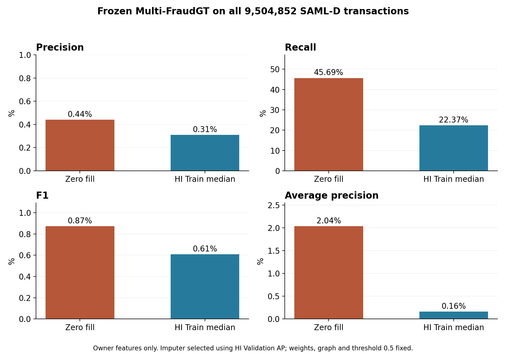

# 소유관계 결측 대체 후 SAML-D 전체 평가

완료: 2026-11-06T06:01:52.461005+00:00

**선택 방식: HI Train 전체 중앙값**. HI Validation AP로 선택한 뒤 SAML 전체 **9,504,852건**을 평가했다. GNN 가중치(epoch280), 임계값0.5, 그래프·샘플링·거래 순서·Port·Ego는 고정했다.

**판단: 이 중앙값 대체 방식은 SAML 개선안으로 채택하지 않는다.** 오탐은 약 30% 줄었지만 Precision·Recall·F1·AP가 모두 악화했다. HI Validation에서 결측을 보완한 통계값이 SAML에서도 유효한 소유관계 정보로 작동한다고 볼 수 없다. 결측 취약점이 있다는 앞선 결과와, HI 중앙값으로 이를 보정하는 시도가 실패했다는 이번 결과를 구분해야 한다.

특히 정상 `Normal_Group`은 기존 528,351건 중 403,879건(76.44%) 오탐에서 **528,338건(99.9975%) 오탐**으로 악화했다. 일부 정상 패턴의 오탐이 줄어든 동시에 다른 정상 패턴의 오류가 커졌으므로 오탐 총수 감소만으로 개선이라고 평가할 수 없다. 자세한 패턴 변화는 `pattern_comparison.csv`에 있다.

## SAML-D 전체 결과

| 처리 | Precision | Recall | F1 | AP | FPR | 오탐 수 |
|---|---:|---:|---:|---:|---:|---:|
| 기존 0 처리 | 0.44% | 45.69% | 0.87% | 2.04% | 10.7241% | 1,018,255 |
| HI Train 전체 중앙값 | 0.31% | 22.37% | 0.61% | 0.16% | 7.5076% | 712,843 |

변화: Precision **-0.13 pp**, Recall **-23.32 pp**, F1 **-0.26 pp**, AP **-1.88 pp**. 원래 오탐 중 **440,012건**이 정상 판정으로 바뀌었고 새 오탐은 **134,600건**이다. 사기 추가 탐지는 **73건**, 기존에 탐지하던 사기를 놓친 건수는 **2,375건**이다.

| 실제 / 예측 | 정상 예측 | 사기 예측 |
|---|---:|---:|
| 정상 | TN 8,782,136 | FP 712,843 |
| 사기 | FN 7,664 | TP 2,209 |

## HI Validation에서 선택한 근거

HI Validation 전체에서 정답과 독립적으로 262,144건(128개 공유 배치)을 무작위 선택했다. 같은 그래프·같은 샘플링으로 다음 조건을 비교했다. 실제 SAML 결측 상황에 맞춰 zero 및 두 대체 조건에서 계좌 유형6개·국가2개를 계속 0으로 두고, 소유관계3개만 대체했다. original은 원래 피처가 있는 참고 조건이다.

| 처리 | Precision | Recall | F1 | AP | FPR |
|---|---:|---:|---:|---:|---:|
| HI 원본 | 92.66% | 59.41% | 72.40% | 68.55% | 0.0061% |
| 기존 0 처리 | 7.49% | 79.41% | 13.69% | 58.55% | 1.2739% |
| HI Train 전체 중앙값 | 87.88% | 59.71% | 71.10% | 68.21% | 0.0107% |
| HI Train 차수 구간별 중앙값 | 83.61% | 60.00% | 69.86% | 68.05% | 0.0153% |

후보 두 개 중 AP가 높은 방식을 선택했다. 동률이면 F1, 그마저 동률이면 전체 중앙값을 선택하도록 사전에 정했다. SAML 정답·새 예측점수로 방법이나 임계값을 선택하지 않았다. HI Validation은 표본 평가이고 SAML은 전체 평가다.

## 대체값 계산

- 대상 열: `log_entity_observed_accounts`, `log_entity_out_diversity`, `log_entity_in_diversity`.
- HI Train 마지막 날(2022-09-25)의 활동 계좌 **2,100,893개**만 사용했다. 사기 정답을 읽지 않았다.
- 전체 중앙값(이미 로그 변환된 입력 공간): **[2.3025851249694824, 3.044522523880005, 2.7725887298583984]**. 거래 빈도로 계좌에 가중치를 주지 않았다.
- 조건부 방식은 관측 가능한 `log_out_neighbors`, `log_in_neighbors`로 고정 구간을 만들고, 그 구간의 HI Train 소유관계 중앙값을 사용했다. 계좌가 128개 미만인 구간은 전체 중앙값으로 대체했다. 유효 구간은 41/144개다.
- 계좌 유형·국가 정보·Unknown 결제방식 매핑과 다른 피처는 유지했다. 원본 캐시와 원본 0 처리 점수도 보존했다.

## 해석과 검증

이 값은 **관측된 SAML 소유관계가 아니라 HI 통계로 추정한 대체값**이다. 기존 Test 결과를 이미 보고 결측 취약점을 분석한 뒤 수행한 후속 진단이므로, 완전히 새로운 미사용 Test 검증으로 해석하지 않는다. HI Validation에서 더 나았던 방식이 SAML에도 더 낫다는 보장은 없고, 이 결과를 보고 추가로 SAML 임계값을 조절하지 않았다.

다음 우선순위는 미관측 11종을 제외한 공통 23종으로 처음부터 학습하는 대조 또는 결측을 포함한 학습이다. 이번 턴에는 해당 재학습을 실행하지 않았다. 중앙값 대체 실패가 모든 가능한 결측 처리 방식의 실패를 의미하지는 않는다.

전체 거래 ID 중복·누락 없이 정확히 한 번 점수를 만들었다. 대표 실제 배치에서 기존 0 처리 점수 재현, 변경된 GPU 입력과 독립 CPU 입력의 일치, 소유관계 열 외 입력 보존을 검사했다. 전체 AP는 scikit-learn으로 교차 검산했고 원본 전체 지표도 재계산해 일치시켰다.

`plan.json`, `fit.json`, `selection.json`, `target_protocol.json`에 학습 범위·대체값·선택 근거·고정 조건을 기록했다. `validation_metrics.csv`, `saml_metrics.csv`, `pattern_comparison.csv`, `result.json`에 결과가 있고 `saml_logits.npy`는 원본 거래 ID 순서의 전체 새 점수다. 각 실행 스크립트와 `target_chunks/`의 재개 가능한 결과를 함께 보존했다.

**SALT-GNN은 중단 상태를 유지한다.** 원래 체크포인트를 변경하거나 학습을 재개하지 않았다.

## 추가 검산 및 해석

HI Validation에서 전체 중앙값의 zero 대비 AP 변화는 **+9.66 pp**, paired 배치 bootstrap 500회의 95% 구간은 **[+7.47, +11.76] pp**다. 두 중앙값 방식 간 AP 차이는 **+0.16 pp**, 구간은 **[-0.73, +1.02] pp**로 0을 포함한다. 따라서 선택 규칙에 따라 전체 중앙값을 택했지만, 그것이 보편적으로 더 낫거나 SAML에서 최적이라는 주장을 하지 않는다. 구간별 방식의 SAML 전체 평가는 이번 실험 범위에 포함하지 않았다.

`final_verification.json`에 전체 지표·쌍별 판정 변화의 건수 일치, 해시, 사전 검사 통과, SALT 중단 상태·체크포인트 보존 확인을 기록했다. `validation_uncertainty.json`은 선택 완료 후 산출한 불확실성 분석이며 선택 방법을 변경하지 않았다.
