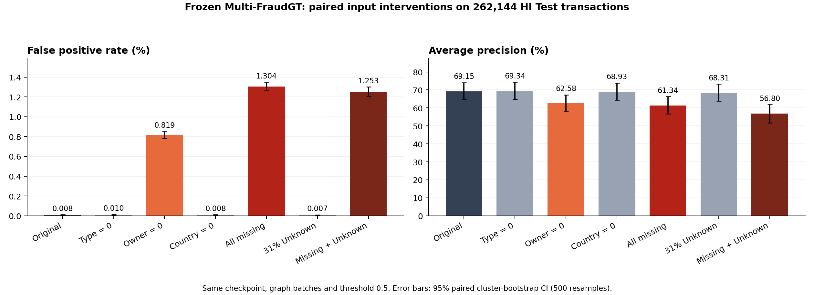
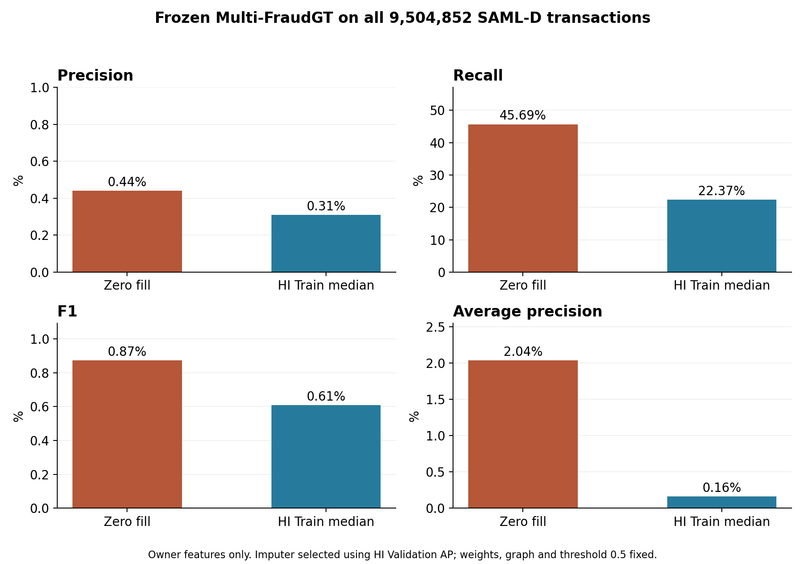
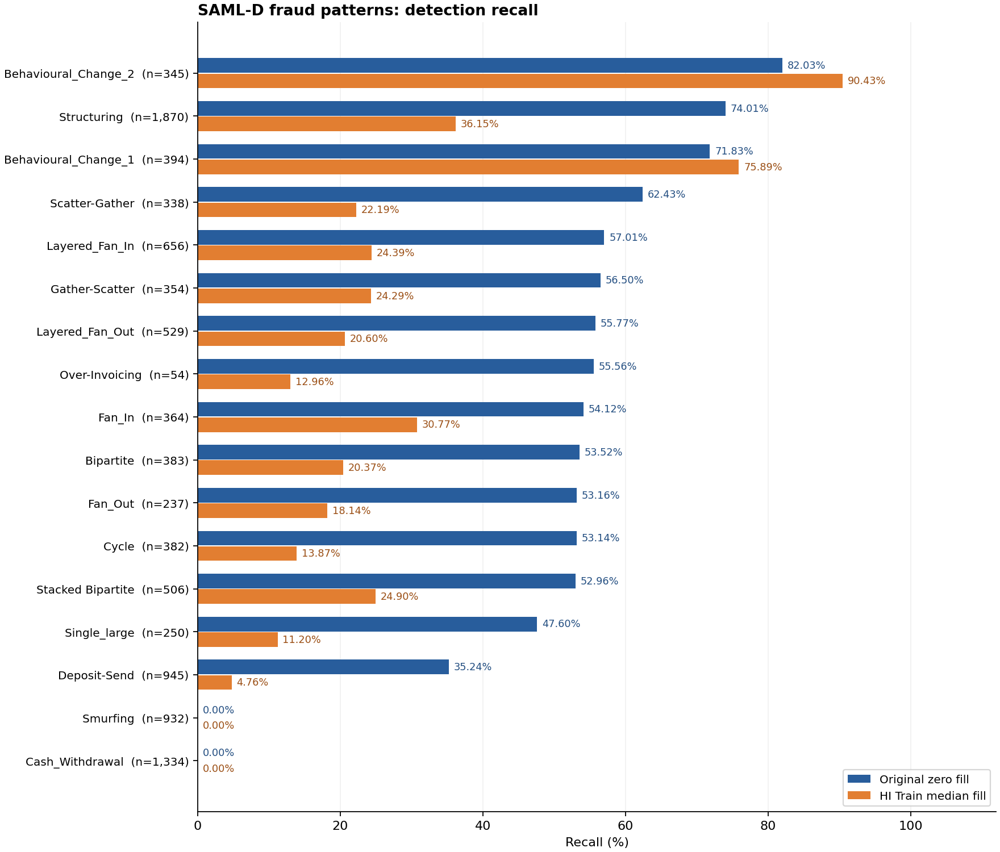
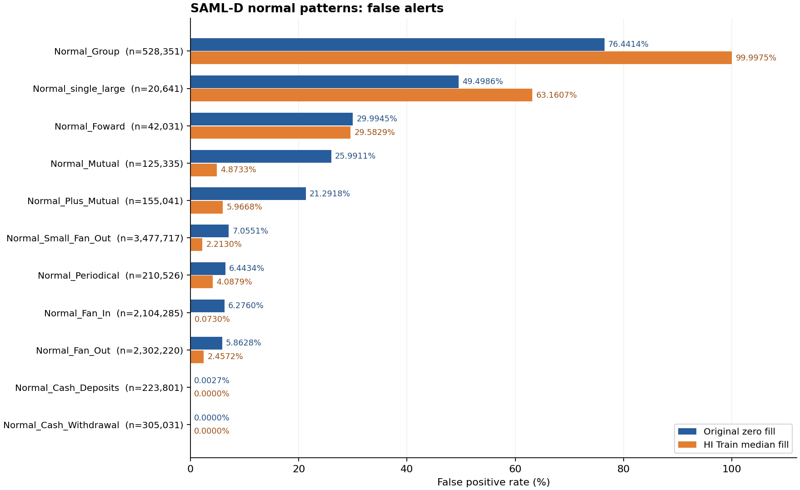

# Multi-FraudGT의 SAML-D 성능 하락 원인 보고서

팀원에게 전달할 전체 실험 흐름과 최신 결론은 [SAML-D Test 최종 보고서](../보고서.md)에 정리했다. 이 문서는 단계별 상세 근거를 보존한다.

작성일: 2026-11-06 (UTC)  
분석 대상: HI에서 학습한 `multi_fraudgt_format`, epoch 280 고정 가중치의 SAML-D 전체 외부 평가  
근거 범위: 기존 전체 평가, HI 결측 대조 실험, 피처·결제방식 분포 분석, 소유관계 중앙값 대체 실험

추가: **HI-Large·SAML-D 전체 모집단의 34종 입력과 Port·Ego 비교표는 10절**에 수록했다. 기존 5절은 정상 거래 표본 비교다.

## 1. 핵심 판단

**현재 근거는 소유관계 피처 결측에 대한 모델의 취약성과 HI·SAML 사이의 거래 분포 차이가 함께 존재함을 보여준다. 소유관계 결측의 영향은 HI 대조 실험에서 확인했지만, SAML 성능 하락을 원인별 비율로 분해할 수 있는 단계는 아니다.**

| 원인 후보 | 확인한 근거 | 현재 판단 |
|---|---|---|
| 소유관계 피처 3종의 0 대체 | 같은 HI 거래에서 해당 피처만 0으로 바꾸면 오탐 21 → 2,143건, F1 72.33% → 17.95% | **HI에서의 모델 취약점 확인.** SAML 저하에 대한 기여 크기는 미확정 |
| 결제방식과 사기 패턴의 관계 차이 | HI Train의 알려진 패턴 양성 중 ACH가 99.987%. SAML 현금 사기는 전체 사기의 27.74%지만 탐지율 1.53% | **분포·오류 집중 확인.** 모델이 결제방식에 얼마나 의존하는지는 추가 대조 필요 |
| 정상 거래의 구조·이력 분포 차이 | SAML의 자기거래, 반복 거래, 활동일, Port 분포가 HI와 다르고 `Normal_Group`의 76.44%가 오탐 | **분포 차이 확인.** 개별 피처와 그래프 구조의 인과 기여는 미분리 |
| HI 중앙값으로 결측을 보정하면 회복될 것 | HI Validation AP는 개선됐지만 SAML AP는 2.04% → 0.16% | **이번 대체 방식의 실패 확인.** 이 설정은 채택하지 않음 |
| 국가 피처·Unknown 결제방식·사기 비율 차이만으로 설명 | 국가 피처 단독 영향은 작음. Known 결제방식에서도 FPR 11.40%. 사기 비율 차이보다 FPR 상승이 훨씬 큼 | **단독 주원인이라는 설명은 현재 근거가 지지하지 않음** |

결측을 HI에 재현해도 AP는 61.34%, Unknown까지 함께 적용해도 56.80%였다. SAML 전체 AP 2.04%까지의 저하는 이 대조에서 재현되지 않았다. 따라서 **결측 처리만 바꾸면 HI 수준 성능으로 회복된다고 기대할 근거는 없다.** 이 수치들의 차이를 빼서 원인별 기여율을 계산해서도 안 된다. 서로 다른 모집단·그래프·패턴 구성의 결과이기 때문이다.

## 2. 성능 하락의 규모와 비교 조건

| 지표 | 기존 HI 전체 Test | SAML-D: 기존 0 대체 | SAML-D: HI 중앙값 대체 |
|---|---:|---:|---:|
| 평가 거래 수 | 33,429,507 | 9,504,852 | 9,504,852 |
| 실제 사기 수 | 44,103 | 9,873 | 9,873 |
| 사기 비율 | 0.1319% | 0.1039% | 0.1039% |
| Precision | 89.22% | 0.44% | 0.31% |
| Recall | 57.78% | 45.69% | 22.37% |
| F1 | 70.14% | 0.87% | 0.61% |
| AP | 66.88% | 2.04% | 0.16% |
| FPR: 정상 중 오탐 비율 | 0.00922% | 10.7241% | 7.5076% |
| 사기 탐지 수(TP) | 25,483 | 4,511 | 2,209 |
| 정상 오탐 수(FP) | 3,078 | 1,018,255 | 712,843 |
| 사기 미탐 수(FN) | 18,620 | 5,362 | 7,664 |

AP는 점수 순위로 계산한 **Average Precision**이다. 단일 임계값의 Precision과 다르며, PR 곡선의 사다리꼴 적분값을 별도로 계산한 것은 아니다. 비율 지표는 %로 표시하고 비율 간 차이는 pp(퍼센트포인트)로 표시한다.

두 데이터의 전체 평가는 같은 epoch 280 가중치, `all_targets` 평가 방식, 임계값 `sigmoid(logit) > 0.5`를 사용했다. 구조는 hidden 64, heads 8, layers 2, 정방향·역방향 관계이며 공유 배치 2,048, fanout [50, 50]이다. 학습 당시 readout은 `official`이므로 위 HI 기준은 **기존 all_targets 전체 Test 결과**로 명시한다. 이전의 다른 범위·readout 성능과 혼용하지 않는다.

SAML은 2022-10-07~2023-08-23 전체를 평가했으며, 이번 평가를 위해 SAML을 새 Train/Validation/Test로 분할하거나 재학습하지 않았다. 그래프·노드 상태는 기간 말 누적 기준이다. 개별 거래 시점보다 나중에 발생한 거래가 문맥에 포함될 수 있으므로 실시간 탐지 성능을 뜻하지 않는다.

근거: [HI 전체 Test 원본 결과](../results/hi_reference/full_test_result.json), [SAML 전체 결과](../results/01_baseline/result.json), [중앙값 대체 전체 결과](../results/03_global_median/result.json).

## 3. 결측 문제: 없는 정보가 실제 숫자 0으로 입력됨

기본 피처는 **34종 = 계좌 19종 + 거래 숫자 14종 + 결제방식 1종**이다. 결제방식 one-hot, Ego, Port를 반영한 실제 입력은 노드 20차원, 관계별 엣지 23차원이다. 34종이라는 피처 종류 수와 모델 입력 차원을 구분해야 한다.

| SAML에서 미제공된 정보 | 피처 수 | 기존 입력 처리 | 의미상 문제 |
|---|---:|---|---|
| 계좌 유형 | 6 | 모두 0 | 유형을 모르는 상태가 유형이 모두 해당하지 않는 형태로 들어감 |
| 소유 엔터티의 계좌 수·송신 다양성·수신 다양성 | 3 | 모두 0 | 정보 부재와 실제로 작은 소유관계 통계값을 구분하기 어려움 |
| 같은 알려진 소유국가 여부·양쪽 국가의 가용성 | 2 | 모두 0 | `same_known_country`만으로는 다른 국가와 정보 부재를 구분할 수 없음 |

NaN/Inf는 0개였다. 문제는 계산에 실패한 NaN이 아니라 **미제공 11종을 유효한 숫자 0으로 표현한 입력 차이**다. 소유관계 3종은 HI에서 주로 양수였으며, 특히 `log_entity_observed_accounts=0`은 정보가 없다는 별도 표시가 아니다. 소유관계 결측을 구분하는 신규 mask 없이 기존 가중치에 입력했다.

국가 정보는 `both_countries_known=0`이라는 기존 가용성 표시가 함께 있으므로 “모든 결측에 표시가 전혀 없다”고 해석하면 안 된다. 또한 SAML 자기거래 수의 0은 실제 관측 결과이며 결측 대체가 아니다.

근거: [피처 대응 정의](02_입력피처대응.md), [결측·NaN 검사](../metadata/02_missingness_controls/missingness_inventory.json).

### 같은 HI 입력에서 확인한 결측 영향

HI 전체 Test의 원래 공유 배치 128개를 무작위 선택했다. 총 262,144건, 사기 332건이다. 거래·가중치·그래프·샘플링·임계값을 고정하고 해당 피처만 바꿨다. 이 표는 **HI 표본 대조 결과**이며 SAML 전체 결과나 HI 전체 Test 지표가 아니다.

| 변경 조건 | 오탐 수 | F1 | AP |
|---|---:|---:|---:|
| 원본 입력 | 21 | 72.33% | 69.15% |
| 계좌 유형 6종만 0 | 26 | 71.91% | 69.34% |
| 소유관계 3종만 0 | 2,143 | 17.95% | 62.58% |
| 국가 2종만 0 | 20 | 72.69% | 68.93% |
| 결측 11종 모두 0 | 3,413 | 12.98% | 61.34% |
| 결제방식 약 31%만 Unknown | 19 | 72.13% | 68.31% |
| 결측 11종 + Unknown 약 31% | 3,281 | 12.75% | 56.80% |

소유관계 3종을 0으로 만들면 정상 거래의 평균 logit이 **+4.837** 올라갔다. 정상 점수가 기존 임계값을 넘으면서 오탐이 크게 증가했다. AP 변화는 -6.57 pp이며, 같은 배치를 함께 재표집한 bootstrap 500회의 95% 구간은 **[-8.31, -4.88] pp**다. 소유관계 0 대체가 이 모델에 미치는 영향은 단순한 표본 변동으로 보기 어렵다.

반면 국가 피처 단독 AP 변화의 95% 구간은 [-0.55, +0.12] pp로 0을 포함했다. Unknown 단독 영향은 상대적으로 작았으나 다른 결측과 함께 적용하면 추가 AP 저하가 있었다. 이 Unknown 실험은 HI 거래를 무작위로 가리는 대조이며 실제 SAML의 Debit card·Cross-border 의미나 패턴 구성을 재현하지 않는다.

**해석 범위:** 이는 HI에서 피처를 바꿔 측정한 모델 민감도다. SAML의 실제 소유관계 참값을 복원한 실험이 아니므로, SAML에서 소유관계를 확보했을 때의 회복 성능은 아직 알 수 없다.

근거: [대조 지표와 신뢰구간](../results/02_missingness_controls/control_metrics.csv), [대조 계획](../metadata/02_missingness_controls/control_plan.json).

## 4. 결제방식·사기 패턴의 관계가 다름

HI Train에서 **알려진 패턴으로 분류된 사기 54,898건 중 54,891건(99.987%)이 ACH**였다. 이는 전체 사기의 99.987%가 ACH라는 뜻은 아니다. 전체 사기에는 기존의 무패턴 양성도 포함된다. 현금 사기는 Train에 2,136건 있었지만 모두 무패턴 양성이었고 알려진 패턴 양성은 0건이었다.

HI 전체 Test에서도 임계값 0.5에서 탐지한 사기 25,483건 중 25,481건이 ACH였다. 같은 기준에서 알려진 패턴 Recall은 98.22%, 무패턴 Recall은 0.26%였다. **HI의 전체 지표가 높아도 사기 유형별 탐지가 균일하지 않았음**을 보여준다. 이 수치는 고정 임계값의 결과이며 무패턴 거래의 전체 점수 순위까지 모두 무의미하다는 뜻은 아니다.

| SAML 구간 | 관측 결과 | 성능 하락과의 관련성 |
|---|---|---|
| ACH | 정상 오탐 607,884건, FPR 30.28%, 사기 Recall 99.83% | 사기를 많이 탐지하지만 정상 ACH에도 경보가 과도하게 발생 |
| 현금 입출금 | 사기 2,739건으로 전체 사기의 27.74%; 탐지는 42건, Recall 1.53% | 현금 사기 미탐 2,697건이 전체 미탐의 50.30%를 차지 |
| 정상 `Normal_Group` 패턴 | 정상 528,351건 중 403,879건 오탐, FPR 76.44% | 전체 오탐의 39.66%가 이 정상 패턴에 집중 |
| 알려진 결제방식 | FPR 11.40% | Unknown을 제외해도 큰 오탐 문제가 남음 |
| Unknown 결제방식 | 2,946,034건, FPR 9.22% | 지원하지 않는 결제방식만이 전체 오탐의 주원인이라는 설명은 부족 |

결제방식 구간과 정상 패턴 구간은 서로 겹치므로 이 표의 오탐 수를 더해서 기여율을 계산하지 않는다. HI의 무패턴 구분도 SAML 패턴에 임의로 대응시키지 않았다.

**추정:** 모델이 HI에서 강했던 결제방식·행동 패턴의 조합을 SAML에도 적용하면서 정상 ACH에는 높은 점수를, 현금 사기에는 낮은 점수를 주는 문제가 있을 수 있다. 데이터와 오류의 집중은 확인했지만, 결제방식을 제외한 재학습 등의 대조를 하지 않았으므로 “결제방식 하나에 과적합한 것이 확정 원인”이라고 단정하지 않는다.

근거: [HI 학습·Test 결제방식 모집단](../results/02_missingness_controls/HI_payment_population.csv), [HI 전체 Test 결제방식별 오류](../results/02_missingness_controls/HI_full_test_payment_metrics.csv), [SAML 전체 그룹별 오류](../results/02_missingness_controls/saml_group_metrics.csv), [정상 패턴별 오탐](../results/02_missingness_controls/normal_pattern_fp_contribution.csv).

## 5. 관측 가능한 피처와 누적 그래프의 분포 차이 — 표본 비교

각 데이터에서 정답과 독립적으로 거래 100,000건을 뽑아 그중 정상 거래를 비교했다. 아래는 **실제 모델 입력 공간의 중앙값**이며 원래 거래 수나 일수가 아니다. KS는 분포 차이를 나타내며 원인 중요도나 성능 기여율이 아니다.

| 피처 | HI Train | HI Test | SAML | SAML vs HI Train KS |
|---|---:|---:|---:|---:|
| 송신 계좌 자기거래 수 `src_log_self_count` | 1.099 | 1.609 | 0.000 | 0.733 |
| 계좌 쌍의 과거 거래 수 `pair_prior_count` | 3.689 | 5.004 | 1.946 | 0.640 |
| 송신 계좌 활동일 `src_log_active_days` | 4.043 | 4.533 | 5.069 | 0.682 |
| 수신 계좌 활동일 `dst_log_active_days` | 4.043 | 4.533 | 2.773 | 0.662 |
| 통화별 금액 정규화 `paid_currency_z` | -0.033 | -0.021 | 0.834 | 0.412 |
| `in_port` | 1.000 | 1.000 | 0.000 | 0.486 |
| `out_port` | 1.000 | 1.000 | 7.000 | 0.385 |

누적 그래프의 관측 기간은 HI Train 56일, HI Test 92일, SAML 321일이다. SAML 정상 송신 계좌 활동일 입력의 68.24%가 HI Train 정상 표본의 99백분위를 넘었다. 관측 기간 차이는 활동일과 누적 통계에 영향을 줄 수 있다.

다만 HI Test에서도 같은 활동일 기준을 넘는 비율이 91.73%였다. 따라서 **학습 범위를 벗어났다는 사실만으로 해당 피처가 SAML 성능 하락의 원인이라고 확정할 수 없다.** 동일 길이의 이력으로 학습·평가하는 대조가 필요하다. 현재 확인한 것은 결측이 없는 피처에도 차이가 있으며, 미제공 11종을 제거해도 이 차이는 남는다는 점이다.

근거: [정상 표본 피처 분포](../results/02_missingness_controls/feature_distribution_normal_sample.csv), [표본 추출 조건](../metadata/02_missingness_controls/distribution_sampling.json).

## 6. 중앙값 대체가 성능을 더 낮춘 이유와 해석 한계

소유관계 3종을 HI Train 활동 계좌 2,100,893개의 중앙값으로 대체했다. 사용 값은 로그 변환된 입력 공간에서 `[2.302585, 3.044523, 2.772589]`다. HI 정답이나 SAML 데이터로 대체값을 학습하지 않았다. 다른 결측 8종은 계속 0으로 두었고 가중치·임계값·그래프는 유지했다.

HI Validation 262,144건(사기 340건)에서 전체 중앙값과 차수 구간별 중앙값 두 후보를 비교하고 사전 규칙에 따라 AP가 높은 전체 중앙값을 선택했다. Validation에서 결측 11종을 0으로 처리한 AP는 58.55%, 전체 중앙값 대체는 68.21%였다. 그러나 SAML 전체에서는 AP가 2.04%에서 0.16%로 떨어졌다. **HI에서 효과가 있는 보정이 SAML에서 유효한 정보 복원이 되지는 않았다.**

| SAML에서 중앙값 대체 후 변화 | 건수·지표 |
|---|---:|
| 기존 오탐 중 정상 판정으로 바뀜 | 440,012건 |
| 새롭게 발생한 오탐 | 134,600건 |
| 새롭게 탐지한 사기 | 73건 |
| 기존에 탐지했지만 놓치게 된 사기 | 2,375건 |
| 전체 오탐 감소 | 약 30.00% |
| Recall 변화 | 45.69% → 22.37% |
| AP 변화 | 2.04% → 0.16% |
| 정상 `Normal_Group`의 오탐률 | 76.44% → 99.9975% |

전체 중앙값은 모든 계좌에 같은 소유관계 값을 주므로 계좌 간 실제 소유관계 차이를 복원하지 못한다. 관측된 다른 피처와 이 상수값이 함께 입력되면서 패턴별 예측이 다르게 변했다. 실제로 `Normal_Group`의 오탐은 403,879건에서 528,338건으로 늘었다. 따라서 오탐 총수 감소만으로 개선이라고 볼 수 없다.

**가능한 설명:** HI에서 산출한 소유관계 통계가 SAML의 행동 피처·그래프와 맞지 않거나, 이들 피처 간 관계가 달라졌을 수 있다. 다만 SAML의 실제 소유관계 참값이 없어 이 설명의 기여도를 직접 검증하지는 못했다. 이 단계에서 확인한 결론은 **현재 가중치에 HI 전체 중앙값을 넣는 방식이 실패했다**는 것이다. 모든 결측 처리 방식이 실패한다는 결론은 아니다. 차수 구간별 방식은 이 단계에서는 HI Validation에서만 비교했고, 이후 SAML 전체 평가까지 완료했다. 추가 결과는 12절에 있다.

근거: [대체 실험 상세 보고](04_전체중앙값대체.md), [Validation 지표](../results/03_global_median/validation_metrics.csv), [패턴별 변화](../results/03_global_median/pattern_comparison.csv).

## 7. 현재 근거로 주원인이라고 보기 어려운 설명

| 설명 | 검토 결과 |
|---|---|
| NaN이나 추론 누락 때문에 점수가 낮다 | 입력 NaN/Inf 0개. SAML 전체 9,504,852건을 중복·누락 없이 평가하고 지표를 교차 검산함 |
| GPU 속도 개선이 예측을 망가뜨렸다 | CPU 원본과 GPU 입력·점수를 비교해 통과. 기존 CPU 평가 196,608건과의 최대 logit 오차는 약 0.00000334 |
| 같은 국가 여부의 0 처리가 핵심이다 | 국가 2종만 바꾼 HI 대조에서 AP 변화가 작고 신뢰구간이 0을 포함함 |
| Unknown 결제방식 또는 미지원 통화만 문제다 | Known FPR도 11.40%. 미지원 통화 오탐은 4,572건으로 전체 오탐의 일부이며 지원 통화에서도 오류가 큼 |
| SAML의 사기 비율이 낮아서만 Precision이 떨어졌다 | FPR 자체가 HI 대비 약 1,163배 상승. HI의 TPR/FPR을 유지하고 사기 비율만 SAML 수준으로 바꾸는 산술 계산의 Precision은 약 86.70% |
| 임계값만 바꾸면 HI 성능으로 회복된다 | AP도 66.88% → 2.04%로 하락. 임계값 조절은 경보 수·Precision/Recall을 바꿀 수 있지만 현재 점수의 AP를 회복시키지는 않음 |

86.70%는 사기 비율 차이의 규모를 살펴보는 가정 계산이며 실제 SAML 모델 성능이 아니다. 구현 검증 통과도 데이터 정의·전처리의 모든 의미적 차이가 없다는 증명은 아니다.

## 8. 후속 검증 우선순위 — 계획이며 미실행

| 순서 | 검증할 질문 | 비교 방법 | 판단 기준 |
|---|---|---|---|
| 1 | 미제공 피처 없이 학습하면 이전 성능이 나아지는가? | 기본 34종 중 미제공 11종을 뺀 **공통 23종**으로 재학습. Ego·Port는 별도로 유지하고 구조·학습 예산을 맞춤 | HI 성능 손실과 결측 상황 성능을 함께 비교. 추론 때 0으로 만드는 실험과 구분 |
| 2 | 학습 중 결측을 경험하면 견고해지는가? | 소유관계 masking·명시적 결측 표시를 학습에 적용하고 원본·결측 조건을 함께 검증 | AP, 고정 임계값 지표, 같은 경보 예산에서 Recall 비교 |
| 3 | 결제방식에 대한 의존이 이전을 방해하는가? | 같은 피처·학습 조건에서 결제방식 포함/제외 모델 비교 | 전체 및 결제방식·사기 유형별 오류 변화 확인 |
| 4 | 누적 기간과 구조 피처의 차이가 영향을 주는가? | 학습·평가 이력 길이를 맞추고 기간 기준 통계 사용. Port 등의 영향은 별도 대조 | 관측 기간 효과와 피처 제거 효과를 한 번에 섞지 않고 비교 |

첫 실험으로 공통 23종 재학습을 권한다. 다만 결측 입력 차이를 줄이는 실험이지, 정상·사기 패턴과 그래프 분포 차이까지 없애는 방법은 아니므로 성능 개선을 보장하지 않는다.

모델·처리 방법·임계값 선택은 별도 Validation에서 수행해야 한다. SAML 전체는 이미 진단에 사용했으므로 이후 반복 비교도 탐색 결과로 기록하고, 최종 일반화 성능 주장에는 따로 보존한 평가 데이터가 필요하다. 현재 보고서 작성을 위해 새 학습이나 추가 Test를 실행하지 않았다.

## 9. 재현성 및 작업 상태

가중치 SHA-256은 `42d0d8002a87962291eb3f409cfbba1d1dec381c35162f11f2e11cb3a034c58f`로 동일하다. 결측 대조의 원본 HI 배치는 기존 저장 점수를 재현했고, 대체 실험도 대표 SAML 배치에서 기존 0 처리 점수·CPU/GPU 입력 일치를 확인했다. 전체 AP는 별도 계산과 scikit-learn으로 교차 검산했다.

| 근거 자료 | 용도 |
|---|---|
| [기존 전체 평가 보고](01_최초전체평가.md), [평가 조건](../metadata/01_baseline/protocol.json) | 모델·모집단·전체 지표·실행 검증 |
| [결측·분포 진단](03_결측분포진단.md), [진단 최종 검산](../metadata/02_missingness_controls/final_verification.json) | 결측 대조와 분포·오류 분석 |
| [대체 실험 계획](../metadata/03_global_median/plan.json), [선택 기록](../results/03_global_median/selection.json) | HI Train 대체값 적합·HI Validation 선택 절차 |
| [대체 실험 최종 검산](../metadata/03_global_median/final_verification.json) | 전체 거래 커버리지·지표·원본 보존 검증 |

이 보고서는 위 실험 결과를 종합한 원인 분석이다. 새 모델의 성능 개선을 주장하는 보고서가 아니다. SALT-GNN은 기존 요청대로 2026-11-06 05:16:11 UTC에 안전 중단한 상태이며, 이번 보고서 작성 과정에서 학습 재개나 체크포인트 변경을 수행하지 않았다.

## 10. HI-Large·SAML-D 전체 입력값 비교

추가 집계일: 2026-11-06 (UTC). **모델에 들어가는 기본 피처 34종과 추가 구조 입력을 모두 비교했다.** 아래 수치는 표본이 아니라 각 데이터의 전체 대상 거래를 집계한 값이다. 위 5절의 정상 거래 표본·중앙값·KS 표와 집계 범위 및 통계량이 다르다.

#### 비교 범위와 읽는 방법

- **HI-Large 전체**는 현재 Multi-FraudGT에서 사용하는 관측 필드 기준 중복 제거 후 170,426,489건이다. Train 102,505,233건 + Validation 34,491,749건 + Test 33,429,507건을 모두 포함한다. 배포 원본 CSV의 중복 제거 전 행 수와 혼동하지 않는다.
- **SAML-D 전체**는 9,504,852건이다. 두 데이터 모두 정상·사기를 포함하며 정답으로 필터링하지 않았다. 원래 0 대체 입력 기준이고, 중앙값 대체 실험 입력은 아래에서 따로 표시한다.
- 거래 피처는 거래마다 한 번 집계했다. 노드 피처는 각 거래의 **송신·수신 끝점 기준**이다. 같은 계좌가 여러 거래에 나오면 그 횟수만큼 반영한다. 전체 계좌를 한 번씩 세는 통계는 별도 CSV로 제공한다.
- HI 노드 입력은 실제 사용 조건에 맞춰 Train은 2022-09-25, Validation은 2022-10-13, Test는 2022-10-31의 누적 스냅샷을 적용했다. HI 전체 노드 평균은 이 세 구간을 거래 수로 가중한 값이다. SAML은 2023-08-23 전체 기간 말 상태를 사용했다.
- 숫자는 **전처리 후 모델 입력값**이다. 로그 변환된 수·시간 이력 값을 원래 건수·분으로 해석하거나 평균을 단순 역변환하면 안 된다. 0 비율은 실제 0, 이력이 없는 경우, 이진 피처의 거짓, 결측 대체를 모두 포함하므로 결측률과 같지 않다.
- 전체 평균·표준편차·최솟값·최댓값·0 개수/비율을 계산했다. 전체 중앙값·분위수는 이번 집계에 포함하지 않았다. 배치마다 반복해서 뽑힌 이웃의 노출 횟수가 아니라 전체 거래 모집단의 입력 분포다.

| 비교 항목 | HI-Large 전체 | SAML-D 전체 |
| --- | --- | --- |
| 전체 거래 수 | 170,426,489 | 9,504,852 |
| 기간 | 2022-08-01~2022-10-31 | 2022-10-07~2023-08-23 |
| 전체 거래에 등장한 계좌 수 | 2,116,072 | 855,460 |
| 기본 피처 종류 | 계좌 19 + 거래 숫자 14 + 결제방식 1 = 34종 | 동일한 34종 스키마 |
| 미제공 정보를 0으로 대체한 피처 | SAML과 동일한 전역 11종 결측 처리 없음 | 계좌 유형 6 + 소유관계 3 + 국가 2 = 11종 |
| 실제 노드 입력 | 19 + Ego 1 = 20차원 | 동일 |
| 관계별 실제 엣지 입력 | 숫자 14 + 결제방식 one-hot 8 + Port 1 = 23차원 | 동일 |
| 결제방식 Unknown | 0건 | 2,946,034건 (30.9951%) |
| 미지원 결제통화 | 기존 HI 인코딩·정규화 통계 사용 | 159,771건의 금액 z-score를 기존 규칙대로 0 처리 |

#### 계좌 입력 19종: 송신·수신 값 비교

각 칸의 `송 / 수`는 송신 계좌와 수신 계좌 순서다. 소유관계·계좌 유형의 SAML 0은 정보 부재 대체값이며, 자기거래 수의 SAML 0은 관측값이다.

| 피처·의미 | HI 전체 평균 송 / 수 | SAML 평균 송 / 수 | HI 0 비율 송 / 수 | SAML 0 비율 송 / 수 | SAML 적용 |
| --- | --- | --- | --- | --- | --- |
| `log_out_count` 송신 거래 수(log1p) | 6.1291 / 3.2473 | 4.9567 / 1.7441 | 0.0000% / 3.9706% | 0.0000% / 66.7011% | 관측 거래에서 계산 |
| `log_in_count` 수신 거래 수(log1p) | 4.5354 / 4.9560 | 3.2740 / 3.4304 | 2.9774% / 0.0000% | 25.1543% / 0.0000% | 관측 거래에서 계산 |
| `log_out_neighbors` 송신 상대계좌 수(log1p) | 2.5740 / 1.1945 | 2.7012 / 0.9765 | 0.0000% / 3.9706% | 0.0000% / 66.7011% | 관측 거래에서 계산 |
| `log_in_neighbors` 수신 상대계좌 수(log1p) | 2.0246 / 1.7305 | 1.7241 / 1.3261 | 2.9774% / 0.0000% | 25.1543% / 0.0000% | 관측 거래에서 계산 |
| `log_self_count` 자기거래 수(log1p) | 1.2933 / 1.4001 | 0 / 0 | 25.9603% / 13.6082% | 100.0000% / 100.0000% | 관측 자기거래 없음 |
| `log_reciprocal_neighbors` 쌍방향 거래 상대계좌 수(log1p) | 0.1217 / 0.1559 | 0.8241 / 0.3828 | 85.5418% / 82.4049% | 30.9130% / 69.1618% | 관측 거래에서 계산 |
| `mean_paid_currency_z` 송금액 통화별 z-score 평균 | 0.3332 / 0.5927 | 0.7342 / 0.2207 | 0.0000% / 3.9706% | 0.4631% / 66.7750% | 관측 거래에서 계산 |
| `paid_outlier_fraction` 송금액 이상치 비율 | 0.0285 / 0.0479 | 0.0010 / 0.0015 | 66.9673% / 82.1359% | 72.6329% / 89.2023% | 관측 거래에서 계산 |
| `log_currency_count` 사용 통화 수(log1p) | 0.7517 / 0.7178 | 1.4430 / 1.0164 | 0.0000% / 0.0000% | 0.0000% / 0.0000% | 관측 거래에서 계산 |
| `log_active_days` 활동일 수(log1p) | 4.0119 / 3.9742 | 3.9572 / 2.8267 | 0.0000% / 0.0000% | 0.0000% / 0.0000% | 관측 거래에서 계산 |
| `type_Corporation` 법인 유형 표시 | 0.2859 / 0.2992 | 0 / 0 | 71.4083% / 70.0834% | 100.0000% / 100.0000% | 정보 미제공 → 전부 0 |
| `type_Partnership` 파트너십 유형 표시 | 0.3282 / 0.3438 | 0 / 0 | 67.1822% / 65.6160% | 100.0000% / 100.0000% | 정보 미제공 → 전부 0 |
| `type_Sole Proprietorship` 개인사업 유형 표시 | 0.3793 / 0.3534 | 0 / 0 | 62.0746% / 64.6604% | 100.0000% / 100.0000% | 정보 미제공 → 전부 0 |
| `type_Individual` 개인 유형 표시 | 0.0007 / 0.0006 | 0 / 0 | 99.9274% / 99.9389% | 100.0000% / 100.0000% | 정보 미제공 → 전부 0 |
| `type_Country` Country 유형 표시 | 0.0059 / 0.0030 | 0 / 0 | 99.4087% / 99.7023% | 100.0000% / 100.0000% | 정보 미제공 → 전부 0 |
| `type_Direct` Direct 유형 표시 | 1.284e-05 / 9.846e-06 | 0 / 0 | 99.9987% / 99.9990% | 100.0000% / 100.0000% | 정보 미제공 → 전부 0 |
| `log_entity_observed_accounts` 동일 소유 엔터티 관측 계좌 수(log1p) | 1.9896 / 1.6528 | 0 / 0 | 0.0000% / 0.0000% | 100.0000% / 100.0000% | 정보 미제공 → 전부 0 |
| `log_entity_out_diversity` 소유 엔터티 송신 다양성(log1p) | 3.4259 / 2.1620 | 0 / 0 | 0.0000% / 2.6385% | 100.0000% / 100.0000% | 정보 미제공 → 전부 0 |
| `log_entity_in_diversity` 소유 엔터티 수신 다양성(log1p) | 2.9929 / 2.4426 | 0 / 0 | 0.0526% / 0.0000% | 100.0000% / 100.0000% | 정보 미제공 → 전부 0 |

#### 거래 숫자 입력 14종: 전체 평균·0 비율

이진 피처의 평균은 값이 1인 거래의 비율이다. `same_known_country=0`은 다른 국가 또는 정보 부재일 수 있고, 함께 입력하는 `both_countries_known=0`이 국가 정보 부재의 단서를 제공한다.

| 피처·의미 | HI 전체 평균 | SAML 평균 | HI 0 비율 | SAML 0 비율 | SAML 적용 |
| --- | --- | --- | --- | --- | --- |
| `pair_prior_count` 계좌 쌍의 과거 거래 수 | 3.6885 | 1.7568 | 4.8734% | 9.3474% | 관측 거래에서 계산 |
| `pair_gap_minutes` 계좌 쌍의 직전 거래 이후 간격 | 4.8196 | 6.2637 | 4.8734% | 9.3474% | 관측 거래에서 계산 |
| `pair_count_1h` 계좌 쌍의 최근 1시간 거래 수 | 0.3784 | 0.1757 | 54.1316% | 78.4377% | 관측 거래에서 계산 |
| `sender_gap_minutes` 송신 계좌의 직전 거래 이후 간격 | 4.1708 | 5.0400 | 1.2321% | 3.0846% | 관측 거래에서 계산 |
| `sender_count_1h` 송신 계좌의 최근 1시간 거래 수 | 1.0621 | 0.6410 | 45.7041% | 63.6259% | 관측 거래에서 계산 |
| `receiver_gap_minutes` 수신 계좌의 직전 거래 이후 간격 | 4.5638 | 5.8499 | 1.0238% | 6.8680% | 관측 거래에서 계산 |
| `receiver_count_1h` 수신 계좌의 최근 1시간 거래 수 | 0.4394 | 0.5769 | 50.5417% | 65.9336% | 관측 거래에서 계산 |
| `paid_currency_z` 송금액의 HI 통화별 z-score | 0.3356 | 0.7342 | 0.0006% | 1.6809% | HI 통계 고정; 미지원 통화는 0 |
| `reverse_history_count` 역방향 거래 이력 수 | 0.1244 | 0.1893 | 94.3396% | 92.4240% | 관측 거래에서 계산 |
| `pair_age_at_day_start` 일 시작 시 계좌 쌍의 이력 기간 | 6.4884 | 4.4311 | 6.1306% | 54.0942% | 관측 거래에서 계산 |
| `same_known_country` 같은 알려진 소유국가 여부 | 0.3522 | 0 | 64.7836% | 100.0000% | 정보 미제공 → 전부 0 |
| `both_countries_known` 양쪽 소유국가를 모두 아는지 | 0.5355 | 0 | 46.4530% | 100.0000% | 정보 미제공 → 전부 0 |
| `same_currency` 지급·수취 통화가 같은지 | 0.9845 | 0.8858 | 1.5452% | 11.4243% | 관측 거래에서 계산 |
| `is_self_transfer` 송신·수신 계좌가 같은지 | 0.0628 | 0 | 93.7200% | 100.0000% | 관측 자기거래 없음 |

#### 결제방식 1종: 실제 one-hot 8차원

각 거래는 아래 8개 열 중 하나가 1이고 나머지는 0이다. 표의 비율은 해당 one-hot 열의 평균과 같다. SAML Cash Deposit·Cash Withdrawal은 Cash로, Debit card·Cross-border는 Unknown으로 대응한다.

| 모델 범주 | HI 전체 건수 | HI 비율 | SAML 건수 | SAML 비율 | SAML 원본 대응 |
| --- | --- | --- | --- | --- | --- |
| ACH | 20,903,557 | 12.2654% | 2,008,807 | 21.1345% | ACH |
| Bitcoin | 3,703,987 | 2.1734% | 0 | 0.0000% | 해당 결제방식 없음 |
| Cash | 17,426,775 | 10.2254% | 525,683 | 5.5307% | Cash Deposit + Cash Withdrawal |
| Cheque | 66,790,636 | 39.1903% | 2,011,419 | 21.1620% | Cheque |
| Credit Card | 48,124,587 | 28.2377% | 2,012,909 | 21.1777% | Credit card |
| Reinvestment | 7,410,544 | 4.3482% | 0 | 0.0000% | 해당 결제방식 없음 |
| Wire | 6,066,403 | 3.5595% | 0 | 0.0000% | 해당 결제방식 없음; Cross-border를 임의 매핑하지 않음 |
| Unknown | 0 | 0.0000% | 2,946,034 | 30.9951% | Debit card + Cross-border |

#### 추가 구조 입력: Port·Ego와 그래프 인덱스

Port는 계좌별 시간순 최초 상대계좌의 0부터 시작하는 순번이다. 수신 Port는 정방향 관계, 송신 Port는 역방향 관계에 사용한다. 각 관계에 Port 1개가 추가되는 것이며 같은 관계에 2개를 모두 붙이는 것은 아니다.

| 입력 | HI 평균 | SAML 평균 | HI 범위 | SAML 범위 | HI 0 비율 | SAML 0 비율 |
| --- | --- | --- | --- | --- | --- | --- |
| in_port | 1.6786 | 2.3916 | 0~2,303 | 0~49 | 24.9335% | 72.7092% |
| out_port | 1246.8173 | 11.2285 | 0~55,955 | 0~59 | 20.3676% | 32.5121% |

전체 집계에서 HI의 `out_port` 평균은 1,246.82, 최댓값은 55,955이고 SAML은 평균 11.23, 최댓값 59다. 앞선 정상 표본의 중앙값 비교와는 다른 통계다. 큰 값의 영향을 받는 전체 평균과 표본 중앙값을 함께 보아야 하며, 이 차이만으로 Port가 성능 하락의 확정 원인이라고 판단하지 않는다.

Ego는 **현재 공유 배치의 질의 거래 끝점이면 1, 그 외 문맥 노드이면 0**이다. 배치 구성에 따라 달라지므로 전역 고정 평균을 만들지 않았다. 양쪽 데이터에서 같은 규칙을 사용한다. `edge_index`·노드/거래 ID는 연결과 조회에 쓰는 인덱스이며 ID 숫자 자체를 새로운 수치 피처로 넣지 않는다. 사기 정답과 패턴명은 모델 입력이 아니다.

기존 캐시의 `pair_history_count`, `same_entity`, `amt_z_pay_ccy`는 17개 원래 거래 열 중 이번 Multi-FraudGT 숫자 14종에서 제외된 열이다. SAML 캐시 71개 열 전체나 과거 HGB 41피처가 이 모델에 모두 들어간 것은 아니다. 소유관계 3종은 노드 피처로 사용되지만 `same_entity` 엣지 피처를 추가로 사용하는 것은 아니다.

#### 중앙값 대체 실험에서 달라진 입력

아래 3종만 모든 SAML 계좌에 같은 상수로 대체했다. 위 전체 통계표는 기존 0 대체 기준이다.

| 노드 피처 | 기존 SAML 값 | 중앙값 대체 실험 값 |
| --- | --- | --- |
| `log_entity_observed_accounts` | 0 | 2.302585 |
| `log_entity_out_diversity` | 0 | 3.044523 |
| `log_entity_in_diversity` | 0 | 2.772589 |

#### 집계 파일과 검증

전체 HI 입력을 날짜가 겹치지 않는 세 구간으로 전수 순회했고, 관측 거래 ID의 중복·누락 없이 총 170,426,489건을 포함하는지 확인했다. SAML은 전체 9,504,852건을 순회했다. 알려진 0 대체 열, Unknown 건수, 기존 HI Train/Test 결제방식 모집단 통계와의 일치도 검산했다. 저장된 입력의 크기·수정 시각은 작업 전후 동일하며 모델 재학습·추론이나 SALT-GNN 재개는 수행하지 않았다.

| 파일 | 내용 |
| --- | --- |
| [거래·Port 전체 통계](../results/05_full_input_statistics/edge_full_statistics.csv) | HI Train/Validation/Test/전체, SAML 전체; 평균·표준편차·범위·0 비율 |
| [거래 끝점별 노드 전체 통계](../results/05_full_input_statistics/node_query_full_statistics.csv) | 각 구간의 실제 노드 스냅샷을 거래 빈도로 가중한 송신·수신 19종 |
| [고유 활동 계좌 전체 통계](../results/05_full_input_statistics/node_account_full_statistics.csv) | 계좌당 한 번 집계; HI 전체는 마지막 날 누적 스냅샷 |
| [결제방식 전체 분포](../results/05_full_input_statistics/payment_full_distribution.csv) | 구간별·전체 one-hot 범주 건수·비율 |
| [모집단 커버리지](../metadata/05_full_input_statistics/coverage.json), [검산 결과](../metadata/05_full_input_statistics/verification.json) | 전수 집계 범위·인원/거래 수·검증 |
| [집계 계획](../metadata/05_full_input_statistics/plan.json), [입력 파일 목록](../metadata/05_full_input_statistics/input_manifest.json) | 입력 경로·형상·집계 기준 |
| 전수 집계 코드 (실행 환경에 보관; 보고서 묶음에서는 제외), 표 생성 코드 (실행 환경에 보관; 보고서 묶음에서는 제외) | 기존 입력을 읽어 통계와 표를 재현 |

## 11. SAML-D 전체 패턴별 탐지 결과

**SAML-D 전체 9,504,852건은 사기 패턴 17종(9,873건), 정상 패턴 11종(9,494,979건)으로 구분된다.** Multi-FraudGT epoch 280의 저장된 전체 예측값을 재집계했다. 재학습·재추론 없이 기존 0 대체와 HI Train 중앙값 대체 결과를 비교하며, 판정 기준은 두 경우 모두 `sigmoid(logit) > 0.5`다.

모델은 정상/사기 이진 분류기다. 아래 패턴은 사후 오류 분석에 사용한 정답 메타데이터이며, 모델이 패턴 이름을 맞혔다는 의미가 아니다. 사기 패턴별 지표는 **탐지율(Recall = TP / 실제 사기 수)**, 정상 패턴별 지표는 **오탐률(FPR = FP / 실제 정상 수)**이다. 각 패턴 내부는 정답이 한 종류이므로 단독 Precision·AP를 성능 비교 지표로 표시하지 않았다. 원본 패턴명과 철자를 유지했다.

### 사기 패턴 17종: 탐지·미탐과 탐지율

기존 0 대체 탐지율이 높은 순서다. 중앙값 대체는 전체 성능이 악화해 채택하지 않은 실험 조건이다.

| 패턴 | 사기 건수 | 기존 탐지 | 기존 미탐 | 기존 탐지율 | 중앙값 탐지 | 중앙값 미탐 | 중앙값 탐지율 | 변화(pp) |
| --- | --- | --- | --- | --- | --- | --- | --- | --- |
| Behavioural_Change_2 | 345 | 283 | 62 | 82.03% | 312 | 33 | 90.43% | +8.41 |
| Structuring | 1,870 | 1,384 | 486 | 74.01% | 676 | 1,194 | 36.15% | -37.86 |
| Behavioural_Change_1 | 394 | 283 | 111 | 71.83% | 299 | 95 | 75.89% | +4.06 |
| Scatter-Gather | 338 | 211 | 127 | 62.43% | 75 | 263 | 22.19% | -40.24 |
| Layered_Fan_In | 656 | 374 | 282 | 57.01% | 160 | 496 | 24.39% | -32.62 |
| Gather-Scatter | 354 | 200 | 154 | 56.50% | 86 | 268 | 24.29% | -32.20 |
| Layered_Fan_Out | 529 | 295 | 234 | 55.77% | 109 | 420 | 20.60% | -35.16 |
| Over-Invoicing | 54 | 30 | 24 | 55.56% | 7 | 47 | 12.96% | -42.59 |
| Fan_In | 364 | 197 | 167 | 54.12% | 112 | 252 | 30.77% | -23.35 |
| Bipartite | 383 | 205 | 178 | 53.52% | 78 | 305 | 20.37% | -33.16 |
| Fan_Out | 237 | 126 | 111 | 53.16% | 43 | 194 | 18.14% | -35.02 |
| Cycle | 382 | 203 | 179 | 53.14% | 53 | 329 | 13.87% | -39.27 |
| Stacked Bipartite | 506 | 268 | 238 | 52.96% | 126 | 380 | 24.90% | -28.06 |
| Single_large | 250 | 119 | 131 | 47.60% | 28 | 222 | 11.20% | -36.40 |
| Deposit-Send | 945 | 333 | 612 | 35.24% | 45 | 900 | 4.76% | -30.48 |
| Cash_Withdrawal | 1,334 | 0 | 1,334 | 0.00% | 0 | 1,334 | 0.00% | +0.00 |
| Smurfing | 932 | 0 | 932 | 0.00% | 0 | 932 | 0.00% | +0.00 |
| 전체 사기 | 9,873 | 4,511 | 5,362 | 45.69% | 2,209 | 7,664 | 22.37% | -23.32 |

`Cash_Withdrawal` 1,334건과 `Smurfing` 932건은 두 조건 모두 탐지하지 못했다. 이 두 패턴의 2,266건은 기존 전체 미탐 5,362건의 **42.26%**다. 중앙값 대체에서 탐지율이 오른 사기 패턴은 `Behavioural_Change_1`과 `Behavioural_Change_2` 두 종류이며, 나머지 15종은 하락하거나 0%에 머물렀다. 이는 패턴명 기준 결과로, 결제방식 기준 현금 입출금 집계와 동일한 구분은 아니다.

### 정상 패턴 11종: 오탐 건수와 오탐률

정상 패턴에서는 높은 사기 예측 비율이 오탐을 의미하므로 낮을수록 좋다. 기존 오탐률이 높은 순서다.

| 패턴 | 정상 건수 | 기존 오탐 | 기존 오탐률 | 중앙값 오탐 | 중앙값 오탐률 | 변화(pp) |
| --- | --- | --- | --- | --- | --- | --- |
| Normal_Group | 528,351 | 403,879 | 76.4414% | 528,338 | 99.9975% | +23.56 |
| Normal_single_large | 20,641 | 10,217 | 49.4986% | 13,037 | 63.1607% | +13.66 |
| Normal_Foward | 42,031 | 12,607 | 29.9945% | 12,434 | 29.5829% | -0.41 |
| Normal_Mutual | 125,335 | 32,576 | 25.9911% | 6,108 | 4.8733% | -21.12 |
| Normal_Plus_Mutual | 155,041 | 33,011 | 21.2918% | 9,251 | 5.9668% | -15.32 |
| Normal_Small_Fan_Out | 3,477,717 | 245,356 | 7.0551% | 76,962 | 2.2130% | -4.84 |
| Normal_Periodical | 210,526 | 13,565 | 6.4434% | 8,606 | 4.0879% | -2.36 |
| Normal_Fan_In | 2,104,285 | 132,064 | 6.2760% | 1,536 | 0.0730% | -6.20 |
| Normal_Fan_Out | 2,302,220 | 134,974 | 5.8628% | 56,571 | 2.4572% | -3.41 |
| Normal_Cash_Deposits | 223,801 | 6 | 0.0027% | 0 | 0.0000% | -0.00 |
| Normal_Cash_Withdrawal | 305,031 | 0 | 0.0000% | 0 | 0.0000% | +0.00 |
| 전체 정상 | 9,494,979 | 1,018,255 | 10.7241% | 712,843 | 7.5076% | -3.22 |

`Normal_Group`은 기존에도 76.44%가 오탐이었고 중앙값 대체 후 99.9975%로 악화했다. 반대로 `Normal_Fan_In`과 `Normal_Small_Fan_Out`의 오탐은 크게 줄었다. 따라서 전체 오탐 감소가 모든 정상 패턴의 개선을 뜻하지 않는다. 표의 소수점 반올림 때문에 작은 비율은 0.00% 또는 100.00%로 보일 수 있으므로 정확한 건수와 CSV를 함께 확인한다.

### 패턴별 모델 점수: 평균·중앙값

점수는 `sigmoid(logit)`의 0~1 값이다. 0.5를 초과하면 사기로 판정한다. 이는 모델 출력이며 해당 수치가 실제 사기 발생 확률과 일치하도록 보정됐다는 의미는 아니다. 평균만으로 탐지율을 판단하지 않도록 위 탐지 건수와 함께 표시했다.

| 구분 | 패턴 | 기존 평균 점수 | 기존 중앙값 | 대체 후 평균 점수 | 대체 후 중앙값 |
| --- | --- | --- | --- | --- | --- |
| 사기 | Behavioural_Change_2 | 0.7523 | 0.8379 | 0.7340 | 0.7384 |
| 사기 | Structuring | 0.7284 | 0.9299 | 0.3733 | 0.2296 |
| 사기 | Behavioural_Change_1 | 0.6797 | 0.7848 | 0.6283 | 0.6525 |
| 사기 | Scatter-Gather | 0.6186 | 0.7768 | 0.2417 | 0.0416 |
| 사기 | Layered_Fan_In | 0.5843 | 0.6889 | 0.2629 | 0.0422 |
| 사기 | Gather-Scatter | 0.5785 | 0.7090 | 0.2615 | 0.0462 |
| 사기 | Layered_Fan_Out | 0.5753 | 0.7031 | 0.2270 | 0.0185 |
| 사기 | Over-Invoicing | 0.5451 | 0.5916 | 0.1613 | 0.0239 |
| 사기 | Fan_In | 0.5750 | 0.6824 | 0.3179 | 0.0707 |
| 사기 | Bipartite | 0.5476 | 0.5926 | 0.2254 | 0.0255 |
| 사기 | Fan_Out | 0.5470 | 0.5581 | 0.2125 | 0.0265 |
| 사기 | Cycle | 0.5377 | 0.5404 | 0.1700 | 0.0171 |
| 사기 | Stacked Bipartite | 0.5612 | 0.6819 | 0.2635 | 0.0449 |
| 사기 | Single_large | 0.4814 | 0.4075 | 0.1421 | 0.0082 |
| 사기 | Deposit-Send | 0.3645 | 0.1907 | 0.0686 | 0.0022 |
| 사기 | Cash_Withdrawal | 0.0005 | 0.0002 | 0.0003 | 0.0000 |
| 사기 | Smurfing | 0.0046 | 0.0009 | 0.0011 | 0.0000 |
| 정상 | Normal_Group | 0.7569 | 0.9500 | 0.9858 | 0.9918 |
| 정상 | Normal_single_large | 0.5171 | 0.4686 | 0.6301 | 0.7685 |
| 정상 | Normal_Foward | 0.3315 | 0.0528 | 0.3170 | 0.0534 |
| 정상 | Normal_Mutual | 0.2821 | 0.0819 | 0.1056 | 0.0528 |
| 정상 | Normal_Plus_Mutual | 0.2453 | 0.0712 | 0.1302 | 0.0515 |
| 정상 | Normal_Small_Fan_Out | 0.0868 | 0.0012 | 0.0394 | 0.0013 |
| 정상 | Normal_Periodical | 0.0858 | 0.0022 | 0.0639 | 0.0066 |
| 정상 | Normal_Fan_In | 0.1234 | 0.0454 | 0.0058 | 0.0030 |
| 정상 | Normal_Fan_Out | 0.1047 | 0.0294 | 0.0680 | 0.0309 |
| 정상 | Normal_Cash_Deposits | 0.0036 | 0.0022 | 0.0000 | 0.0000 |
| 정상 | Normal_Cash_Withdrawal | 0.0001 | 0.0001 | 0.0001 | 0.0000 |

### 근거 및 검증

[패턴별 탐지·미탐·오탐 CSV](../results/06_pattern_detection/pattern_detection.csv), [점수 분포 CSV](../results/06_pattern_detection/pattern_scores.csv), 집계 코드 (실행 환경에 보관; 보고서 묶음에서는 제외), [검산 기록](../metadata/06_pattern_detection/verification.json).

점수 CSV에는 평균·중앙값 외에 5/95백분위와 최솟값·최댓값도 있다. 두 점수 파일의 SHA-256을 기존 전체 평가 결과와 대조하고, 정답 거래 ID·레이블 정렬, 패턴별 집계의 전체 혼동행렬 합계, 기존 패턴별 결과와의 일치를 검증했다. 패턴별로 임계값을 바꾸거나 모델을 다시 선택하지 않았으며 SALT-GNN 학습도 재개하지 않았다.

## 12. 추가 결측 대체 실험 결과

**추가한 두 방법 모두 기존 0 대체보다 Precision·Recall·F1·AP가 낮아 채택하지 않는다.** 이 결과는 결측의 영향이 없다는 뜻이 아니라, 현재 모델에 HI 기반 추정값을 넣는 세 가지 대체 방식에서 SAML 성능 회복을 확인하지 못했다는 뜻이다. 공통 관측 피처 23종 재학습 또는 학습 중 결측에 적응시키는 대조는 아직 실행하지 않았다.

전체 결과 비교를 추가했다. 두 후보는 사전에 정했고 HI Validation으로 먼저 선정한 후보는 **차수 구간별 중앙값**이다. 두 후보 모두 같은 전체 SAML 거래와 샘플링 그래프에서 평가했다.

| 입력 처리 | Precision | Recall | F1 | AP | FPR | 사기 탐지 | 정상 오탐 |
| --- | --- | --- | --- | --- | --- | --- | --- |
| 기존 0 대체 | 0.44% | 45.69% | 0.87% | 2.04% | 10.7241% | 4,511 | 1,018,255 |
| HI 전체 중앙값 | 0.31% | 22.37% | 0.61% | 0.16% | 7.5076% | 2,209 | 712,843 |
| 차수 구간별 중앙값 | 0.32% | 21.95% | 0.63% | 0.17% | 7.1266% | 2,167 | 676,670 |
| 행동 유사 계좌 대체 | 0.36% | 24.68% | 0.72% | 0.23% | 7.0375% | 2,437 | 668,211 |

- **차수 구간별 중앙값:** 기존 0 대체 대비 AP·F1의 일관된 개선을 확인하지 못했다. AP -1.86 pp, F1 -0.24 pp, Recall -23.74 pp. 이는 이미 확인한 SAML 전체에 대한 탐색 결과다.
- **행동 유사 계좌 대체:** 기존 0 대체 대비 AP·F1의 일관된 개선을 확인하지 못했다. AP -1.80 pp, F1 -0.16 pp, Recall -21.01 pp. 이는 이미 확인한 SAML 전체에 대한 탐색 결과다.

세부 조건·Validation·28개 패턴별 결과·그래프·검증은 [추가 결측 실험 보고서](06_추가결측대체실험.md)에 있다. 가중치·임계값은 고정했고, 소유관계3종 외의 결측과 도메인 차이는 남아 있다. 이미 분석한 Test의 후속 진단이며 완전히 새로운 일반화 검증으로 해석하지 않는다.
