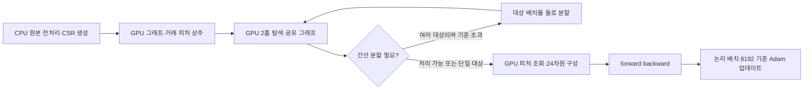

# SALT-GNN 속도 개선·학습 방식·논문 비교·HGB 결합 계획

기준일: **2026-11-05**. 현재 서버 실험의 최종 실행 설정을 팀 공유 노트북에 적용했다. 현재 실행은 기존 체크포인트를 이어 학습했고, **이 노트북은 원본에서 새로 전처리하고 처음부터 학습**한다. 같은 하이퍼파라미터를 사용해도 두 실행의 가중치·성능이 같다는 의미는 아니다.

## 1. CPU 그래프 준비가 느렸던 이유와 변경 과정

기존에는 배치마다 CPU에서 주변 거래를 탐색하고, 그래프를 합치고, 로컬 노드 번호를 만들었다. 이어서 CPU의 메모리 매핑 배열에서 많은 거래·노드 피처를 조회하고 GPU로 복사한 후에 모델을 계산했다. 작은 GPU 배치와 반복되는 준비 작업 때문에 GPU가 다음 입력을 기다리는 구간이 발생했다.

| 단계 | 기존 처리 | 적용한 개선 | 효과·유지 조건 |
|---|---|---|---|
| 탐색 중복 | 대상 거래별 반복 탐색 | `(계좌, 대상 거래의 분 시각)` 상태를 배치 내 중복 제거 | 같은 계좌라도 분 시각이 다르면 별도 상태 유지 |
| 그래프 준비 | CPU C 샘플러와 NumPy 합집합·매핑 | NVRTC로 컴파일한 CUDA 커널에서 2홉 탐색, GPU에서 합집합·노드 매핑 | 같은 대상 배치에서는 CPU 기준 그래프와 일치하도록 검사 |
| 거래 피처 | CPU 배열 조회 후 매 배치 전송 | GPU 상주 거래 피처에서 직접 조회·조합 | 수치 float32 유지; 라벨은 캐시하지 않음 |
| 피처 저장 | 24차원을 매번 CPU에서 구성 | 숫자 12개 float32 + 범주·유효성 비트 uint8 = 거래 ID당 49바이트 | 4개 이진 필드와 결제형식은 정수 비트로 보관 후 정확히 복원 |
| 날짜 변경 | 매 배치 입력 준비에 일별 정보 혼재 | 일별 노드 19차원과 원래 in/out-degree를 날짜마다 갱신 | 당일 마감 cutoff, Train에서 고정한 degree 보정 상수 유지 |
| 배치 확대 | GPU 최대 128 / 논리 512 | GPU 최대 4,096 / 논리 8,192 | 논리 배치 전체의 가중 CE 분모로 기울기 누적 후 Adam 1회 |
| 큰 그래프 처리 | 작은 상한, 입력 준비 비용 반복 | 간선 6,000,000개를 기준으로 **피처 조회 전** 재귀 분할 | 단일 대상 그래프는 크더라도 절단·누락하지 않음 |
| GPU 사용 한도 | 이전 서버 설정 9% | 현재 기본 90% | GPU 할당 제한이지 목표 사용률이나 OOM 방지 보장은 아님 |
| 진행률 | 한 번 출력한 상태는 고정 | 완료 배치·점수 저장 구간의 최신 기록을 3초마다 갱신 | 최근 배치 속도·UTC 시각 표시; 처리 건수 비율은 시간 비율이 아님 |



원본 CSV 전처리, 전역 CSR 생성, 일별 원래 degree 계산·디스크 캐시, 체크포인트·점수 저장은 여전히 CPU/디스크 작업이다. GPU로 옮긴 부분은 주로 **학습 중 반복되는 그래프 탐색과 입력 조합**이다. 전체 기간의 피처가 메모리에 있어도 샘플러는 다음 날 이후 간선을 선택하지 않는다. 같은 날 대상 시각보다 나중 거래는 사용할 수 있는 **당일 마감 일괄 탐지**이며, 실시간 인과 탐지와는 다르다.

간선 기준은 완성된 그래프를 보고 적용한다. 따라서 그래프 탐색 자체의 최대 메모리를 제한하는 하드 상한은 아니다. 마이크로배치 구성은 공유 이웃과 Ego 표시를 바꾸므로, **배치 확대는 예측·학습 궤적에 영향을 주는 실험 조건 변경**이다. 동일 대상 배치에서 CPU/CUDA 구현이 일치한다는 검증과, 서로 다른 배치 크기의 학습 결과가 같다는 주장은 구분한다.

## 2. 실측 속도와 실행 이력

측정 환경은 Tesla V100-SXM2-32GB 1대다. 동일 A3 체크포인트·날짜별 거래 순서에서 워밍업 후 32,768건씩 비교했다. 아래 기준 버전은 **이미 CUDA 그래프 탐색을 적용한 중간 버전**이다. 최초 CPU 그래프 준비 버전 대비 전체 개선 배율로 해석하지 않는다. 비교용 업데이트는 실제 학습 체크포인트에 반영하지 않았다.

| Train 날짜 | CUDA 그래프 + CPU 피처, micro/logical 4096/4096 | CUDA 그래프 + GPU 피처, micro/logical 4096/8192 | 개선 배율 | 준비 시간 비중 |
|---|---:|---:|---:|---|
| 2022-08-16 | 1,596.9건/초 | 6,208.9건/초 | 3.89배 | 69.7% → 5.2% |
| 2022-09-25 | 792.7건/초 | 3,973.5건/초 | 5.01배 | 74.4% → 5.5% |

이 비교에는 GPU 피처 캐시 외에도 논리 배치·간선 분할 기준 변경이 포함돼 있다. 한 요소만의 독립 효과가 아니며, 짧은 구간의 속도를 전체 6에폭·평가 시간에 그대로 곱하지 않는다. 새 전달본으로 같은 대규모 속도 측정을 다시 한 결과도 아니다. [원본 측정값과 조건](docs/source_speed_comparison_20261105.json)

| 서버 적용 시각 UTC | A3 첫 에폭에서 이미 처리한 거래 | 변경 |
|---|---:|---|
| 11-04 23:28 | 14,566,059 | CUDA 그래프, micro 128→4096, logical 512→4096, 간선 기준 640,000→8,000,000, 메모리 9%→85% |
| 11-04 23:50 | 15,327,915 | GPU 피처 캐시, logical 4096→8192, 간선 기준 8,000,000→6,000,000, 메모리 85%→90% |
| 11-05 00:34 | 28,782,046 | A3 완료 직후 개별 Val/Test를 먼저 실행하도록 순서 변경 |

서버 A3는 모델·Adam·난수 상태·진행 위치를 보존했다. 첫 에폭은 이전 배치가 섞여 **37,477회 업데이트**로 끝났다. 팀 공유본의 새 실행은 현재 배치를 처음부터 사용하므로, 지정 HI-Large 대상 수가 맞으면 **1에폭 10,714회**다. 계산은 날짜별 `ceil(대상 수 / 8192)`의 합이며 날짜를 섞지 않는다. 전달본은 실행 중 체크포인트의 설정 해시를 바꿔 강제 이관하는 기능을 제공하지 않는다.

## 3. 현재 학습·평가 조건

| 구간 | 날짜, 2022년 | 전체 대상 수 | 역할 |
|---|---|---:|---|
| 초기 이력 | 08-01~08-07 | 별도 감독학습 대상 아님 | 초기 관측 이력·전처리 보정 |
| Train | 08-08~09-25 | 87,572,226 | 매 에폭 모든 거래 학습 |
| Monitor | 09-26~10-04 | 18,625,135 | 매 에폭 F1@0.5로 best 체크포인트 선택 |
| fusion_fit | 10-05~10-08 | 7,315,599 | HGB 결합 후속 학습 예약; 현재 SALT 실행은 별도 학습하지 않음 |
| Val | 10-09~10-13 | 8,551,015 | 완료한 모델 비교·선택 |
| Test | 10-14~10-31 | 33,429,507 | 체크포인트·Val 고정 후 평가 |

Train 정상 거래 다운샘플링·IPW는 없다. 양성 손실 가중치 7은 클래스 불균형을 다루는 손실 설정이며 IPW와 다르다. 미래 구간의 라벨은 입력 피처에 포함하지 않는다. Degree 보정 상수 δ는 09-25 Train 종료 그래프의 활성 계좌 집합에서 방향별 `mean(log1p(degree))`로 계산해 고정한다.

| 항목 | 기본 설정 |
|---|---|
| 모델 | A3 층별 SALT-Trans 결합, A0 attention만, A1 통계만, A2 최종 단계 결합 |
| 구조 | 2층, hidden 20, attention heads 2 |
| 노드 입력 | 업무 피처 19 + Ego 1 = 20차원 |
| 간선·대상 입력 | 기존 14 + 결제형식 원핫 8 + in/out Port 2 = 24차원 |
| 학습 | Adam, 고정 LR 0.0012, weighted CE 양성 7, clip 5, seed 42, 모델당 6에폭 |
| Dropout | 층 결합 후 0.083, 최종 은닉층 0.288 |
| 그래프 | 양방향 2홉, 다른 분 최대 100 + 같은 분 전부, 거래 ID별 병렬 간선 보존 |
| 배치 | 논리 8192 / GPU 최대 4096, 간선 기준 600만, GPU 메모리 비율 0.9 |
| 평가 | 전체 대상, IPW 없음, 기본 확률 ≥0.5, AP·임계값 표·TOP-K·패턴/무패턴 Recall |
| 점수 저장 | 8192건 단위 commit, 체크포인트·코드·입력 해시 확인 후 재개 |

03의 기본 실행 순서는 **A3 Train/Monitor → A3 Val → 개별 고정 → A3 Test → A0/A1/A2 Train/Monitor → 전체 Val 비교·선택 고정 → 나머지 Test**다. A3 결과는 재사용하고 Test로 모델을 다시 선택하지 않는다. 04에서는 A3만 평가하거나 중단된 전체 평가를 재개할 수 있다. 학습 중인 같은 작업에는 연결만 하며 두 worker를 동시에 실행하지 않는다.

원본 데이터 처리와 현재 대규모 캐시 사이의 모든 수치·관측 ID가 동일하다는 검증은 아직 없다. 기본 설정과 실행 알고리즘을 옮긴 전달본이며, **기존 모델 결과의 완전 재현 완료본은 아니다**. GPU 상주 피처 크기는 원본 ID 폭에 비례한다. 기존 캐시에서 약 7.78GiB였고 그래프·모델·중간 activation 메모리는 별도다.

## 4. 논문과 우리 방식 비교

비교 원문은 [SALT-GNN v1](https://arxiv.org/html/2607.10131v1)이다. 아래 논문 조건은 주로 HI-Small/HI-Medium의 SALT-Trans이며, 배치 시간 비교는 부록 K의 별도 범위다.

| 항목 | 논문 | 현재 노트북 방식 |
|---|---|---|
| 데이터 | HI-Small, HI-Medium, AMLSim. [§4](https://arxiv.org/html/2607.10131v1#S4) | HI-Large 거래 분류, Train만 8,757만 건 |
| 시간 분할 | HI-Small/Medium 시간순 Train/Val/Test. [부록 I](https://arxiv.org/html/2607.10131v1#A9) | 별도 Monitor·fusion_fit 구간 추가, 위 날짜 고정 |
| 그래프 시간 범위 | 우리 일별 마감과 동일한 규칙은 확인하지 않음 | 당일 종료까지 누적, 같은 날 나중 거래 가능 |
| SALT 결합 | 통계·degree 보정·attention을 매 층 결합. [§3](https://arxiv.org/html/2607.10131v1#S3) | A3에 적용; 양방향 처리·Ego 등 세부 구현은 자체 선택 |
| 구조·최적화 | 2층, hidden 20, Adam, LR 0.0012, 양성 7. [최종 설정](https://arxiv.org/html/2607.10131v1#A9) | 수치 채택; heads 2·clip 5는 프로젝트 설정 |
| Dropout | 0.083 / 최종 0.288. [부록 I](https://arxiv.org/html/2607.10131v1#A9) | 수치는 채택, 적용 위치는 구현에서 명시 |
| 배치·이웃 | HI-Small 시간 비교: batch 8192, hop당 100. [부록 K](https://arxiv.org/html/2607.10131v1#A11) | logical 8192, micro 4096, 같은 분은 무제한; 동일 샘플링을 뜻하지 않음 |
| 구현·하드웨어 | 시간 비교 RTX A6000. [부록 K](https://arxiv.org/html/2607.10131v1#A11) | V100 32GB에서 튜닝한 CUDA 샘플러·49바이트 GPU 피처 캐시 |
| 체크포인트 | 전체 Val F1 최고. [§4](https://arxiv.org/html/2607.10131v1#S4) | 전체 Monitor F1 최고, 별도 Val로 모델 비교 |
| 예산·시드 | HI-Small 5, HI-Medium 3개 시드. [§4](https://arxiv.org/html/2607.10131v1#S4) | 현재 6에폭·seed 42, 추가 시드는 예정; 6에폭은 논문 수치 아님 |
| degree별 보고 | Test 예측을 수신 in-degree별 집계, F1·PR-AUC. [§4](https://arxiv.org/html/2607.10131v1#S4), [부록 F](https://arxiv.org/html/2607.10131v1#A6) | 전체 AP/F1 등 출력, degree별 분석은 후속 계획 |
| HGB 결합 | 이 비교의 SALT 구조와 별개 | 두 완성 모델의 점수를 새 로지스틱 회귀로 결합할 예정 |

논문의 학습률 설명 문장에는 0.001도 등장하지만 최종 SALT-Trans 설정은 0.0012이며 이 값을 채택했다. 배치 8192·이웃 100을 논문의 모든 실험에 일반화하지 않는다. 노트북의 AP는 average precision이며 논문의 PR-AUC와 적분 정의까지 같은지는 별도 확인이 필요하다. 데이터·시간 범위·입력·시드·배치의 차이가 있으므로 논문과의 숫자만으로 우열이나 완전 재현을 주장하지 않는다.

## 5. 후속 계획: SALT A3 + HGB 점수 결합

**상태: 연결 가능성 확인, 정식 결합 모델·성능 평가는 예정.** 기존 서버 A3의 1에폭 스냅샷과 41피처 실험에서 채택한 HGB를 CPU 256건에 연결해 로지스틱 회귀 학습·저장·재로딩을 확인했다. 해당 HGB는 22종/36입력 열을 사용하며, 당시 추가 8종/12열은 HGB에만 들어갔다. 41은 예전 HGB+GNN의 피처 종류 합집합이며, 현재 payment format·Port가 추가된 SALT 결합 모델의 총 종류 수로 그대로 부르지 않는다. [확인 결과 요약](docs/hgb_feasibility_summary_20261105.json)

```text
동일 거래 ID
 ├─ 완료된 SALT A3 → logit_1 - logit_0 ───┐
 └─ 기존 HGB(36열) → 보정한 사기 logit ───┤
                                         └─ 새 scaler + 로지스틱 회귀 → 결합 점수
```

HGB는 기존 3클래스 확률을 `[1,100,100]`으로 나눈 뒤 재정규화하고, 두 사기 클래스 확률의 합을 logit으로 바꾼다. SALT는 현재 모델의 `logit_1-logit_0`를 사용한다. 이전 GNN용 `-log(300)`이나 예전 fusion의 scaler·계수·임계값을 새 모델에 그대로 적용하지 않는다. 새 결합 학습의 가중치·정규화·임계값 규칙은 별도 실험 설정으로 고정한다.

| 순서 | 예정 사항 | 완료 기준 |
|---|---|---|
| 1 | A3 6에폭 완료 후 Monitor 기준 best 고정 | 모델·프로토콜·입력·코드 해시 기록 |
| 2 | HGB 모델 및 입력 계약 고정 | 36열의 순서·정의·학습 시 변환 일치; HGB 추가 피처 준비 |
| 3 | 10-05~10-08 두 점수 준비 | 거래 ID·날짜·정상/사기·무패턴 구분 일치, 누락·중복 0 |
| 4 | 해당 구간으로 새 로지스틱 회귀 학습 | Train/Monitor/Val/Test 라벨을 결합 학습에 섞지 않음 |
| 5 | 전체 Val에서 SALT/HGB/결합 비교 | 같은 대상·지표, F1/AP/Precision/Recall/무패턴 Recall 확인 |
| 6 | 결합 방식·임계값 고정 후 전체 Test | 33,429,507건의 완전한 점수·실제 정오분류 수, Test 튜닝 없음 |
| 7 | 결과에 따른 진단 | degree별 성능, 추가 시드, 메모리·처리 시간 보고 |

현재 서버의 fusion_fit는 **전량 7,315,599건**, 기존 HGB의 저장 점수는 **정상 표본 + 양성 전수 115,830건**이다. 전량 학습을 우선안으로 두며, 기존 표본을 이용할 경우 IPW와 표본임을 명시한다. 전량 경로에는 SALT 추론과 10-05~10-08의 HGB 일부 피처 생성이 남아 있다. 샘플로 학습하더라도 최종 Val/Test는 전수로 평가한다.

SALT는 마이크로배치 구성에 따라 공유 문맥이 달라진다. 따라서 정식 fusion_fit 점수도 최종 평가와 맞춘 배치·정렬·분할 규칙으로 생성한다. **256건 CPU 시험(micro 16)은 생산용 micro 4096의 점수 동등성이나 성능 검증이 아니다.** HGB의 패턴 라벨 1~8은 SALT의 알려진 패턴 1로 대응하며 정상 0·무패턴 9는 같다.

기존 서버 모델과 캐시에 대한 호환 확인을 새 원본 전처리에도 자동으로 확장하지 않는다. **이 공유본에는 HGB 가중치·36열 전체 생성기·정식 fusion 학습기를 아직 포함하지 않았다.** 새 캐시로 기존 HGB를 쓸 때는 추가 피처 구현과 기존 점수 재현 검사가 먼저 필요하다. 기존 모델을 재사용할 수 있는 조건이 충족되면 SALT/HGB를 결합 때문에 처음부터 재학습할 필요 없이 결합기만 새로 학습한다.

추가 시간의 주요 후보는 SALT 추론과 피처 생성이다. 입력이 2열인 로지스틱 회귀 자체의 비용은 작지만, 256건 시험 시간을 전량 소요 시간으로 환산하지 않는다. 현재 GPU 학습과 큰 캐시를 동시에 올리지 않도록 추론 실행 시간을 분리한다. 이 계획은 자동 실행 예약이 아니다.

## 6. 전달본 검증과 저장 범위

실행 가능한 테스트와 검증 결과는 [검증 JSON](docs/verification_20261105.json)에 기록한다. 검증에는 노트북만 복사한 작업 폴더의 소스 복원, Python 구문, 단위 테스트, 작은 합성 CSV의 원본 전처리→4개 모델→전체 Val/Test가 포함된다. CUDA 전용 검사는 작은 합성 그래프·피처를 사용한다.

2026-11-05 검증 결과:

- **6개 노트북만 복사한 별도 폴더**에서 새 커널로 모두 실행했다. 내장 실행 소스 40개가 검사한 코드와 일치하고, 기본 실행으로 실제 원본 전처리·대규모 학습이 시작되지 않았다.
- CPU 환경: **26개 통과, CUDA 전용 7개 skip**. CUDA 환경: **33개 모두 통과**, skip 없음.
- CPU와 CUDA 각각 합성 원본 **133행 → 관측 거래 132건**, 4개 모델 각 1에폭, 모델별 전체 합성 Test **24건** 채점 완료.
- CUDA에서 **6개 날짜 × 4개 모델**의 실제 생성 입력·forward/backward를 검사했다. 동일 대상 배치의 CPU/CUDA 입력은 일치했고, A3 개별 Test가 A0 학습 전에 끝나는 순서·완료 결과 재사용도 확인했다.
- CUDA 작은 입력 사전 검증의 최대 할당은 **19,149,824바이트(약 18.3MiB)**였다. 실제 HI-Large의 메모리 요구량을 나타내는 수치가 아니다.

기존 서버의 대규모 GPU 사전 검증과 이번 전달본의 작은 데이터 검증은 별개다. 이 공유본으로 HI-Large 전체를 재전처리·6에폭 재학습하거나 최종 Val/Test 성능을 새로 측정한 것은 아니다. 코드·문서는 Git에 올릴 수 있도록 출력과 실행 번호를 제거했다. 원본·실험 산출물·로컬 경로 설정은 `.gitignore`로 제외한다.
