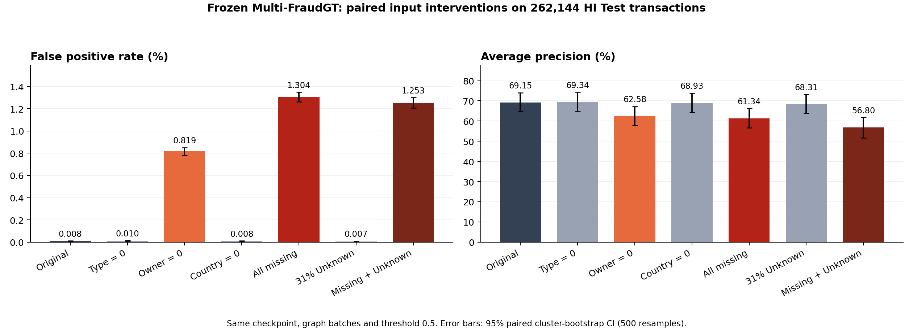
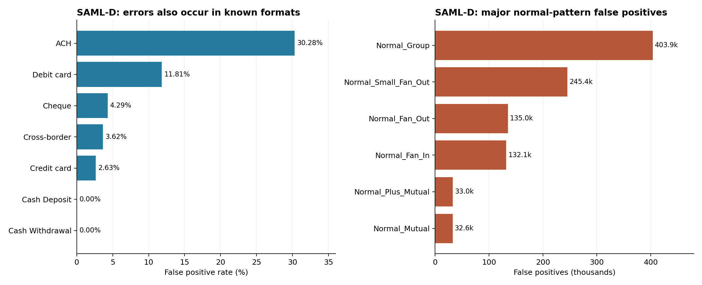

# Multi-FraudGT SAML-D 결측·분포 진단

분석 완료: 2026-11-06T05:29:51.953491+00:00

## 판단

**현재 모델은 소유관계 피처의 0 대체에 크게 취약하다. 다만 SAML-D의 전체 성능 저하를 결측 하나로 설명할 수는 없다.**

- HI의 같은 거래·같은 그래프·같은 가중치에서 소유관계 3종만 0으로 바꾸자 오탐이 **21 → 2,143건**, F1이 **72.33% → 17.95%**로 악화했다. 원래 정상으로 판단한 거래 2,124건이 새 오탐으로 바뀌었다.
- SAML과 동일하게 결측 11종을 모두 0으로 처리하면 F1 **12.98%**, AP **61.34%**다. 여기에 약31% Unknown까지 넣어도 AP **56.80%**다. **SAML 전체 AP 2.04% 수준의 순위 성능 붕괴는 이 HI 대조 실험에서 재현되지 않았다.**
- 국가 피처만 0으로 처리한 영향은 작았다. 따라서 “같은 국가 여부를 0으로 채운 것”이 핵심이라는 가설은 이번 대조 결과가 지지하지 않는다.
- Unknown 결제방식은 단독으로 약간의 AP 저하가 있었고 다른 결측과 함께 적용하면 추가 악화가 있었다. 그러나 단독 조건의 오탐 폭증은 나타나지 않았다. SAML에서도 Known 거래의 오탐률이 Unknown보다 높았다.
- 원본 HI 학습 데이터의 알려진 사기 패턴은 **99.987%가 ACH**였다. SAML에서는 사기·정상 패턴과 결제방식의 관계, 반복 거래·활동일·자기거래·Port 분포가 모두 다르다. 이런 차이가 별도의 설명 후보다.

이는 **HI에서 입력을 인위적으로 바꾼 모델 민감도 실험**이다. 실제 SAML의 누락된 소유관계 참값을 확보한 전후 비교가 아니므로, 결측을 복구하면 SAML에서 몇 % 회복되는지나 원인별 기여율을 확정하지 않는다.

## 1. 사전에 고정한 가설·실험 조건

가설: (H1) 미제공 계좌·국가 피처의 0 대체가 성능 저하를 유발한다. (H2) HI에서 없었던 Unknown 결제방식이 주된 원인이다. (H3) 관측 가능한 피처와 거래 패턴의 분포 차이도 크다.

| 항목 | 조건 |
|---|---|
| 대상 | 기존 HI 전체 Test 중 원래 공유 배치 128개를 무작위 선택: **262,144건**, 양성 **332건** |
| 표본 선택 | seed 20261106, 정답·점수와 독립적으로 원래 2,048건 배치 단위 선택 |
| 모델 | HI Multi-FraudGT epoch280 고정, 재학습 없음 |
| 판정 | 원래 임계값 sigmoid(logit)>0.5 고정, 새 임계값 선택 없음 |
| 그래프 | 원래 HI Test 누적 그래프, 같은 배치 구성과 sampler RNG·fanout[50,50] 유지 |
| 변경 범위 | 지정한 피처만 변경. context 엣지와 query 엣지에 같은 처리 적용. Ego·Port·그래프·거래 ID는 유지 |
| Unknown 대조 | 전체 거래 ID에 고정한 독립 Bernoulli mask, 확률 30.9951%; 실제 query 비율 31.0551% |
| 불확실성 | 같은 배치를 함께 재표집하는 paired cluster bootstrap 500회, 95% 구간 |
| 검증 | 128개 원본 배치 모두 기존 전체 Test 저장 점수를 허용 오차 이내 재현 |

Unknown 대조는 HI에 임의의 결측을 넣은 민감도 시험이다. SAML의 Debit card/Cross-border가 Unknown이 되는 실제 의미·패턴 구성을 그대로 재현하지 않는다. 결과는 **표본 진단 지표**이며, 기존 HI 전체 Test 성능을 대체하지 않는다. SAML 전체 결과를 본 후 수행한 사후 분석으로, 새 미사용 Test 검증이 아니다.

## 2. 같은 HI 표본에서의 대조 결과

| 조건 | Precision | Recall | F1 | AP | FPR | 오탐 수 |
|---|---:|---:|---:|---:|---:|---:|
| 원본 | 90.50% | 60.24% | 72.33% | 69.15% | 0.0080% | 21 |
| 계좌 유형 6종 → 0 | 88.55% | 60.54% | 71.91% | 69.34% | 0.0099% | 26 |
| 소유관계 3종 → 0 | 10.22% | 73.49% | 17.95% | 62.58% | 0.8185% | 2,143 |
| 국가 2종 → 0 | 90.95% | 60.54% | 72.69% | 68.93% | 0.0076% | 20 |
| 결측 11종 모두 → 0 | 7.08% | 78.31% | 12.98% | 61.34% | 1.3036% | 3,413 |
| 결제방식 약31% → Unknown | 91.24% | 59.64% | 72.13% | 68.31% | 0.0073% | 19 |
| 결측 11종 + Unknown 약31% | 6.97% | 74.10% | 12.75% | 56.80% | 1.2532% | 3,281 |

| 조건 | 원본 대비 AP 변화 | paired 95% 신뢰구간 |
|---|---:|---:|
| 계좌 유형 6종 → 0 | +0.19 pp | [-0.45, +0.80] pp |
| 소유관계 3종 → 0 | -6.57 pp | [-8.31, -4.88] pp |
| 국가 2종 → 0 | -0.22 pp | [-0.55, +0.12] pp |
| 결측 11종 모두 → 0 | -7.81 pp | [-9.75, -5.97] pp |
| 결제방식 약31% → Unknown | -0.84 pp | [-1.83, -0.04] pp |
| 결측 11종 + Unknown 약31% | -12.36 pp | [-14.79, -9.91] pp |

소유관계 0 처리 시 정상 거래의 평균 logit이 **+4.837** 상승했다. F1과 오탐은 크게 악화했지만 AP 하락은 상대적으로 작았다. 따라서 **고정 임계값에서 정상 점수가 올라가 경보가 늘어나는 문제와 순위 성능 저하를 구분**해야 한다. 이 결과만 보고 SAML Test 정답으로 임계값을 다시 맞추지는 않았다.

## 3. 무엇이 실제로 결측인가

전처리 캐시의 NaN/Inf는 **0개**다. 문제는 NaN 계산 오류가 아니라 **없는 정보를 숫자 0으로 표현한 체계적인 입력 차이**다.

- 노드 계좌 유형 6종: Corporation, Partnership, Sole Proprietorship, Individual, Country, Direct.
- 노드 소유관계 3종: `log_entity_observed_accounts`, `log_entity_out_diversity`, `log_entity_in_diversity`.
- 엣지 국가 2종: `same_known_country`, `both_countries_known`.
- 위 11종은 SAML 전체에서 0이다. 따라서 SAML 안에는 해당 정보의 “관측된 대조군”이 없다.
- 소유 엔터티 관측 계좌 수·송신 다양성 등은 HI 정상 표본에서 거의 항상 양수였다. SAML의 0은 학습 때 드물거나 없던 입력이다. 특히 로그 계좌 수의 0은 숫자로는 관측 계좌 0개를 뜻해, 실제 계좌가 존재하는 상황에서 ‘정보 없음’과 의미가 어긋난다.
- `both_countries_known=0`은 기존의 정보 가용성 단서를 제공한다. 따라서 모든 결측에 표시가 전혀 없다고 일반화하면 안 된다. 다만 소유관계 등의 0을 구분하는 공통 신규 mask는 없다.

## 4. 기존 SAML 전체 점수에서의 오탐 위치

| 구분 | 거래 수 | 오탐 수 | FPR | Recall | AP |
|---|---:|---:|---:|---:|---:|
| Known | 6,558,818 | 747,007 | 11.40% | 27.15% | 2.69% |
| Unknown | 2,946,034 | 271,248 | 9.22% | 75.93% | 1.43% |
| Supported | 9,345,081 | 1,013,683 | 10.86% | 46.15% | 2.11% |
| Unsupported | 159,771 | 4,572 | 2.87% | 35.91% | 2.97% |

Known 결제방식 거래만 남겨도 오탐률은 **11.40%**다. 지원하지 않는 통화의 오탐은 4,572건으로 전체 1,018,255건의 일부이며, 지원 통화에서도 오탐이 크다. 이 그룹 비교는 패턴 구성이 달라질 수 있어 단독 인과 효과로 해석하지 않는다.

사기 비율도 HI Test **0.1319%**, SAML **0.1039%**로 다르지만 이것만으로 낮은 Precision을 설명할 수는 없다. 정상 거래를 분모로 하는 FPR 자체가 HI **0.00922%**에서 SAML **10.7241%**로 약 **1,163배** 늘었다. 참고로 HI의 TPR/FPR이 그대로라고 가정하고 양성 비율만 SAML 비율로 바꾸는 산술 계산의 Precision은 약 **86.70%**다. 이는 실제 SAML 예측 성능이 아니라 단순 양성 비율 차이의 영향 크기를 살펴보는 계산이다.

| 결제방식 | HI 전체 Test FPR | SAML 전체 FPR | SAML 오탐 수 | SAML Recall |
|---|---:|---:|---:|---:|
| ACH | 0.0738% | 30.2784% | 607,884 | 99.83% |
| Cash Deposit | 0.0002% | 0.0027% | 6 | 2.99% |
| Cash Withdrawal | 0.0002% | 0.0000% | 0 | 0.00% |
| Cheque | 0.0003% | 4.2889% | 86,222 | 30.63% |
| Credit card | 0.0002% | 2.6293% | 52,895 | 11.44% |
| Cross-border | 대응 없음 | 3.6225% | 33,736 | 69.29% |
| Debit card | 대응 없음 | 11.8108% | 237,512 | 91.46% |

SAML 사기의 **27.74%**가 현금 입출금인데 해당 탐지율은 **1.53%**였다. 이 구간의 미탐 2,697건은 전체 미탐의 **50.30%**다. HI 학습에서 현금 사기가 전혀 없었던 것은 아니다: **2,136건**이 있었지만 모두 기존의 ‘무패턴’ 양성이었고 알려진 패턴 양성은 0건이었다. HI 전체 Test에서도 현금 사기 643건을 전부 놓쳤다. 기존 HI의 높은 알려진 패턴 성능이 SAML의 다른 사기 유형에 그대로 이전되지 않는다는 근거다.

정상 `Normal_Group` 528,351건 중 **403,879건(76.44%)**이 오탐이며, 전체 오탐의 **39.66%**를 차지한다. 정상 행위 패턴 자체도 별도 분석 대상이다.

## 5. 관측 가능한 피처도 분포가 다르다

각 도메인에서 정답과 독립적으로 거래 100,000건을 추출하고, 그중 정상 거래를 비교했다. 노드값은 실제 모델에 사용한 기간 말 스냅샷이다. 표의 값은 변환된 입력의 **중앙값**이며 원래 거래 수가 아니다. KS는 분포 차이 크기(0~1)이며 인과 중요도가 아니다.

| 피처 | HI Train | HI Test | SAML | SAML vs HI Train KS |
|---|---:|---:|---:|---:|
| `src_log_entity_observed_accounts` | 1.386 | 1.386 | 0.000 | 1.000 |
| `src_log_entity_out_diversity` | 2.398 | 2.485 | 0.000 | 1.000 |
| `src_log_entity_in_diversity` | 2.079 | 2.303 | 0.000 | 0.999 |
| `src_log_self_count` | 1.099 | 1.609 | 0.000 | 0.733 |
| `dst_log_self_count` | 1.099 | 1.609 | 0.000 | 0.862 |
| `pair_prior_count` | 3.689 | 5.004 | 1.946 | 0.640 |
| `src_log_active_days` | 4.043 | 4.533 | 5.069 | 0.682 |
| `dst_log_active_days` | 4.043 | 4.533 | 2.773 | 0.662 |
| `paid_currency_z` | -0.033 | -0.021 | 0.834 | 0.412 |
| `in_port` | 1.000 | 1.000 | 0.000 | 0.486 |
| `out_port` | 1.000 | 1.000 | 7.000 | 0.385 |

SAML의 자기거래·자기거래 수는 실제로 0이며 이 부분은 결측 대체가 아니다. 계좌 활동일 수는 HI 학습 그래프 56일, HI Test 누적 92일, SAML 누적 321일이라는 관측 기간 차이도 받는다. SAML 정상 송신 계좌 활동일 입력의 **68.24%**가 HI 학습 정상 표본의 99백분위를 넘었다. Port와 반복 거래 수의 차이는 단순히 결측 열을 제거해도 남는다.

## 6. 다음 실험의 우선순위 — 이번에는 실행하지 않음

1. **공통으로 관측 가능한 피처만 쓰는 재학습 대조**: 34종에서 미제공 11종을 제외한 23종 기준. 기존 모델의 추론 입력을 0으로 만드는 것과, 처음부터 해당 정보 없이 학습하는 것은 다른 실험이다.
2. **학습 시 결측 처리에 적응시키는 대조**: 명시적 결측 표시, 소유관계 피처 masking, Unknown 결제방식 노출 등을 학습 데이터에 적용하고 원래 HI 성능과 결측 상황 성능을 함께 검증한다.
3. **결제방식 의존과 관측 기간 차이 분리**: 결제방식 제외 모델, 같은 길이의 관측 이력/기간 기준 피처를 비교한다. 설정 선택은 별도 검증 데이터에서 하고, 이미 진단에 사용한 SAML 전체를 새로운 미사용 Test라고 부르지 않는다.

SAML의 실제 KYC/소유관계를 추측해 넣거나, 이번 Test 점수를 보고 임계값·피처값을 바꾸어 최종 개선이라고 보고하지 않았다.

## 산출물·검증·작업 상태

- `analysis_plan.json`, `control_plan.json`: 분석 범위·가설·표본·입력 개입 조건. `control_plan.json`은 추론 전에 고정했다.
- `control_metrics.csv`, `control_result.json`: 대조 지표·신뢰구간. `control_chunks/`: 동일 표본의 조건별 점수.
- `control_input_parity.json`: 3개 실제 배치에서 GPU 입력과 원본 CPU 입력의 비트 단위 일치 확인.
- `intervention_unit_checks.json`: 지정 열만 변경하고 원본 배치·그래프·Port·Ego를 보존하는지 확인.
- `saml_group_metrics.csv`, `saml_pattern_by_payment_known.csv`, `normal_pattern_fp_contribution.csv`: SAML 전체 그룹 진단.
- `HI_payment_population.csv`, `HI_full_test_payment_metrics.csv`: HI 전체 Train/Test 결제방식 분포 및 저장 점수의 조건별 오류.
- `feature_distribution_normal_sample.csv`, `distribution_sampling.json`: 표본 분포와 표본 방식. `missingness_inventory.json`: 결측·NaN 검사.
- **SALT-GNN은 2026-11-06 05:16:11 UTC에 체크포인트를 저장하고 중단했으며, 자동 재개하지 않았다.** `salt_paused.json`, `salt_last_at_pause.pt`에 재개 가능한 상태를 보존했다.

후속 실험으로 소유관계 3종을 HI Train 중앙값으로 대체해 SAML 전체를 평가했다. HI Validation에서는 개선됐으나 SAML에서는 Precision·Recall·F1·AP가 악화했다. 자세한 조건·전체 결과는 [대체값 비교 결과](../대체값_비교_20261106/결과.md)에 기록했다. 이는 결측에 대한 민감도와, 실제로 유효한 대체값을 구하는 문제가 다르다는 추가 근거다.
