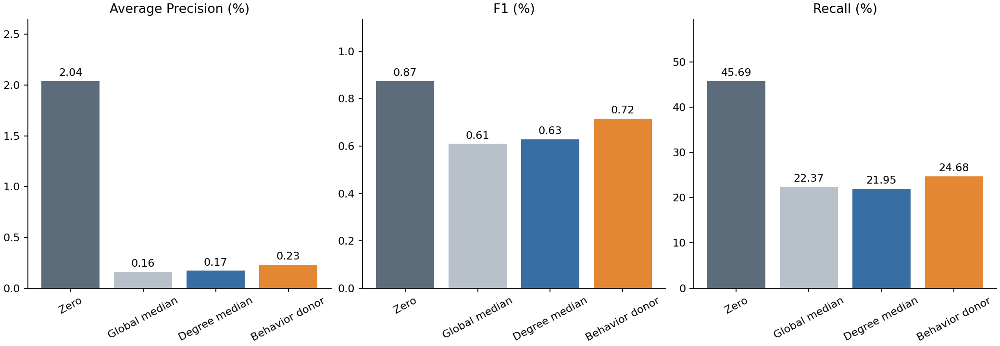

# 추가 결측 대체 실험: 차수 구간 중앙값과 유사 계좌 대체

완료: 2026-11-06T07:21:37.620779+00:00

**판단: 이번 두 대체 방식은 채택하지 않는다.** 차수 구간별 중앙값과 유사 계좌 대체 모두 기존 0 대체보다 Precision·Recall·F1·AP가 낮았다. HI Validation에서는 결측을 보완했지만 SAML의 전체 성능 개선으로 이어지지 않았다.

이는 **결측이 성능 하락 원인이 아니라는 증거가 아니다.** HI 통계나 유사 계좌에서 가져온 값으로 실제 SAML 소유관계를 복원하지 못했을 수 있다. 다음 우선순위는 공통 관측 피처 23종으로 재학습하거나 학습 중 결측 masking에 적응시키는 대조다. 이번에는 해당 재학습을 실행하지 않았다.

## SAML-D 전체 결과

두 방법 모두 사전에 정해 **전체 9,504,852건**을 평가했다. HI Validation에서 먼저 고른 후보는 **차수 구간별 중앙값**이다. 아래 SAML 성능으로 후보나 임계값을 재선택하지 않았다.

| 입력 처리 | Precision | Recall | F1 | AP | FPR | 사기 탐지 | 정상 오탐 |
| --- | --- | --- | --- | --- | --- | --- | --- |
| 기존 0 대체 | 0.44% | 45.69% | 0.87% | 2.04% | 10.7241% | 4,511 | 1,018,255 |
| HI 전체 중앙값 | 0.31% | 22.37% | 0.61% | 0.16% | 7.5076% | 2,209 | 712,843 |
| 차수 구간별 중앙값 | 0.32% | 21.95% | 0.63% | 0.17% | 7.1266% | 2,167 | 676,670 |
| 행동 유사 계좌 대체 | 0.36% | 24.68% | 0.72% | 0.23% | 7.0375% | 2,437 | 668,211 |

- **차수 구간별 중앙값:** 기존 0 대체 대비 AP·F1의 일관된 개선을 확인하지 못했다. AP -1.86 pp, F1 -0.24 pp, Recall -23.74 pp. 이는 이미 확인한 SAML 전체에 대한 탐색 결과다.
- **행동 유사 계좌 대체:** 기존 0 대체 대비 AP·F1의 일관된 개선을 확인하지 못했다. AP -1.80 pp, F1 -0.16 pp, Recall -21.01 pp. 이는 이미 확인한 SAML 전체에 대한 탐색 결과다.

## 바꾼 값과 고정한 조건

소유관계 노드 피처 `log_entity_observed_accounts`, `log_entity_out_diversity`, `log_entity_in_diversity` 3종만 변경했다. 계좌 유형6종·국가2종은 계속0이며, 결제방식 Unknown 대응·다른 관측 피처·Port·Ego는 유지했다. 가중치 epoch280, 임계값0.5, all_targets, 공유배치2048, fanout[50,50], 거래 순서와 sampler RNG도 동일하다. 두 방법이 배치마다 **같은 샘플링 그래프**를 공유했다.

| 방법 | 계산 기준 | 한계 |
|---|---|---|
| 차수 구간별 중앙값 | HI Train의 송신·수신 상대계좌 수 구간별 소유관계 중앙값. 128계좌 미만인 구간은 Train 전체 중앙값. 앞선 실험과 같은 적합 결과 사용 | 같은 구간 안에서도 실제 소유관계는 다를 수 있음 |
| 행동 유사 계좌 대체 | HI Train 활동 계좌 중 seed20261109로 65,536개를 균등 추출. 관측 행동10종을 Train p01/p99로 제한하고 중앙값/IQR로 스케일링. 근접 계좌1개의 실제 소유관계3종을 함께 복사 | 근접 계좌의 소유관계가 SAML의 참값이라는 뜻은 아님. p01/p99 제한으로 관측 범위 밖의 차이가 소실될 수 있음 |

유사 계좌 검색은 Euclidean cKDTree k=1, eps0.1로, 반환 거리는 정확한 최단거리의1.1배 이내인 근사 최근접 검색이다. 스케일은 max(IQR,0.1)이며 설정·계좌 표본은 모델 평가 전에 고정했다. 분류 정답은 대체값 적합에 쓰지 않았다. SAML 입력은 적합된 규칙으로 변환하고 검색할 때만 사용했다. 모든 대체값은 추정값이며 누락된 실제 소유관계의 복원이 아니다.

## HI Validation에서의 비교

앞선 실험과 같은262,144건(128배치), 사기340건을 사용했다. 기존 네 조건의 점수를 모두 재현했고 새 유사 계좌 조건을 추가했다. 두 신규 전체평가 후보의 AP로 우선 후보를 선택하고, AP 동률1e-12 이내에서는 F1을 사용하도록 사전에 정했다. 두 후보는 선택 결과와 무관하게 모두 SAML 전체 평가하도록 고정했다.

| HI Validation 조건 | Precision | Recall | F1 | AP | 오탐 |
| --- | --- | --- | --- | --- | --- |
| HI 원본 | 92.66% | 59.41% | 72.40% | 68.55% | 16 |
| 기존 0 대체 | 7.49% | 79.41% | 13.69% | 58.55% | 3,335 |
| HI 전체 중앙값 | 87.88% | 59.71% | 71.10% | 68.21% | 28 |
| 차수 구간별 중앙값 | 83.61% | 60.00% | 69.86% | 68.05% | 40 |
| 행동 유사 계좌 대체 | 83.95% | 60.00% | 69.98% | 67.46% | 39 |

## 패턴별 변화

사기 패턴은 Recall, 정상 패턴은 FPR다. 전체 패턴별 건수는 `pattern_comparison.csv`에 있다.

두 방법 모두 사기 패턴 17종 중 15종에서 기존 0 대체보다 탐지율이 낮아졌고, `Cash_Withdrawal` 1,334건과 `Smurfing` 932건은 계속 탐지율 0%였다. 정상 `Normal_Group`의 오탐률은 기존 76.4414%에서 차수 구간별 중앙값 99.9947%, 유사 계좌 대체 99.8917%로 악화했다. 전체 오탐이 줄었다는 사실만으로 개선이라고 평가할 수 없다.

| 패턴 | 구분 | 건수 | 기존 0 대체 | HI 전체 중앙값 | 차수 구간별 중앙값 | 행동 유사 계좌 대체 |
| --- | --- | --- | --- | --- | --- | --- |
| Behavioural_Change_1 | 사기 | 394 | 71.8274% | 75.8883% | 69.7970% | 59.3909% |
| Behavioural_Change_2 | 사기 | 345 | 82.0290% | 90.4348% | 81.4493% | 67.2464% |
| Bipartite | 사기 | 383 | 53.5248% | 20.3655% | 21.9321% | 26.3708% |
| Cash_Withdrawal | 사기 | 1,334 | 0.0000% | 0.0000% | 0.0000% | 0.0000% |
| Cycle | 사기 | 382 | 53.1414% | 13.8743% | 14.3979% | 20.9424% |
| Deposit-Send | 사기 | 945 | 35.2381% | 4.7619% | 7.0899% | 8.9947% |
| Fan_In | 사기 | 364 | 54.1209% | 30.7692% | 29.6703% | 34.8901% |
| Fan_Out | 사기 | 237 | 53.1646% | 18.1435% | 21.5190% | 22.3629% |
| Gather-Scatter | 사기 | 354 | 56.4972% | 24.2938% | 24.8588% | 29.6610% |
| Layered_Fan_In | 사기 | 656 | 57.0122% | 24.3902% | 26.6768% | 30.6402% |
| Layered_Fan_Out | 사기 | 529 | 55.7656% | 20.6049% | 20.4159% | 28.3554% |
| Normal_Cash_Deposits | 정상 | 223,801 | 0.0027% | 0.0000% | 0.0000% | 0.0000% |
| Normal_Cash_Withdrawal | 정상 | 305,031 | 0.0000% | 0.0000% | 0.0000% | 0.0000% |
| Normal_Fan_In | 정상 | 2,104,285 | 6.2760% | 0.0730% | 0.0755% | 0.1985% |
| Normal_Fan_Out | 정상 | 2,302,220 | 5.8628% | 2.4572% | 1.8399% | 1.0005% |
| Normal_Foward | 정상 | 42,031 | 29.9945% | 29.5829% | 28.5884% | 26.5994% |
| Normal_Group | 정상 | 528,351 | 76.4414% | 99.9975% | 99.9947% | 99.8917% |
| Normal_Mutual | 정상 | 125,335 | 25.9911% | 4.8733% | 4.6643% | 5.5890% |
| Normal_Periodical | 정상 | 210,526 | 6.4434% | 4.0879% | 3.4552% | 2.5541% |
| Normal_Plus_Mutual | 정상 | 155,041 | 21.2918% | 5.9668% | 5.9733% | 5.8275% |
| Normal_Small_Fan_Out | 정상 | 3,477,717 | 7.0551% | 2.2130% | 1.6505% | 1.9753% |
| Normal_single_large | 정상 | 20,641 | 49.4986% | 63.1607% | 61.0629% | 57.7831% |
| Over-Invoicing | 사기 | 54 | 55.5556% | 12.9630% | 14.8148% | 18.5185% |
| Scatter-Gather | 사기 | 338 | 62.4260% | 22.1893% | 22.7811% | 25.4438% |
| Single_large | 사기 | 250 | 47.6000% | 11.2000% | 11.6000% | 15.2000% |
| Smurfing | 사기 | 932 | 0.0000% | 0.0000% | 0.0000% | 0.0000% |
| Stacked Bipartite | 사기 | 506 | 52.9644% | 24.9012% | 27.8656% | 30.2372% |
| Structuring | 사기 | 1,870 | 74.0107% | 36.1497% | 33.1551% | 41.8182% |

## 해석·검증·산출물

이번 결과는 이미 여러 번 분석한 SAML Test에 대한 후속 진단이다. HI Validation에서 좋은 방식이 SAML에도 유효하다는 보장은 없다. 3종의 대체 방식 비교이지, 11종 전체 결측이나 도메인 차이를 제거한 실험은 아니다. 모든 방법이 실패하더라도 결측이 원인이 아니라는 결론을 낼 수 없으며, 새 방법이 개선돼도 별도 미사용 평가에서 재확인이 필요하다.

대체값 적합은 HI Train만 사용했다. 대표노드64개에서 유사 계좌 거리의 근사 허용범위와 실제 donor3종의 일치를 독립 전수 거리 계산으로 검사했다. HI Validation 원본 및 이전3조건은128배치 모두 기존 점수를 재현했다. SAML 대표4배치에서는 두 방법 각각의 CPU/GPU 입력·점수 일치와 기존 0 대체 재현을 검사했다. 전체950만여 거래에 대해 누락·중복 없이 점수를 만들었고 AP는 별도 구현과 scikit-learn으로 검산했다. SALT-GNN의 중단 상태와 체크포인트 보존도 확인했다.

`plan.json`, `fit.json`, `fit_checks.json`, `selection.json`, `target_protocol.json`, `target_preflight.json`, `final_verification.json`에 조건과 검증을 기록했다. `validation_metrics.csv`, `saml_metrics.csv`, `pattern_comparison.csv`, `result.json`은 결과이며, `saml_degree_median_logits.npy`, `saml_behavior_donor_logits.npy`는 원래 거래 ID 순서의 전체 점수다.

## 추가 검산·Validation 불확실성

동일한128개 검증 배치를 함께 재표집한 paired cluster bootstrap500회 결과다. 방법 선택을 끝낸 후 계산했으며, 선택이나 설정을 변경하는 데 사용하지 않았다.

| AP 비교 | 변화 | 95% 구간 |
|---|---:|---:|
| degree_median minus zero | +9.50 pp | [+7.34, +11.83] pp |
| behavior_donor minus zero | +8.91 pp | [+6.87, +11.16] pp |
| behavior_donor minus degree_median | -0.60 pp | [-1.81, +0.67] pp |
| behavior_donor minus train_median | -0.76 pp | [-2.12, +0.44] pp |
| behavior_donor minus original | -1.10 pp | [-2.63, +0.57] pp |

유사 계좌와 차수 구간 중앙값의 AP 차이 구간은0을 포함한다. Validation에서의 순위를 보편적인 우열로 해석하지 않는다.

유사 계좌 적합에서는 HI Train의65,536개 donor만 사용했다. Validation 전체 계좌에서는 39,471개 donor, SAML 전체 계좌에서는 1,939개 donor가 실제 선택됐다. 변환 후 근접 거리는 계좌 단위 중앙값 기준 HI Validation 0.2201, SAML 0.4461다. 이는 행동 입력의 대응 정도를 살펴보는 진단이며 실제 소유관계 정확도는 아니다. SAML에는 실제 소유관계 정답이 없어 대체값의 참값 오차를 계산할 수 없다.

[Validation 불확실성 원본](validation_uncertainty.json), [대체값 적합·거리 진단](fit.json), [최종 독립 검산](independent_verification.json).
