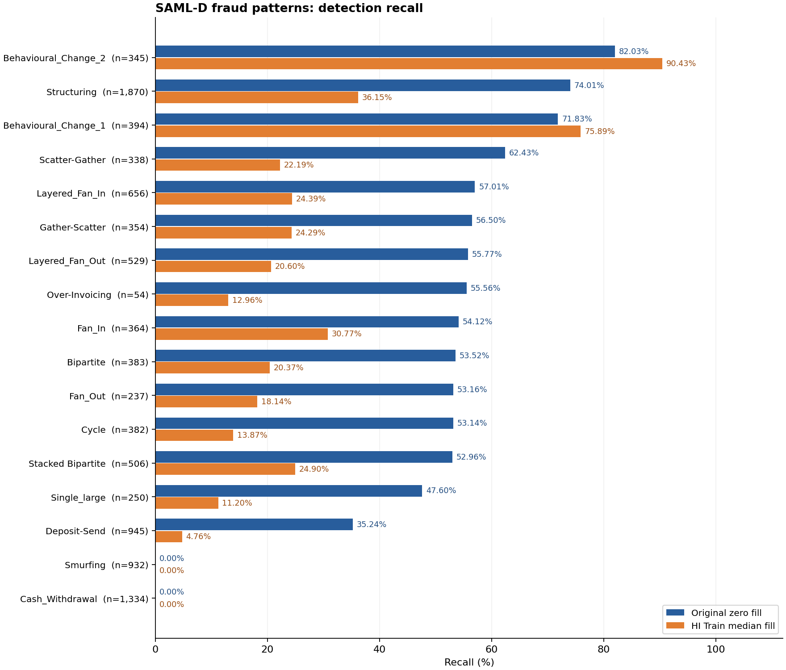
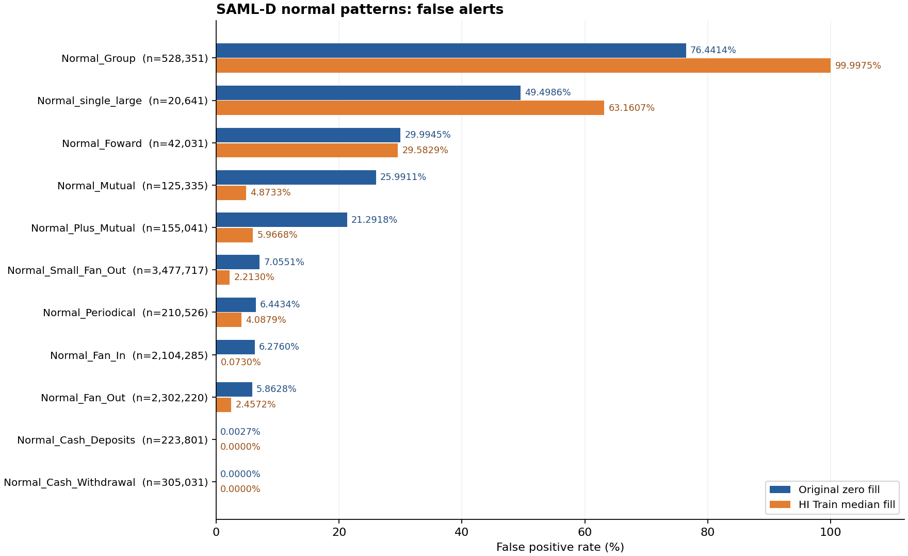

# SAML-D 전체 패턴별 탐지 결과

**SAML-D 전체 9,504,852건은 사기 패턴 17종(9,873건), 정상 패턴 11종(9,494,979건)으로 구분된다.** Multi-FraudGT epoch 280의 저장된 전체 예측값을 재집계했다. 재학습·재추론 없이 기존 0 대체와 HI Train 중앙값 대체 결과를 비교하며, 판정 기준은 두 경우 모두 `sigmoid(logit) > 0.5`다.

모델은 정상/사기 이진 분류기다. 아래 패턴은 사후 오류 분석에 사용한 정답 메타데이터이며, 모델이 패턴 이름을 맞혔다는 의미가 아니다. 사기 패턴별 지표는 **탐지율(Recall = TP / 실제 사기 수)**, 정상 패턴별 지표는 **오탐률(FPR = FP / 실제 정상 수)**이다. 각 패턴 내부는 정답이 한 종류이므로 단독 Precision·AP를 성능 비교 지표로 표시하지 않았다. 원본 패턴명과 철자를 유지했다.

### 사기 패턴 17종: 탐지·미탐과 탐지율

기존 0 대체 탐지율이 높은 순서다. 중앙값 대체는 전체 성능이 악화해 채택하지 않은 실험 조건이다.

| 패턴 | 사기 건수 | 기존 탐지 | 기존 미탐 | 기존 탐지율 | 중앙값 탐지 | 중앙값 미탐 | 중앙값 탐지율 | 변화(pp) |
| --- | --- | --- | --- | --- | --- | --- | --- | --- |
| Behavioural_Change_2 | 345 | 283 | 62 | 82.03% | 312 | 33 | 90.43% | +8.41 |
| Structuring | 1,870 | 1,384 | 486 | 74.01% | 676 | 1,194 | 36.15% | -37.86 |
| Behavioural_Change_1 | 394 | 283 | 111 | 71.83% | 299 | 95 | 75.89% | +4.06 |
| Scatter-Gather | 338 | 211 | 127 | 62.43% | 75 | 263 | 22.19% | -40.24 |
| Layered_Fan_In | 656 | 374 | 282 | 57.01% | 160 | 496 | 24.39% | -32.62 |
| Gather-Scatter | 354 | 200 | 154 | 56.50% | 86 | 268 | 24.29% | -32.20 |
| Layered_Fan_Out | 529 | 295 | 234 | 55.77% | 109 | 420 | 20.60% | -35.16 |
| Over-Invoicing | 54 | 30 | 24 | 55.56% | 7 | 47 | 12.96% | -42.59 |
| Fan_In | 364 | 197 | 167 | 54.12% | 112 | 252 | 30.77% | -23.35 |
| Bipartite | 383 | 205 | 178 | 53.52% | 78 | 305 | 20.37% | -33.16 |
| Fan_Out | 237 | 126 | 111 | 53.16% | 43 | 194 | 18.14% | -35.02 |
| Cycle | 382 | 203 | 179 | 53.14% | 53 | 329 | 13.87% | -39.27 |
| Stacked Bipartite | 506 | 268 | 238 | 52.96% | 126 | 380 | 24.90% | -28.06 |
| Single_large | 250 | 119 | 131 | 47.60% | 28 | 222 | 11.20% | -36.40 |
| Deposit-Send | 945 | 333 | 612 | 35.24% | 45 | 900 | 4.76% | -30.48 |
| Cash_Withdrawal | 1,334 | 0 | 1,334 | 0.00% | 0 | 1,334 | 0.00% | +0.00 |
| Smurfing | 932 | 0 | 932 | 0.00% | 0 | 932 | 0.00% | +0.00 |
| 전체 사기 | 9,873 | 4,511 | 5,362 | 45.69% | 2,209 | 7,664 | 22.37% | -23.32 |

`Cash_Withdrawal` 1,334건과 `Smurfing` 932건은 두 조건 모두 탐지하지 못했다. 이 두 패턴의 2,266건은 기존 전체 미탐 5,362건의 **42.26%**다. 중앙값 대체에서 탐지율이 오른 사기 패턴은 `Behavioural_Change_1`과 `Behavioural_Change_2` 두 종류이며, 나머지 15종은 하락하거나 0%에 머물렀다. 이는 패턴명 기준 결과로, 결제방식 기준 현금 입출금 집계와 동일한 구분은 아니다.

### 정상 패턴 11종: 오탐 건수와 오탐률

정상 패턴에서는 높은 사기 예측 비율이 오탐을 의미하므로 낮을수록 좋다. 기존 오탐률이 높은 순서다.

| 패턴 | 정상 건수 | 기존 오탐 | 기존 오탐률 | 중앙값 오탐 | 중앙값 오탐률 | 변화(pp) |
| --- | --- | --- | --- | --- | --- | --- |
| Normal_Group | 528,351 | 403,879 | 76.4414% | 528,338 | 99.9975% | +23.56 |
| Normal_single_large | 20,641 | 10,217 | 49.4986% | 13,037 | 63.1607% | +13.66 |
| Normal_Foward | 42,031 | 12,607 | 29.9945% | 12,434 | 29.5829% | -0.41 |
| Normal_Mutual | 125,335 | 32,576 | 25.9911% | 6,108 | 4.8733% | -21.12 |
| Normal_Plus_Mutual | 155,041 | 33,011 | 21.2918% | 9,251 | 5.9668% | -15.32 |
| Normal_Small_Fan_Out | 3,477,717 | 245,356 | 7.0551% | 76,962 | 2.2130% | -4.84 |
| Normal_Periodical | 210,526 | 13,565 | 6.4434% | 8,606 | 4.0879% | -2.36 |
| Normal_Fan_In | 2,104,285 | 132,064 | 6.2760% | 1,536 | 0.0730% | -6.20 |
| Normal_Fan_Out | 2,302,220 | 134,974 | 5.8628% | 56,571 | 2.4572% | -3.41 |
| Normal_Cash_Deposits | 223,801 | 6 | 0.0027% | 0 | 0.0000% | -0.00 |
| Normal_Cash_Withdrawal | 305,031 | 0 | 0.0000% | 0 | 0.0000% | +0.00 |
| 전체 정상 | 9,494,979 | 1,018,255 | 10.7241% | 712,843 | 7.5076% | -3.22 |

`Normal_Group`은 기존에도 76.44%가 오탐이었고 중앙값 대체 후 99.9975%로 악화했다. 반대로 `Normal_Fan_In`과 `Normal_Small_Fan_Out`의 오탐은 크게 줄었다. 따라서 전체 오탐 감소가 모든 정상 패턴의 개선을 뜻하지 않는다. 표의 소수점 반올림 때문에 작은 비율은 0.00% 또는 100.00%로 보일 수 있으므로 정확한 건수와 CSV를 함께 확인한다.

### 패턴별 모델 점수: 평균·중앙값

점수는 `sigmoid(logit)`의 0~1 값이다. 0.5를 초과하면 사기로 판정한다. 이는 모델 출력이며 해당 수치가 실제 사기 발생 확률과 일치하도록 보정됐다는 의미는 아니다. 평균만으로 탐지율을 판단하지 않도록 위 탐지 건수와 함께 표시했다.

| 구분 | 패턴 | 기존 평균 점수 | 기존 중앙값 | 대체 후 평균 점수 | 대체 후 중앙값 |
| --- | --- | --- | --- | --- | --- |
| 사기 | Behavioural_Change_2 | 0.7523 | 0.8379 | 0.7340 | 0.7384 |
| 사기 | Structuring | 0.7284 | 0.9299 | 0.3733 | 0.2296 |
| 사기 | Behavioural_Change_1 | 0.6797 | 0.7848 | 0.6283 | 0.6525 |
| 사기 | Scatter-Gather | 0.6186 | 0.7768 | 0.2417 | 0.0416 |
| 사기 | Layered_Fan_In | 0.5843 | 0.6889 | 0.2629 | 0.0422 |
| 사기 | Gather-Scatter | 0.5785 | 0.7090 | 0.2615 | 0.0462 |
| 사기 | Layered_Fan_Out | 0.5753 | 0.7031 | 0.2270 | 0.0185 |
| 사기 | Over-Invoicing | 0.5451 | 0.5916 | 0.1613 | 0.0239 |
| 사기 | Fan_In | 0.5750 | 0.6824 | 0.3179 | 0.0707 |
| 사기 | Bipartite | 0.5476 | 0.5926 | 0.2254 | 0.0255 |
| 사기 | Fan_Out | 0.5470 | 0.5581 | 0.2125 | 0.0265 |
| 사기 | Cycle | 0.5377 | 0.5404 | 0.1700 | 0.0171 |
| 사기 | Stacked Bipartite | 0.5612 | 0.6819 | 0.2635 | 0.0449 |
| 사기 | Single_large | 0.4814 | 0.4075 | 0.1421 | 0.0082 |
| 사기 | Deposit-Send | 0.3645 | 0.1907 | 0.0686 | 0.0022 |
| 사기 | Cash_Withdrawal | 0.0005 | 0.0002 | 0.0003 | 0.0000 |
| 사기 | Smurfing | 0.0046 | 0.0009 | 0.0011 | 0.0000 |
| 정상 | Normal_Group | 0.7569 | 0.9500 | 0.9858 | 0.9918 |
| 정상 | Normal_single_large | 0.5171 | 0.4686 | 0.6301 | 0.7685 |
| 정상 | Normal_Foward | 0.3315 | 0.0528 | 0.3170 | 0.0534 |
| 정상 | Normal_Mutual | 0.2821 | 0.0819 | 0.1056 | 0.0528 |
| 정상 | Normal_Plus_Mutual | 0.2453 | 0.0712 | 0.1302 | 0.0515 |
| 정상 | Normal_Small_Fan_Out | 0.0868 | 0.0012 | 0.0394 | 0.0013 |
| 정상 | Normal_Periodical | 0.0858 | 0.0022 | 0.0639 | 0.0066 |
| 정상 | Normal_Fan_In | 0.1234 | 0.0454 | 0.0058 | 0.0030 |
| 정상 | Normal_Fan_Out | 0.1047 | 0.0294 | 0.0680 | 0.0309 |
| 정상 | Normal_Cash_Deposits | 0.0036 | 0.0022 | 0.0000 | 0.0000 |
| 정상 | Normal_Cash_Withdrawal | 0.0001 | 0.0001 | 0.0001 | 0.0000 |

### 근거 및 검증

[패턴별 탐지·미탐·오탐 CSV](pattern_detection.csv), [점수 분포 CSV](pattern_scores.csv), 집계 코드 (`summarize_patterns.py`; ZIP 외부 원본 파일), [검산 기록](verification.json).

점수 CSV에는 평균·중앙값 외에 5/95백분위와 최솟값·최댓값도 있다. 두 점수 파일의 SHA-256을 기존 전체 평가 결과와 대조하고, 정답 거래 ID·레이블 정렬, 패턴별 집계의 전체 혼동행렬 합계, 기존 패턴별 결과와의 일치를 검증했다. 패턴별로 임계값을 바꾸거나 모델을 다시 선택하지 않았으며 SALT-GNN 학습도 재개하지 않았다.
