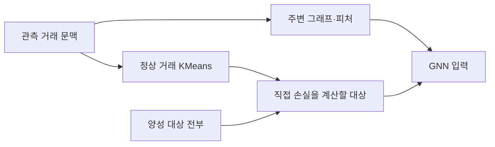

# V10 클러스터 추출과 주변 그래프 보존 검증 — 2026-10-24

**현재 구현에서는 클러스터 추출 때문에 주변 거래 그래프가 잘리지 않는다.** 학습 대상 거래만 선택하고, 메시지를 전달할 주변 거래는 별도 전체 문맥 캐시에서 가져오는 구조임을 코드·실제 캐시·native sampler·V10 추론으로 확인했다.

사용자가 우려한 현상은 **추출한 거래만으로 그래프까지 만들면 실제로 발생한다.** 그 잘못된 경로를 대조 실험으로 구현했을 때 정상·무패턴 주변 연결 대부분이 사라졌다. 현재 코드는 그 필터를 적용하지 않는다. 이 결론이 클러스터 방식의 성능 우수성이나 전체 전처리 무결성을 뜻하지는 않는다.

**어떤 클러스터인가**

그래프 커뮤니티를 잘라서 각각 학습하는 방법이 아니다. 정상 거래의 엣지 피처 17개로 KMeans 32개 군집을 만들고, 날짜별로 정상 약 1%를 학습 대상으로 선택한다. 표본 예산은 75%를 군집 크기에 비례시키고 25%를 군집에 균등 배정한다. 각 양성 거래는 전부 직접 학습한다. 선택한 정상에는 역추출확률 가중치를 사용한다.

클러스터 선택 결과는 `positions.npy`와 `weights.npy`다. `train_binary.py`는 이 위치의 대상을 `Sampler(train_day)`에 요청한다. Sampler는 선택 목록으로 주변 거래를 필터링하지 않고, `day.lists`와 `day.offsets`에 저장된 입출금 연결을 확장한다. 미니배치에서는 대상별 주변 그래프를 분리해 구성하며 다른 대상의 선택 여부가 해당 그래프를 바꾸지 않는다.

**실제 학습 대상과 가중치**

| 확인 항목 | 결과 |
|---|---:|
| 기존 정제 학습 모집단 | 102,501,969건 |
| 정상 모집단 | 102,403,718건 |
| 선택한 정상 | 1,024,066건 (1.0000%) |
| 선택한 양성 | 98,251건, 클러스터 단계 추가 누락 0 |
| 그중 무패턴 양성 | 46,617건, 모두 포함 |
| 전체 선택 대상 | 1,122,317건 |
| 역확률 가중치 총합 | 102,501,969, 모집단과 일치 |
| 날짜별 가중치 총합 | 56일 모두 해당 날짜 모집단과 일치 |

선택된 1,122,317건을 원본 거래와 조인해 날짜·이진 라벨을 전수 대조했다. 불일치 0건이며 모두 2022-08-01~09-25 학습 구간이다. 클러스터 생성 코드 해시는 원래 저장된 signature와 일치했다.

“양성 누락 0”은 클러스터 단계에 들어온 기존 정제 모집단 기준이다. 그 전에 패턴 형태 필터가 제거했던 학습 양성 3,264건은 별도 문제이며, 앞선 전처리 수정에서 복원했다. 클러스터 때문이 아닌 제거를 클러스터 누락으로 집계하지 않았다.

**주변 거래가 실제로 남아 있는가**

학습용 입출금 연결 배열을 전수 검사했다. 아래는 방향별 연결 항목 수이며, 입금·출금을 합친 고유 거래 수가 아니다.

| 방향 | 전체 연결 항목 | 학습 대상으로 선택되지 않은 정상 연결 | 그 비중 |
|---|---:|---:|---:|
| 입금 | 73,735,964 | 72,910,802 | 98.88% |
| 출금 | 50,074,355 | 49,494,600 | 98.84% |

즉, 주변 문맥의 약 98.8%는 직접 학습 대상으로 선택하지 않은 정상 거래였다. 전체 캐시에 대상 표본 외 거래가 있다는 설명만 확인한 것이 아니라, 실제 GNN이 읽는 방향별 연결 배열에서 확인했다.

정상·패턴·무패턴 각각 64건, 총 192건에 대해 다음을 비교했다.

1. 전체 대상 ID 목록에서 그 거래를 요청.
2. 클러스터로 선택한 ID 목록으로 대상을 재색인한 뒤 같은 거래를 요청.
3. 대상 ID 목록을 해당 거래 1개만 남긴 뒤 다시 요청.

세 경우에서 native sampler의 **8개 출력 배열이 모두 동일**했다. 엣지 ID, 계좌 ID, 연결 방향, 대상 위치, ego 표시까지 비교했다. 192건 모두 학습 대상으로 선택되지 않은 정상 거래를 주변 문맥으로 사용했다.

추가로 16건 미니배치와 각각 단독으로 생성한 그래프도 일치했다. 실제 V10에서는 세 그룹 2건씩 6건의 **입력 텐서 7개 및 재색인 전후 로짓이 완전히 같았다**. 단독 추론과 배치 추론 차이는 최대 3.8146973e-06로 부동소수점 연산 오차 범위였다.

**사용자가 우려한 방식의 대조 실험**

기존 연결 배열에서 학습 표본에 없는 거래를 의도적으로 제거하고, 두 홉 그래프를 다시 확장했다. 이 실험은 “기존 cap100 캐시를 학습 표본 엣지로만 제한”한 토폴로지 대조이며, 현재 구현이나 새 학습 후보가 아니다. 노드 통계는 다시 학습하거나 바꾸지 않았다.

| 대상 종류 | 검사 수 | 원래 그래프 대비 남은 엣지 비율 평균 | 남은 계좌 비율 평균 |
|---|---:|---:|---:|
| 패턴 양성 | 64 | 1.86% | 10.25% |
| 정상 | 64 | 0.42% | 4.48% |
| 무패턴 양성 | 64 | 0.59% | 8.00% |

원래 연결돼 있던 거래 양 끝 계좌가 이 대조에서 끊어진 사례도 정상 8건, 무패턴 3건 있었다. 따라서 **추출 대상을 그래프의 관측 거래 목록으로 재사용하는 구현은 피해야 한다.** 단, 이 표를 현재 모델의 손실률이나 성능 감소량으로 해석하면 안 된다.

**실제로 연결을 줄이는 다른 요인**

15개 계좌·30개 입출금 방향에 대해 원본의 전체 정제 거래에서 SQL로 100개 이웃을 재추출했다. 기존 연결 배열과 엣지 ID가 모두 일치했다. 이웃 후보 원천은 전체 정제 문맥이며 클러스터 학습 표본이 아니다.

- **방향별 이웃 100개 제한**은 거래가 많은 계좌의 연결을 줄인다. 동일 분 거래까지 잘렸던 직접 원인은 이 제한이었다.
- **패턴 형태에 따른 6,140건 삭제**는 클러스터와 별도의 전처리였다.
- **구간 종료 그래프**의 다음 날 이후 문맥 사용도 클러스터와 별도 문제였다.

위 세 사항은 [앞선 전처리 수정·시퀀스 검증](../V10_전처리수정_시퀀스검증_20261024/검증결과.md)에 정리돼 있다. 수정 코드는 일마감 경계를 적용하고, 대상 분 연결을 각 홉에서 전부 유지하며, 그 외 이력에만 100개 제한을 적용한다. 전체 과거 연결과 3홉 이상의 경로를 모두 보존한다는 뜻은 아니다.

새 일마감 입력 경로에서도 세 그룹의 실제 거래를 확인했다. 한 건짜리 학습 목록을 등록한 전후 그래프가 같았고, 목록 밖 연결 94·185·343개가 유지됐다. 다음 날 거래는 0건이었다. 이 확인이 아직 만들지 않은 전체 일별 학습 캐시의 검증을 대신하지는 않는다.

**클러스터 방식 자체에 남는 검토 사항**

그래프 보존은 통과했지만, 정상 거래 약 1%만 직접 정상 라벨의 손실을 계산한다는 사실은 남는다. 나머지 정상은 메시지 문맥으로 보여도 해당 거래 자체를 정상 대상으로 직접 학습하는 것은 아니다. 따라서 무패턴과 비슷한 어려운 정상을 충분히 학습 대상으로 골랐는지는 성능 비교가 필요하다.

가중치는 실제 학습 손실에 적용되고 총량도 일치했다. 정상 가중치 범위는 1.00~129.64, 참고용 Kish 유효표본수는 약 953,158건이다. 가중치 총합이 같다고 모든 특징·패턴의 분포나 학습 성능이 완벽히 복원되는 것은 아니다.

2026-10-21의 별도 KLD 감사에서는 가중치 보정 후 분포 차이가 작았지만, 그것만으로 클러스터가 같은 수의 무작위 정상 추출보다 우수하다고 결론 내릴 수 없다. 해당 감사에는 역사적 군집 재배정 집계 1,792개 셀 중 20개가 ±1씩 불일치한 미해결 재현성 기록도 있다. 원인을 배치 크기 때문이라고 확정하지 않았다. 이번 검증은 실제 학습에 사용한 고정 ID·가중치로 수행했으므로 그 재배정 차이에 의존하지 않는다. 관련 원 기록을 `prior_kld_*.json`으로 보존했다.

다음 학습 비교에서는 **수정된 동일한 일별 문맥 + 동일한 정상 표본 수 + 양성 전부 + 가중치 적용**을 고정하고, 클러스터 추출과 균등 무작위 추출만 바꿔야 한다. 현재는 그래프를 자른다는 이유로 클러스터를 폐기할 근거가 없다. 클러스터 방식의 성능 우열은 이번 검증에서 주장하지 않는다.

기존 검증 정상 표본은 무작위이며 클러스터 표본이 아니고, 기존 최종 테스트는 전체 정제 모집단이다. 기존 시퀀스 P76.25/R60.01은 목표 P70/R65 미달이며, 이번 그래프 감사로 새 성능 수치가 생긴 것은 아니다.

**파일과 재현**

원본 실행 경로: `/workspace/kimi/Claude_GNN/final_model/experiments/v10_cluster_graph_audit_20261024`. 인계 폴더에는 감사 코드, 결과 JSON, 대상별·그룹별 CSV, 입력 동일성 결과, 전체 실행 순서를 보존했다. 기존 모델·클러스터·캐시는 수정하지 않았다. 감사에만 쓰는 163MB 상태 배열과 대조용 CSR은 원본 실행 경로에 남겨 두었다.

순서는 `audit.py` → `check_inputs.py` → `check_model.py` → `check_dates.py`였다. 일반 감사는 `/workspace/kimi/CODEX/.venv/bin/python`, PyG 모델 검사는 `/workspace/kimi/venv/bin/python`으로 실행했다. 다른 경로에서는 `V10_MODEL_ROOT`와 `V10_GRAPH_CACHE`로 원본 위치를 지정할 수 있다. 상세 기록은 `실험기록.md`, `검증순서_전체기록.csv`에 있다.
