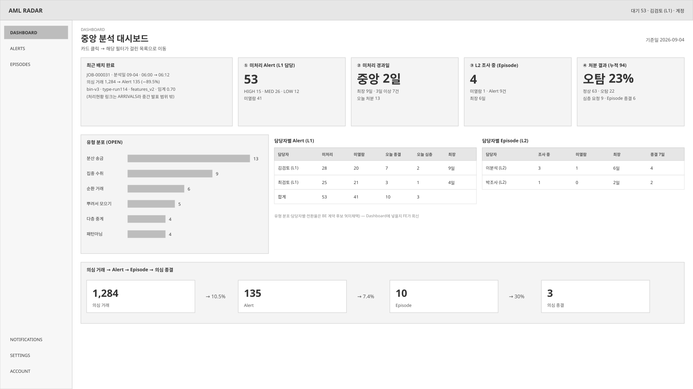
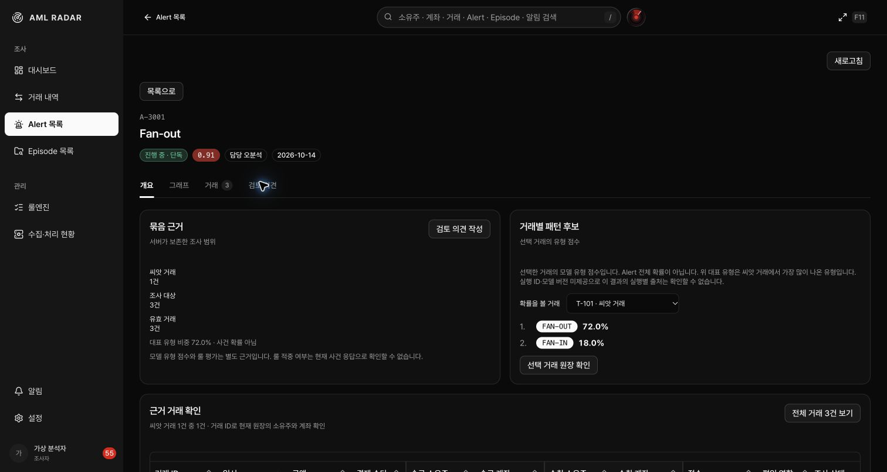
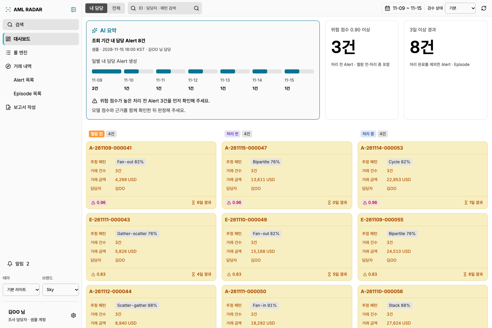
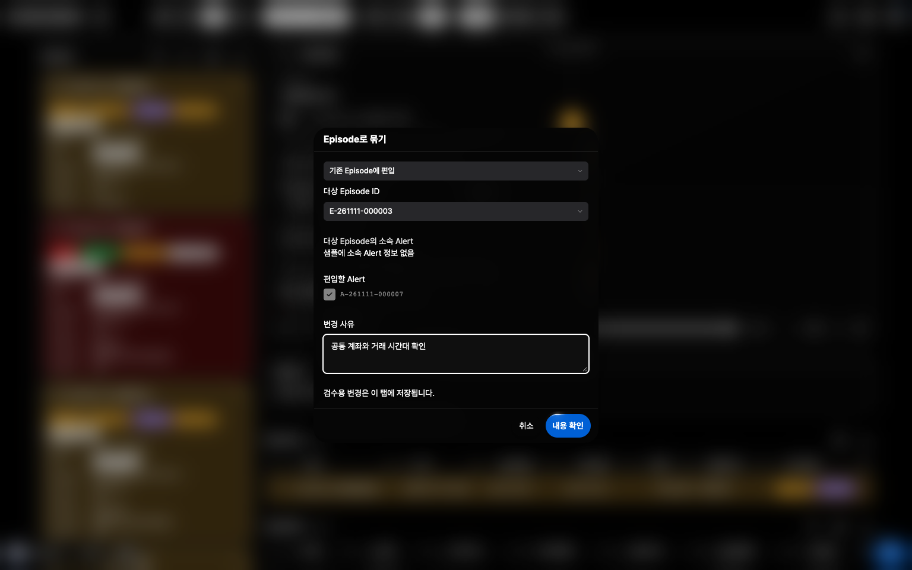

# AML RADAR 화면 버전

팀 작업 기준은 **3.5.0 Liquid Glass**. 11/21부터 앱의 기본 주소의 코드 위치 `frontend/web-app/src`.

## 포트폴리오 화면 자료

0.x 초기 시안, 1.x 조사 화면, 2.x Dashboard, 3.5.0 Episode 편입 화면 비교. 0.x 전체는 하단의 버전별 HTML 다운로드.

## 3.x.y Liquid Glass

| 버전 | 날짜 | 변경 내용 |
| --- | --- | --- |
| 3.5.0 | 11/21 | 관련 Alert 선택 → 판정 → Episode 편입. Alert 목록 묶기와 Episode 연결 해제. 파란 Primary Button 한 번 클릭. Sample 데이터 검수. |
| 3.4.1 | 11/20 | Login·Dashboard 회전 Logo, Motion 감소 시 정적 Logo, Sidebar Button Hover 수정 |
| 3.4.0 | 11/20 | Alert 개요 배치, 거래 방향 Animation, 소유주별 계좌, 통합 Sankey, 2초 실행 Button. [팀 Git 반영](https://github.com/dh0728/money_laundry/commit/81630aa7) |
| 3.3.0 | 11/20 | 움직이는 Login 배경, Header·Footer 정리, Rule 편집과 Backtest 검수 |
| 3.2.0 | 11/19 | 조사 표와 Graph 선택 연동, Alert·Episode 개요, 통화별 Sankey 검수 |
| 3.1.1 | 11/19 | Glass·불투명 Mode, Card·Tag 공통 Style, Sidebar를 열어도 Header 위치 고정 |
| 3.1.0 | 11/18 | Component Catalog, Dashboard Chart, 조사 Card·표와 거래 Link |
| 3.0.1 | 11/18 | 검색 닫기 Button, Profile 정렬, 읽지 않은 알림 표시, Button 크기 조정 |
| 3.0.0 | 11/18 | 독립 화면 첫 기록. Header, Overlay Sidebar, 검색, 보관함, 업무 Tab |

[Liquid Glass 실행 안내](../../../frontend/web-app/README.md) · Login `/login?data=sample`

## 2.x.y Sky Blue Brand

| 버전 | 날짜 | 변경 내용 |
| --- | --- | --- |
| 2.3.0 | 11/20 | 조사·판정 화면, 관련 증거, Graph, 공통 검색 보완. [6a4e041c](https://github.com/dh0728/money_laundry/commit/6a4e041c) |
| 2.2.0 | 11/20 | Sample Rule 버전 Snapshot, 조건 Block과 Style. [81630aa7](https://github.com/dh0728/money_laundry/commit/81630aa7) |
| 2.1.1 | 11/16 | 기간 선택 취소, Session 초기화 수정. [07ae51d9](https://github.com/dh0728/money_laundry/commit/07ae51d9) |
| 2.1.0 | 11/15 | React 전체 화면 연결. [62c6624f](https://github.com/dh0728/money_laundry/commit/62c6624f) |
| 2.0.5 | 10/27 | Figma 기준 재작성 |
| 2.0.4 | 10/27 | Figma Header·Tab 비교 |
| 2.0.3 | 10/27 | Design HTML·자산 보존 |
| 2.0.1, 2.0.2 | 미확인 | 원본 미확인 |
| 2.0.0 | 10/26 | [Design 시작 기록](https://github.com/dh0728/money_laundry/blob/09b67d800783d46df5cf2a90f2eac9d8e5a24af2/frontend/design/2.0.0/VERSION.md) |

React 화면은 `src/next`의 `/#/login`. 일부 옛 커밋 제목에서 이 화면을 ‘v3’로 표기했습니다. 위 날짜는 모두 2026년 KST 기준입니다.

## 1.x.y dev 기반 웹 구현

| 버전 | 날짜 | 변경 내용 |
| --- | --- | --- |
| 1.14.0 | 10/23 | fe/work 합성 조사 검수·업무 문맥 구현 |
| 1.13.0 | 10/22 | fe/work 원장·의견·API 연결 구현 |
| 1.12.0 | 10/21 | frontend 조사·Graph 복구 구현 |
| 1.11.0 | 10/15 | 개요 설명·근거 Button 정렬 |
| 1.10.0 | 10/15 | 개요 확대 화면 구조 개편 |
| 1.9.0 | 10/15 | 개요 요약·Chart 재배치 |
| 1.8.0 | 10/15 | 개요 압축 Scan·확대 구분 |
| 1.7.0 | 10/15 | 개요 Rule 점검·근거 대화상자 |
| 1.6.0 | 10/15 | 개요 반응형 배치·번호 배지 |
| 1.5.0 | 10/14 | 개요 상태 초기 HTML |
| 1.4.0 | 10/12 | Pattern·소유주 분리와 고정 계좌행 구현 |
| 1.3.0 | 10/11 | 초기 재설계 구현 시안 |
| 1.2.0 | 10/09 | Dashboard 조회·갱신 표시 구현 |
| 1.1.0 | 10/06 | 계좌·소유주 Wireframe |
| 1.0.0 | 10/04 | 중간발표 이후 구현 기준 |

## 0.x.y SVG·Figma Prototype

| 버전 | 당시 이름 | 남아 있는 자료 |
| --- | --- | --- |
| 0.24.0 | v24 | [원본 HTML](https://github.com/dh0728/money_laundry/blob/09b67d800783d46df5cf2a90f2eac9d8e5a24af2/frontend/prototype/0.24.0/AML-RADAR-0.24.0.html) |
| 0.23.0 | v23 | [원본 HTML](https://github.com/dh0728/money_laundry/blob/09b67d800783d46df5cf2a90f2eac9d8e5a24af2/frontend/prototype/0.23.0/AML-RADAR-0.23.0.html) |
| 0.22.0 | v22 | [원본 HTML](https://github.com/dh0728/money_laundry/blob/09b67d800783d46df5cf2a90f2eac9d8e5a24af2/frontend/prototype/0.22.0/AML-RADAR-0.22.0.html) |
| 0.21.0 | v21 | [원본 HTML](https://github.com/dh0728/money_laundry/blob/09b67d800783d46df5cf2a90f2eac9d8e5a24af2/frontend/prototype/0.21.0/AML-RADAR-0.21.0.html) |
| 0.20.0 | v20 | [원본 HTML](https://github.com/dh0728/money_laundry/blob/09b67d800783d46df5cf2a90f2eac9d8e5a24af2/frontend/prototype/0.20.0/AML-RADAR-0.20.0.html) |
| 0.19.0 | v19 | [원본 HTML](https://github.com/dh0728/money_laundry/blob/09b67d800783d46df5cf2a90f2eac9d8e5a24af2/frontend/prototype/0.19.0/AML-RADAR-0.19.0.html) |
| 0.18.0 | v18 | [원본 HTML](https://github.com/dh0728/money_laundry/blob/09b67d800783d46df5cf2a90f2eac9d8e5a24af2/frontend/prototype/0.18.0/AML-RADAR-0.18.0.html) |
| 0.17.0 | v17 | [원본 HTML](https://github.com/dh0728/money_laundry/blob/09b67d800783d46df5cf2a90f2eac9d8e5a24af2/frontend/prototype/0.17.0/AML-RADAR-0.17.0.html) |
| 0.16.0 | v16 | [원본 HTML](https://github.com/dh0728/money_laundry/blob/09b67d800783d46df5cf2a90f2eac9d8e5a24af2/frontend/prototype/0.16.0/AML-RADAR-0.16.0.html) |
| 0.15.0 | v15 | [원본 HTML](https://github.com/dh0728/money_laundry/blob/09b67d800783d46df5cf2a90f2eac9d8e5a24af2/frontend/prototype/0.15.0/AML-RADAR-0.15.0.html) |
| 0.14.0 | v14 | [원본 HTML](https://github.com/dh0728/money_laundry/blob/09b67d800783d46df5cf2a90f2eac9d8e5a24af2/frontend/prototype/0.14.0/AML-RADAR-0.14.0.html) |
| 0.13.0 | v13 | [원본 HTML](https://github.com/dh0728/money_laundry/blob/09b67d800783d46df5cf2a90f2eac9d8e5a24af2/frontend/prototype/0.13.0/AML-RADAR-0.13.0.html) |
| 0.12.0 | v12 | [SVG 열람용 HTML](https://github.com/dh0728/money_laundry/blob/09b67d800783d46df5cf2a90f2eac9d8e5a24af2/frontend/prototype/0.12.0/preservation/2026-10-26/index.html) |
| 0.11.0 | v11 | [SVG 열람용 HTML](https://github.com/dh0728/money_laundry/blob/09b67d800783d46df5cf2a90f2eac9d8e5a24af2/frontend/prototype/0.11.0/preservation/2026-10-26/index.html) |
| 0.10.0 | v10 | [SVG 열람용 HTML](https://github.com/dh0728/money_laundry/blob/09b67d800783d46df5cf2a90f2eac9d8e5a24af2/frontend/prototype/0.10.0/preservation/2026-10-26/index.html) |
| 0.9.0 | v9 | [SVG 열람용 HTML](https://github.com/dh0728/money_laundry/blob/09b67d800783d46df5cf2a90f2eac9d8e5a24af2/frontend/prototype/0.9.0/preservation/2026-10-26/index.html) |
| 0.8.0 | v8 | [SVG 열람용 HTML](https://github.com/dh0728/money_laundry/blob/09b67d800783d46df5cf2a90f2eac9d8e5a24af2/frontend/prototype/0.8.0/preservation/2026-10-26/index.html) |
| 0.7.0 | v7 | [SVG 열람용 HTML](https://github.com/dh0728/money_laundry/blob/09b67d800783d46df5cf2a90f2eac9d8e5a24af2/frontend/prototype/0.7.0/preservation/2026-10-26/index.html) |
| 0.6.0 | v6 | [SVG 열람용 HTML](https://github.com/dh0728/money_laundry/blob/09b67d800783d46df5cf2a90f2eac9d8e5a24af2/frontend/prototype/0.6.0/preservation/2026-10-26/index.html) |
| 0.5.0 | v5 | [SVG 열람용 HTML](https://github.com/dh0728/money_laundry/blob/09b67d800783d46df5cf2a90f2eac9d8e5a24af2/frontend/prototype/0.5.0/preservation/2026-10-26/index.html) |
| 0.4.0 | v4 | [SVG 열람용 HTML](https://github.com/dh0728/money_laundry/blob/09b67d800783d46df5cf2a90f2eac9d8e5a24af2/frontend/prototype/0.4.0/preservation/2026-10-26/index.html) |
| 0.3.0 | v3 | [SVG 열람용 HTML](https://github.com/dh0728/money_laundry/blob/09b67d800783d46df5cf2a90f2eac9d8e5a24af2/frontend/prototype/0.3.0/preservation/2026-10-26/index.html) |
| 0.2.0 | v2 | [SVG 열람용 HTML](https://github.com/dh0728/money_laundry/blob/09b67d800783d46df5cf2a90f2eac9d8e5a24af2/frontend/prototype/0.2.0/preservation/2026-10-26/index.html) |
| 0.1.0 | v1 | [SVG 열람용 HTML](https://github.com/dh0728/money_laundry/blob/09b67d800783d46df5cf2a90f2eac9d8e5a24af2/frontend/prototype/0.1.0/preservation/2026-10-26/index.html) |

버전 번호는 화면 계열 변경, 기능 추가, 기존 기능 수정 순으로 첫째·둘째·셋째 자리를 올립니다. 초기 작업 번호는 대화와 검수 기록을 보고 나중에 붙였습니다. `implementation/1.14.0`은 과거 보존 경로입니다. 현재 앱은 `frontend/web-app` 한 곳에서 관리합니다.
